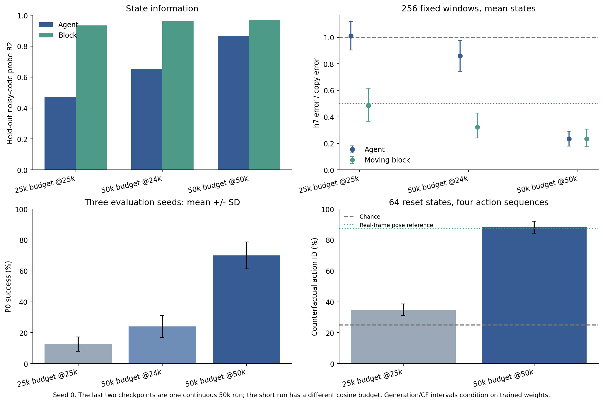
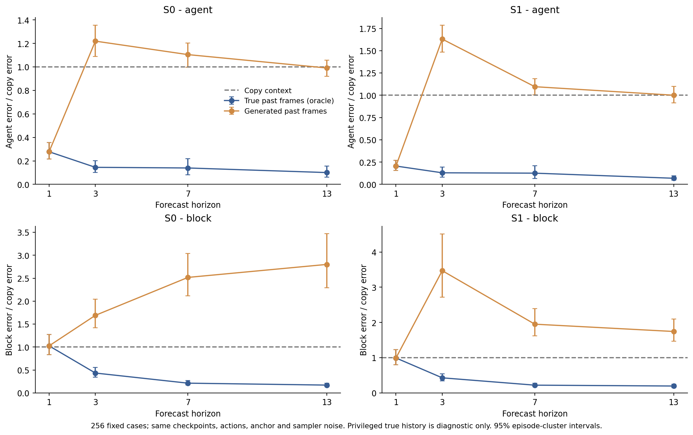
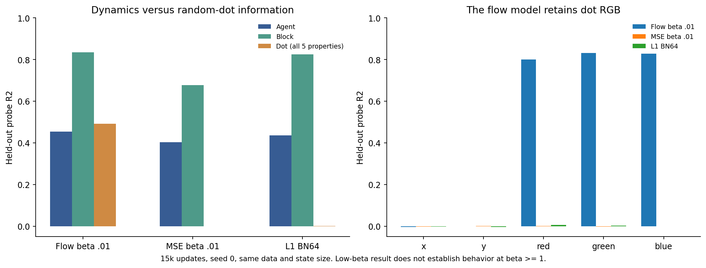
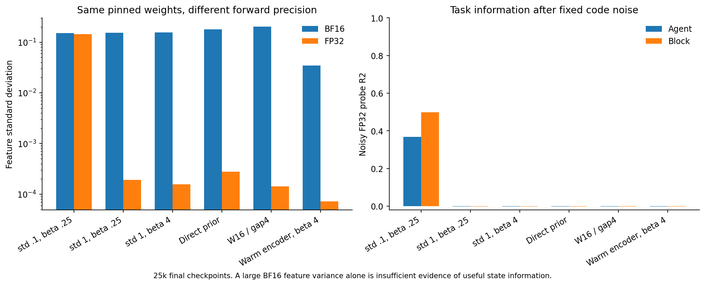

# AS-JEPA PushT results: review of the collaborator branches (2026-10-28)

This is an English reading of the results the collaborator pushed to two branches,
written against our own [experiment spec](as-jepa-experiment-spec.md) and
[story](as-jepa-story.md). The collaborator's reports are mostly in Chinese; every
number below was checked against their Markdown and JSON files at the commits named
here. Figures in `figures/results-20261028/` are copied unchanged from their branch.

## 0. Primer: the models and the result terms

### 0.1 What AS-JEPA is, in one paragraph

Each frame is encoded on its own into a small state (`K = 4` tokens of `d = 16`, so 64
numbers), and Gaussian noise of fixed size `sigma0 = 0.1` is added. A predictor (the
"prior") guesses the next state from past states and actions, never from images. A
flow-matching renderer draws each frame from its noisy state plus an anchor frame
from the same episode. Training minimizes

```
loss = flow loss of the renderer  +  beta * (entry cost + sum of surprise costs)
```

The entry cost `0.5 * ||mu_0||^2` is what the first state costs against `N(0, I)`. The
surprise cost `||mu_t - m_t||^2 / (2 sigma0^2)` is what each later state costs given the
prior's guess `m_t`; that is the JEPA prediction loss. Together they are the rate: how
many nats the state uses. `beta` is the price of one nat. The theory says the price
should make the state keep only what the dynamics need, while the anchor carries
appearance for free and the renderer's own randomness draws unpredictable detail.

### 0.2 The design pieces and what each is for

| Piece | What it is | Why it is there |
| --- | --- | --- |
| `beta` (price) | weight on the rate, per rendered pixel value | removes information that does not pay for itself; the only searched knob |
| `sigma0` (code noise) | fixed noise on the state, 0.1 | sets the state's resolution, so the rate is finite and measurable in nats |
| entry cost | first state against `N(0, I)` | pays once for each piece of information; replaces LeWM's SIGReg |
| surprise cost | later states against the prior | the JEPA loss; trains the predictor and pulls the encoder toward predictable states |
| identity carry | prior predicts the change from the previous state, starting at zero | keeps the starting surprise cost small, so training does not start by collapsing |
| anchor, gap `g = 8` | a frame from 8 kept frames before the window, given to the renderer only | carries appearance; a distant anchor makes slowly moving things (the block) worth keeping |
| flow renderer | SPT's DiT, 64×64 frames | draws unpredictable detail by sampling instead of storing it |

### 0.3 The models

- **L0**: LeWM as published (no renderer). The planning baseline.
- **L1**: our L2 architecture trained with LeWM's objective (prediction loss + SIGReg + renderer, no noise, no price). Comparing L1 with L2 isolates what the price adds.
- **L2**: AS-JEPA in LeWM's code. The main model.
- **S0 / S1**: SPT with actions, and SPT plus the anchor. Comparisons on the SPT side.
- **S2**: AS-JEPA in SPT's code.
- **g0**: L2 with the anchor set to the window's first frame (gap 0) instead of 8 frames earlier.

### 0.4 The result terms

| Term | Plain meaning | Good value | Why it matters |
| --- | --- | --- | --- |
| **copy baseline** | predict that every future frame equals the last real frame | reference | any model that understands motion must beat it |
| **h7 agent / copy** | agent position error 7 frames into a free rollout, divided by copy's | below 0.5 (gate) | does the model move the agent correctly from actions alone |
| **moving block / copy** | same for the block, only in windows where the block is pushed | below 1 (gate) | does the model handle contact, not just free motion |
| **mean vs sample rollout** | roll out with the state's mean, or with sampled noise | both reported | sample rollouts show whether the noise hurts |
| **counterfactual action ID** | from one start, roll out 4 action sequences; can a pose reader tell which rollout came from which actions | at least 75% (gate); chance 25% | do generated futures actually depend on the actions |
| **P0 planning** | LeWM's CEM planner on PushT, goal reached in 50 episodes, 3 evaluation seeds | compare with L0 | the practical use of the state |
| **noisy probe R²** | how well a linear map reads agent / block position from the noisy state | close to 1 | is the information in the state, at the code's resolution |
| **collapse test** | render frames from their own encoded state; is the agent error under 0.9 of just showing the anchor | pass | is the state empty |
| **active dims / rate** | dimensions using more than 0.1 nats per window; total nats per frame | few active dims, rate near the needed information | is the price pruning |
| **FVD / LPIPS / SSIM** | video and image similarity scores | lower FVD and LPIPS, higher SSIM | visual quality; reported, not a gate |
| **gallery gate** | a human marks 32 fixed rollouts pass or fail | at least 24 pass | catches failures numbers miss |
| **training seed vs eval seed** | a training seed is a separately trained model; an eval seed reruns the planner on the same model | 3 training seeds for the gate | eval seeds do not show reproducibility |

## 1. What the two branches are

The two branches overlap; they are not two independent result sets.

| Branch | Head | Relationship | What it contains |
| --- | --- | --- | --- |
| `origin/insights/12h-20261027` | `ab645db` | 51 commits on top of our `9e81418` | The implementation of both ladders (L0/L1/L2 in LeWM, S0/S1/S2 in Native SPT), the shared evaluation package, and a closed 12-hour exploratory campaign: 28 evaluated endpoints, mostly one training seed each. Reports in `experiments/insights12h/`. |
| `origin/research/ideas-20261028` | `094c28c` | Contains all of the branch above, plus 40 more commits | A second, still-running "completion" campaign: three training seeds of the best L2 setting, matched baselines, the state-size check, the full 10-epoch data protocol, and ten new method candidates (I01 to I10). Reports in `experiments/completion20261028/` and `experiments/ideas20261028/`. |

So the research branch is a strict superset: the insights head is an ancestor of the
research head, and `experiments/insights12h/` is byte-identical on both. Merging the
insights branch into the research branch is a no-op ("already up to date"); the
research branch already is the merged branch. The only cleanup left is deleting the
redundant insights branch on the shared remote, which is the collaborator's branch,
so it should be agreed with them first.

The second campaign is still active. Its own recovery note (`RECOVERY_RESEARCH_20261028.md`)
reports all 24 GPUs on dev2, dev13 and dev15 busy, a plan with about 1,440 entries
(most of them dormant conditional follow-ups, not real runs), and detached dispatcher
and watchdog processes. Everything below is a snapshot as of 09:00 UTC on 2026-10-28.

## 2. The headline result and how it departs from the spec

The best configuration is a small L2 (21.6M parameters, 64-dimensional state) trained
from scratch for 50k updates with `beta = 0.01`, `sigma0 = 0.1`, and a one-time
encoder-head initialization scale of 0.1. On training seed 0 it gives:

- h7 agent error / copy baseline = 0.234; moving-block error / copy = 0.234
  (the gate needs agent at most 0.5 and moving block below 1);
- counterfactual action identification 88.3% (gate 75%, chance 25%);
- P0 planning success 70% (mean of 3 evaluation seeds × 50 episodes);
- FVD 278 against 1,629 for copying the last frame (their own 256-clip, 16-frame
  protocol, not RGB16's FVD-2048, so not comparable to other FVD numbers);
- on a fresh set of 256 test windows chosen to share no frames with the old
  diagnostic windows: h7 agent / copy 0.126, FVD 231, action ID 86.7%, P0 67%.

This is a real working world model on one seed. But four things separate it from the
configuration the spec describes, and they matter for what the result says about
AS-JEPA:

1. **`beta = 0.01` is 100 times below the bottom of the spec grid** `{1, 4, 16, 64, 256}`.
   The spec default (`beta = 4`) left the noisy state empty after 25k steps;
   `beta = 1` recovered partly by 25k but planned at 6.7%.
2. **The one-time initialization scale is a new knob** that the spec does not have. The
   precision diagnostic (Section 4.4) shows why it was needed: with the default scale
   the encoder output shrinks to about 1e-4 in FP32.
3. **The budget and data differ.** 50k updates on one frameskip phase of the HDF5 data
   (474k frames), against the spec's 10 LeWM epochs on the full data (124,910 updates on
   2.34M frames). The renderer is also a small one, not SPT's 384×12.
4. **At this price, the price is barely switching anything off.** All 64 dimensions are
   active, and when the state was doubled to 128 all 128 were active too (Section 3.3).
   Random-dot RGB leaked into the state (Section 4.3). The mechanism our story relies
   on, that the price removes what the dynamics do not need, is not visible at
   `beta = 0.01`. The working model is closer to a noisy-bottleneck latent world model
   than to a demonstration of the priced state.

The fourth point is my interpretation, not a claim the collaborator makes, but every
measurement I can find is consistent with it.



One more fact about the budget: on the same 50k run, the 24k checkpoint had h7 agent /
copy 0.860 and P0 24%, and the 50k checkpoint 0.234 and 70%. The separate 25k-budget
run (different cosine schedule) planned at 12.7%. Most 25k results in these reports are
therefore probably undertrained, and the 25k failure screens should not be read as
permanent failures.

## 3. Reproducibility and gate status (completion campaign)

### 3.1 Three training seeds of the 50k L2 setting

| Training seed | noisy agent / block probe R² | h7 agent / moving block (÷ copy) | Action ID | P0 (seeds 42/43/44) | P0 mean |
| --- | --- | --- | --- | --- | --- |
| 0 | 0.867 / 0.972 | 0.234 / 0.234 | 88.3% | 70 / 78 / 58 | 68.7% |
| 1 | 0.657 / 0.950 | 0.700 / 0.266 | 48.4% | 10 / 16 / 12 | 12.7% |
| 2 | 0.840 / 0.946 | 0.300 / 0.275 | 85.9% | 50 / 66 / 60 | 58.7% |
| g0 ablation, seed 0 | 0.917 / 0.920 | 0.218 / 0.268 | 85.6% | 70 / 70 / 70 | 70.0% |


Against the spec's gate (Section 12, mean over three seeds):

| Gate item | Requirement | Result | Status |
| --- | --- | --- | --- |
| h7 agent / copy | at most 0.5 | 0.411 ± 0.252 | passes on the mean, seed 1 fails individually |
| moving block / copy | below 1 | 0.258 ± 0.022 | passes |
| action ID | at least 75% | 74.2% ± 22.4 | **fails** (seed 1 at 48%) |
| 32-case gallery | at least 24 pass | gallery exported, not reviewed by a human | **open; this needs us** |

Planning across training seeds: L2 46.7% ± 29.9 against retrained L0 64.2% ± 9.1. L2
trails L0 by 17.6 points, more than `PLAN_MARGIN`, but P1 to P4 are only triggered once
the generation gate passes, which it has not.

Seed 1 is the important case. It passes the collapse test (its state is not empty) and
its block information is fine, yet its agent information is weaker and its action
following and planning fail. "Not collapsed" is therefore not the same as "works".
The collaborator has queued seeds 3 and 4 under the spec's tie rule.

The g0 ablation (anchor is the first frame of the window, not 8 frames earlier) is as
good as the main model on seed 0. With one seed this cannot show the distant anchor is
unnecessary, but it does mean we have no evidence yet that the gap helps.

The same seed-0 checkpoint re-planned at 70/78/58% where the earlier report had
74/76/60%. GPU planning is not bitwise repeatable, so a few points of P0 difference
between single runs mean little.

### 3.2 Matched 25k baselines (three seeds each)

| Model | h7 agent / copy | moving block / copy | FVD | P0 across training seeds |
| --- | --- | --- | --- | --- |
| L0 (LeWM, retrained) | no renderer | no renderer | none | 64.2% ± 9.1 |
| L1 (our architecture, LeWM objective, MLP-BN projector) | 0.987 ± 0.025 | 0.423 ± 0.019 | 602 to 669 | 25.8% ± 9.1 |
| S0 (SPT with actions) | 1.080 ± 0.042 | 1.220 ± 0.119 | 1,100 to 1,243 | not required |
| S1 (S0 plus anchor) | 3.989 ± 2.595 | 2.725 ± 1.372 | 1,683 to 2,319 | not required |

These are 25k runs, so the L2 (50k) and L1 (25k) numbers are not a matched comparison
of the price. The useful observation is that probes and rollouts disagree: S1 seeds
have agent probe R² of about 0.75 to 0.80 yet free rollouts 5 to 6 times worse than
copying. Linear decodability of the state does not imply a usable closed loop, and
neither does a good FVD (S0 seed 2 beats copy on FVD but loses on positions).

### 3.3 State-size check: doubling the state hurt

The spec says to double `d` if every dimension is active. At 128 dimensions (seed 0,
50k) every dimension was again active and the collapse test passed, but h7 agent / copy
went from 0.234 to 0.939, action ID from 88% to 39%, and P0 from 69% to 10%.


With one seed, and since doubling also raised the total rate, parameters and compute,
this does not show 64 is optimal. It does show two things: "active" under our
definition counts paid nats, not useful information, and at `beta = 0.01` the price
does not prune the extra dimensions. Combined with seed 1, the working point looks
fragile rather than robust.

### 3.4 Native S2 has not produced a valid run

S2 at `beta = 4` had an empty state at 12k and was stopped. The three exploratory
low-price S2 runs (`beta` = 0.0025, 0.01, 0.04) trained to 50k but their weights went
NaN at about 28.4k, 29.1k and 48.6k updates. Retries from scratch at half the learning
rate (the spec's NaN response) are running with new finite-loss guards. So far there
is no evidence either way on whether AS-JEPA works in the SPT code base.

## 4. Mechanism evidence

### 4.1 The anchor carries background colour, the state carries block geometry (two seeds)

In the colour-controlled data (episode-level RGB affine changes, `beta = 0.25`, 25k),
swapping the anchor moves the output's background colour 0.945 of the way to the
donor's; swapping the state moves it 0.0009. Without an anchor, the colour follows the
state (0.946). Geometry goes the other way: swapping the state puts the block at the
donor's position (error to donor about 37 to 39 px, error to the original about 114 px),
while swapping the anchor leaves it in place. Both seeds agree. This is the cleanest
support so far for the anchor-isolation design, with two limits: the colour changes are
simpler than Appendix A's appearance shifts, and the agent's disentanglement is
inconsistent between seeds.


### 4.2 Native's free-rollout failure comes from feeding generated frames back

S1 at 24k predicts one step well (agent 9.2 px against 44.9 for copy). With true past
frames as context its h7 errors are 16.7 / 6.6 px; with its own generated frames they
are 145 / 58 px, with identical first steps. Clipping generated frames to the training
pixel range made it worse.



Candidate I08 then tested a fix on the same S1 seed-0 checkpoint: freeze the frame
encoder, train a small transition (MLP plus depthwise convolution, zero-initialized
residual) to predict the next frame's encoder tokens, and during rollout advance those
tokens instead of re-encoding generated images. The comparison flips one inference flag
on identical weights:

| Feedback during rollout | h7 agent / moving block (÷ copy) | FVD | Action ID |
| --- | --- | --- | --- |
| predicted tokens (semantic) | 0.182 / 0.781 | 202 | 83.6% |
| re-encoded generated frames (pixel) | 0.944 / 1.129 | 940 | 31.6% |


Two things in the code and figure change how to read this:

- **The "matched training" pixel control is not an independent control.** Its numbers
  equal the same-weights pixel toggle exactly. The reason is in
  `runtime/vforge/models/as_jepa/semantic_carry.py`: the frame encoder is frozen and
  its target is detached, so the auxiliary loss trains only the new transition module
  and never touches the pixel path. With the same seed and data order both finetunes
  produce the same pixel-path weights. The result is still valid; there is simply one
  pixel measurement, not two.
- **The drift begins exactly when the real context leaves the window.** The rollout keeps
  the last `window - 1 = 9` token frames and starts with 3 real ones, so real frames
  begin dropping out at horizon 8 and are all gone by horizon 10. Agent error is 24 px at
  h7, 113 px at h10 and 138 px at h13 (worse than pixel feedback's 130). The likely cause
  is that the transition was only trained one step ahead on true encodings, and the
  conditioning transformer was only ever trained on true encodings, so a context made
  entirely of predicted tokens is off its training distribution. That is a hypothesis
  the collaborator has not tested.

For us this is the most useful new finding, because it is an argument for the AS-JEPA
design itself: S2 rolls the state forward with the prior and renders from it, and never
re-encodes generated frames. I08 shows, on SPT's own model, that this is where most of
the mid-horizon gain is. It also warns that our state rollouts will need to stay on
the prior's training distribution past the training window.

### 4.3 Random detail: flow did not remove it at the working price

With random dots added (`beta = 0.01`, 15k), the flow renderer's state kept the dot
colours (R² about 0.80 to 0.83); none of the variants encoded dot
positions linearly. The prediction of our story (flow plus price drops unpredictable
detail) was not seen, but it was only tested at the low price where the price does
little. The theory's regime (`beta` of 1 or more) has no working run to test it in.



### 4.4 BF16 can make an empty state look full

The same checkpoints were evaluated in BF16 and FP32. Several 25k configurations had
encoder-feature standard deviation of 0.15 to 0.20 in BF16 but about 1e-4 in FP32, and
once the `sigma0 = 0.1` noise was added their FP32 probes were zero. Rounding noise in
BF16 was producing the apparent variance. Only the initialization-scale-0.1 setting kept
real signal. Practical consequence: collapse tests, probes and rate counts must be run in
FP32, and any old BF16 "the state is alive" reading is suspect.



This also explains the initialization knob: with `sigma0 = 0.1` fixed, the encoder means
must start large enough relative to the noise, or the price pushes them under the noise
floor before the renderer learns to use them.

## 5. The ten new method candidates

The collaborator proposed ten candidates (I01 to I10) with CPU math checks and launched
most of them. As of the snapshot only one has a final result:

| ID | Idea | Status |
| --- | --- | --- |
| I10 | plan with a local controllability metric instead of latent MSE | **negative**: GoalMSE 71.3% vs training covariance 7.3% vs local Gramian 8.7% (paired cases, same CEM budget) |
| I08 | roll out predicted tokens instead of re-encoding frames (Native) | positive mid-horizon result above; seeds 1/2 queued |
| I07 | weight flow loss by predictability | one endpoint done, poor (agent / copy 1.20, FVD 6,179); matched baseline pending |
| I01 | put rate and generation in the same nats (finite-step diffusion ELBO) | running |
| I02, I03, I04, I05, I06, I09 | decoder-geometry noise, correlated posterior noise, anchor colour canonicalizer, train renderer on prior states, gradient-protected encoder updates, action-fork contrast | running or queued, no results |


I01 deserves attention because it addresses the open problem directly: `beta` has no
meaning because the flow loss is not in nats. I05 also connects to the drift problem in
Section 4.2.

## 6. What is not done

- The spec's three-seed gate is not passed (action ID and human gallery).
- No valid S2 run exists.
- The full-protocol 10-epoch `beta` grid on the complete data (13 initial prices are active; I have not checked
  which values) is running; it is the test closest to our spec, and none of its results
  are in yet.
- L1's 50k matched comparison to L2 (the clean test of what the price adds) does not exist.
- LPIPS / SSIM / angle error now exist for the main L2 seed only.

## 7. Recommended next steps

The main question the evidence raises is whether the working model works *because of*
the priced state or *despite* it. At `beta = 0.01` the price prunes nothing, so the
current success does not yet test our central claim. The plan below is ordered so that
each step answers a question that changes what we do next.

1. **Narrow the campaign.** Ask the collaborator to stop launching new candidates and
   protect GPU time for: the full 10-epoch `beta` grid, L2 seeds 3/4, the S2 half-learning-rate
   retries, and I08 seeds 1/2. I10 is settled negative and should be dropped. Candidates
   other than I01, I05 and I08 should wait.
2. **Get a clean read of the price (highest value).** Run L1 at the same 50k budget and
   seeds as L2, and add L2 at `beta = 1e-4` (noise, almost no price) as a second control.
   Exactly `beta = 0` is not a usable control: the surprise term is the prior's only loss,
   so at zero the prior never trains. Because Adam rescales each parameter's update, the
   prior still trains normally at `1e-4`, while the price's pull on the encoder is 100
   times weaker than at 0.01. If L2 at `beta = 0.01` does not beat both, the price is not what makes the model work and the
   story must say so. If it does, we have the first evidence that the price helps.
3. **Read the full-protocol grid when it lands.** If any price of 1 or more survives the
   collapse test at 10 epochs, that is the regime our theory is about, and the purity
   claims (dot detail, appearance) should be retested there. If every spec price
   collapses even at the full budget, that supports making the calibrated `beta` (I01)
   part of the canonical method instead of a search.
4. **Diagnose seed 1 before adding seeds.** Compare its training curves (rate per
   dimension, agent probe over time, encoder-feature scale in FP32) with seeds 0 and 2.
   Given how much 24k to 50k helped seed 0, also check whether seed 1 is still improving
   at 50k. This tells us whether the instability is an optimization basin (fix with
   initialization or schedule) or a budget problem (fix with the full protocol).
5. **Do the human gallery review ourselves.** The 32-case gallery is exported for seed 0
   and is the one gate item only we can close. The figure `figures/results-20261028/fixed32-overview.png`
   is a thumbnail preview; the formal gallery is on EFS under
   `/efs/prescottsun/SPT-JEPA/reports/completion-qualitative-review`.
6. **Bring the I08 lesson into S2 and the story.** Section 4.2 supports state-space rollout.
   For S2, check that the prior's rollout stays stable past the training window (it is
   trained on `W = 8`), and consider whether the prior should see multi-step rollouts in
   training. The spec currently says not to add multi-step training without our agreement,
   so this is a decision for us.
7. **Make FP32 the evaluation default** for collapse tests, probes and rate counts, and
   record the initialization scale as an explicit, justified choice in the spec rather
   than a hidden knob.

## 8. Theory check: has any term become degenerate?

Short answer: no result contradicts the theory, and no term is useless. The experiments
have not yet reached the regime where the theory's distinctive claims apply. Most
pieces behave as the theory says. The price is the exception: at the only working
value it is nearly inactive. That weakens one design simplification, the claim that
state size needs no search, but it does not refute a proposition.

### 8.1 Why `beta = 0.01` is not itself a contradiction

The propositions are stated for a price in true nats, where `beta = 1` is the exact
code length. Our code's `beta` prices nats against the flow loss per rendered value,
and the flow loss is not in nats (story Section 5.8 already says this). So code
`beta = 0.01` maps to some unknown true price. I01's math check shows the conversion is
not even one constant: it changes with how well the renderer already predicts. The
search moving two orders of magnitude below the planned grid tells us about the unit
conversion and the collapse barrier, not that the objective is wrong.

### 8.2 Term by term

| Term | What the theory says it does | What we observe | Verdict |
| --- | --- | --- | --- |
| price `beta` | removes information that does not pay for itself; dimensions switch off | at 0.01: all 64 dims active, about 6 to 10 nats each, spread evenly; 128 dims also all active; rate about 500 to 600 nats per window, far above the story's estimate of about 40 nats for a clean state | **nearly inactive at the working point.** Consistent with the theory below the transient threshold, but the pruning behaviour is not exercised |
| `sigma0` noise | sets resolution; rescaling the state cannot cheat | essential: when the encoder starts with output spread 0.0007 (1/140 of `sigma0`), the renderer cannot see the state through the noise, and even L1 and `beta = 0` fail early | **working as designed.** It also means initialization must be stated in noise units |
| entry cost | pays once for information; replaces SIGReg | no sign of trouble; keeps state scale bounded | fine |
| surprise cost (JEPA loss) | trains the prior; pulls the encoder toward predictable states | the prior learns (one-step forecasts good; P0 70% on seed 0). With Adam, the prior's updates do not shrink with `beta` because the surprise term is its only loss. The encoder's pull toward predictability does shrink with `beta`, so at 0.01 the encoder is shaped mostly by the renderer | **the prior part works; the representation-shaping part is weak at this price.** Not degenerate, but not yet tested |
| identity carry | removes the early pull toward collapse | no evidence against; the direct-prior screen was not better | fine; but it does not by itself put training on the right side of the barrier (see 8.3) |
| anchor | carries appearance at every price | swapping the anchor moves background colour 94.5% of the way to the donor, the state 0.1%; without the anchor the state carries the colour; two seeds | **strongest support so far** (Proposition 2, qualitatively) |
| anchor gap 8 | keeps the block in the state when it rarely moves | g0 is as good as gap 8 on seed 0 | no evidence of benefit yet; not a contradiction (PushT's block may move often enough that the gap does not matter) |
| flow renderer noise | draws transient detail instead of storing it, for true `beta >= 1` | dot colours are stored at code `beta = 0.01` | consistent: Proposition 3 makes no promise below true `beta = 1`. **Untested** where it applies |

### 8.3 How each proposition and prediction stands

- **Emergence (JEPA loss is the code length) and Proposition 1 (identity):** exact
  algebra about the objective; the experiments neither support nor threaten them.
- **Proposition 2 (appearance excluded at every price):** supported in direction. The state's
  background-colour R² drops from about 0.55 without the anchor to about 0.17 with it,
  at code `beta = 0.25` after 25k steps; not yet zero.
- **Proposition 3 (transients excluded at true `beta >= 1`):** untested. There is no working run
  known to be at or above true `beta = 1`.
- **A5 / completeness (dynamics kept):** supported. Noisy probes read the agent at R² 0.87 and the
  block at 0.97 on seed 0.
- **Collapse is a local minimum behind a barrier:** strongly supported, more than we expected.
  The worked example says a code with small amplitude `A` (in noise units) costs more
  than it gains, while a large `A` gains. Training from the default initialization
  starts at `A` of about 0.007, deep in that bad region. Calibrating the head once so
  the state starts at about one noise unit (`A` of about 1) is what made training
  work. High prices collapse, as the barrier predicts.
- **Prediction 5 (rate near about 40 nats when it works):** at code `beta = 0.01` the rate is
  more than ten times that. This fits the theory's statement that a small price
  rewards all information beyond the anchor, but it means this model is not the
  minimal state the story describes.
- **Prediction 7 (planning parity with LeWM):** seed 0 matches L0; the three-seed mean does not.

### 8.4 Where a real threat would come from

The theory would not be voided by these results, but it could become practically
irrelevant. That happens if no price in the regime where purity holds can be trained
end to end, because the collapse barrier is too high there for gradient descent.
Two running experiments decide this: the full 10-epoch `beta` grid (does any higher
price survive with full data and budget?) and I01 (does a renderer loss in true nats
put the working price near `beta = 1`?). The design simplification at risk now is
spec Section 1.2's "the state size needs no search: the price switches unneeded
dimensions off". At the working price that is false in practice: going from 64 to 128
dimensions dropped P0 from 69% to 10%.

### 8.5 Choices that are currently counterproductive

None of the theory's terms is counterproductive. Three implementation details are:

1. **Default initialization of the pooling head.** It gives a state spread about 1/140 of
   `sigma0`. That puts training inside the collapse basin before the price has any
   effect. Replace it with a rule stated in noise units: start the state at about one
   `sigma0` per dimension. This follows from the theory (only `u = mu / sigma0` matters,
   spec Section 4.3) and is not a tuned knob.
2. **BF16 for the encoder path in diagnostics.** BF16 rounding produced fake state variance
   in several runs. Collapse tests, probes and rates should run in FP32. Note that the
   current 50k collapse audit still ran under BF16 autocast, with only the rate and
   pose computations in FP32.
3. **Pricing per rendered value in flow-loss units.** This is why `beta` has no meaning
   and the search landed outside the grid. It is the problem I01 addresses.

## 9. Conclusions to carry forward

1. **The architecture can work end to end.** A small L2 trained from scratch beats copy by
   a factor of four, follows actions, and plans like LeWM on one seed (confirmed on
   fresh windows). The pipeline, evaluation package and anchor design are sound.
2. **Start on the right side of the barrier.** The identity carry is not enough; the
   encoder's starting amplitude in noise units also matters. Write "initial state
   spread about one `sigma0`" into the canonical method. The theory predicts it, and
   it removes a hidden knob.
3. **Collapse and low signal are different failures, and they need different tests.** An empty
   state, a non-empty state that does not help control (seed 1, 128 dims), and fake
   BF16 variance all occurred. Use the collapse test, FP32 probes, action ID and
   planning together; none suffices alone.
4. **The anchor is the most robust design element.** It does what Proposition 2 says, in two
   seeds. Keep it in every future variant.
5. **Roll out in state space, not image space.** SPT's re-encoding of its own generated
   frames is the main source of its drift (I08). S2's design already avoids that. The
   remaining drift starts when real frames leave the context, so long-horizon training
   of the prior is the next open design question.
6. **Training budget changes conclusions.** 24k and 50k steps of the same run differ from
   24% to 70% P0. Short screens should not be used to declare a setting dead.
7. **`beta` needs a unit.** The search landing two orders of magnitude below the grid,
   plus the rate being uniform across dimensions, shows the price is not yet doing its
   theoretical job. Calibrating it (I01, or an ELBO-weighted renderer loss) is the
   step that lets the experiments test the propositions that make AS-JEPA distinct.
8. **The decisive missing comparison is L1 and L2 at `beta = 1e-4` against L2 at `beta = 0.01`, all at 50k.** Until it exists,
   we cannot say the price contributes anything to the working model.

## Sources

- Insights branch: `experiments/insights12h/results/INSIGHTS.md`, `RESULTS.md`,
  `experiments/insights12h/TASK_AUDIT_20261028.md` at `ab645db`.
- Research branch: `experiments/completion20261028/results/*.md` and `*.json`,
  `experiments/ideas20261028/*.md`, `RECOVERY_RESEARCH_20261028.md` at `094c28c`.
- I08 code: `runtime/vforge/models/as_jepa/semantic_carry.py` at `094c28c`.
