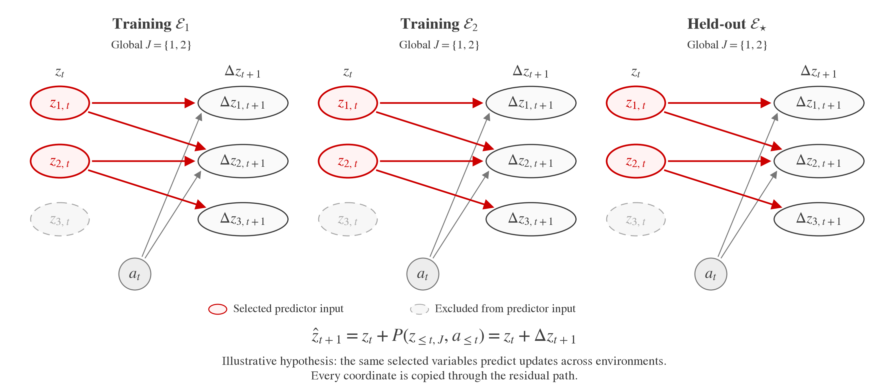

# Residual SPT: a fixed predictive subset

Could we test a residual SPT motivated by sparse causal dynamics? Suppose a stable subset of learned latent variables determines the changes in a scene, while the remaining representation can be carried forward for rendering. The subset would have the same identity across examples and environments, with the encoder learning what information to place there.

The graph describes the parents of the **update**, rather than every dependency of the next state: the full state also has an identity carry path. It illustrates a hypothesis, not an identified graph.

For a full encoding \(z_t=E(x_t)\) and a fixed selected set \(J\), use

\[
s_t=z_t[J],\qquad
\Delta z_{t+1}=P(s_{\leq t},a_{\leq t}),\qquad
\hat z_{t+1}=z_t+\Delta z_{t+1}.
\]

Actions are optional when available. The causal predictor consumes only the selected state but outputs an update with the full encoding's shape. Its output projection can be part of P; no separately named expansion module is needed.

This gives the JEPA motivation an explicit architectural constraint: concentrate information needed for temporal prediction into a small representation, while reusing visual detail through the residual path. We would test whether the selected state supports prediction and planning; sparsity alone does not establish causal identification or prevent its collapse.

For an initial SPT experiment, I would:

1. Replace independently sampled masks with one fixed set of post-encoder latent slots, shared across training and inference.
2. Give the causal predictor a full-shape output, then add the latest complete encoding.
3. Project the sum into the existing DiT conditioning space and retain the flow objective, starting with next-chunk prediction.

Under flow supervision alone, the sum is a conditioning representation. To learn an explicit JEPA transition, additionally align its selected coordinates with the next encoded state and evaluate latent-only rollout. That selected recurrence is simply \(\hat s_{t+1}=s_t+\Delta z_{t+1}[J]\).

Would this be straightforward to try in SPT?

---

Supporting discussion: [technical notes](residual-jepa-technical-notes.md) and [prior-work comparison](residual-jepa-prior-work.md). The closest comparisons include Conscious Planning, DDP-WM and Scope-WM for sparse prediction with full-state integration, and LRC-JEPA for separating predictive state from reconstruction context.
