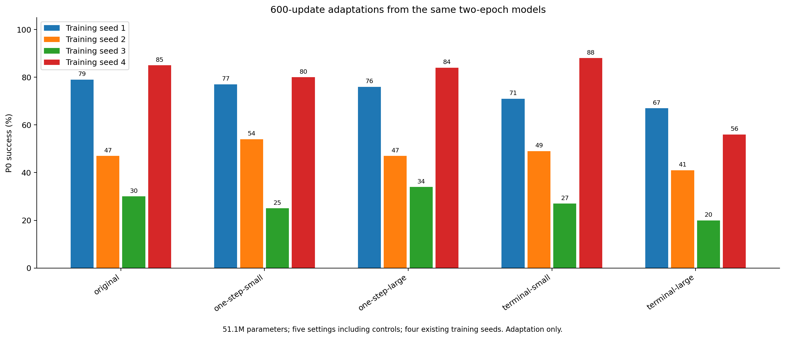
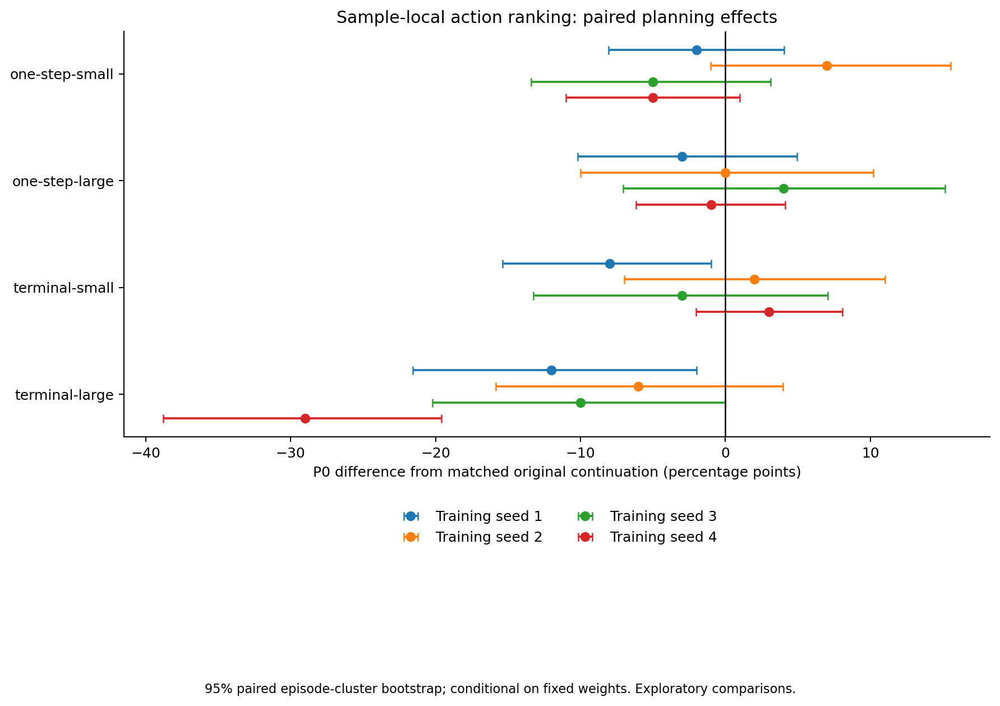

# Sample-level动作排序：600更新配对适应筛选

全部方法从同一训练种子对应的原算法2epoch完整状态出发，只适应600更新。模型参数固定51,097,134，batch128，beta=.25，sigma=.1，学习率日程124910步。

这不是从头训练稳定性，也不是划时代或新颖性的证明。包含原算法续训及必要对照，未修正多重比较；后续胜者必须独立确认。

| 方法 | 训练种子 | P0均值 % | 相对原算法续训百分点 | h7 agent/copy ↓ | h7 moving block/copy ↓ | 动作识别 % | 训练秒数 |
| --- | ---: | ---: | ---: | ---: | ---: | ---: | ---: |
| original | 1 | 79.0 | +0.0 | 0.167 | 0.284 | 82.81 | 627.0 |
| original | 2 | 47.0 | +0.0 | 0.303 | 0.355 | 85.94 | 639.2 |
| original | 3 | 30.0 | +0.0 | 0.402 | 0.328 | 62.50 | 639.3 |
| original | 4 | 85.0 | +0.0 | 0.167 | 0.226 | 84.38 | 623.5 |
| one-step-small | 1 | 77.0 | -2.0 | 0.161 | 0.294 | 81.25 | 649.5 |
| one-step-small | 2 | 54.0 | +7.0 | 0.359 | 0.356 | 87.50 | 646.3 |
| one-step-small | 3 | 25.0 | -5.0 | 0.417 | 0.316 | 65.62 | 643.5 |
| one-step-small | 4 | 80.0 | -5.0 | 0.160 | 0.219 | 84.38 | 657.0 |
| one-step-large | 1 | 76.0 | -3.0 | 0.250 | 0.324 | 81.25 | 636.1 |
| one-step-large | 2 | 47.0 | +0.0 | 0.394 | 0.403 | 76.56 | 639.2 |
| one-step-large | 3 | 34.0 | +4.0 | 0.458 | 0.408 | 62.50 | 650.3 |
| one-step-large | 4 | 84.0 | -1.0 | 0.201 | 0.229 | 79.69 | 624.9 |
| terminal-small | 1 | 71.0 | -8.0 | 0.288 | 0.469 | 79.69 | 715.5 |
| terminal-small | 2 | 49.0 | +2.0 | 0.381 | 0.413 | 87.50 | 715.3 |
| terminal-small | 3 | 27.0 | -3.0 | 0.474 | 0.503 | 62.50 | 690.7 |
| terminal-small | 4 | 88.0 | +3.0 | 0.182 | 0.371 | 82.81 | 690.8 |
| terminal-large | 1 | 67.0 | -12.0 | 0.436 | 0.598 | 71.88 | 710.4 |
| terminal-large | 2 | 41.0 | -6.0 | 0.613 | 0.989 | 60.94 | 684.7 |
| terminal-large | 3 | 20.0 | -10.0 | 0.959 | 1.551 | 40.62 | 686.4 |
| terminal-large | 4 | 56.0 | -29.0 | 0.332 | 0.617 | 79.69 | 686.2 |

[完整逐例结果、配对episodebootstrap、检查点身份与成本](actionrank-short-results.json)、[生成逐例数值](actionrank-short-per-case.npz)。

所有新运行均已停在600更新上限。根据两种子的规划/生成/动作结果及成本作继续决定，不自动延长整组。

## 配对效果与继续决定

[完整四种子继续决定](DECISION.md)。本组没有跨种子稳定规划收益；强终点排序在四种子均下降。全部适应已停在600更新，不自动延长。
