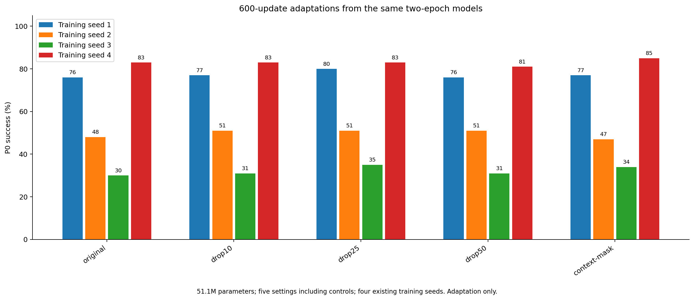
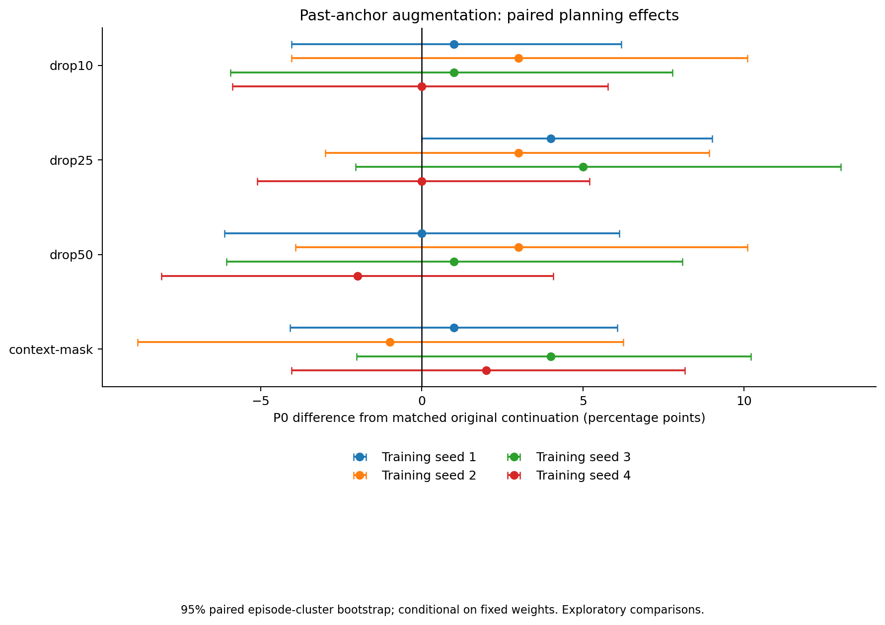

# Sample-level旧图像侧信息：600更新配对适应筛选

全部方法从同一训练种子对应的原算法2epoch完整状态出发，只适应600更新。模型参数固定51,097,134，batch128，beta=.25，sigma=.1，学习率日程124910步。

这不是从头训练稳定性，也不是划时代或新颖性的证明。包含原算法续训及必要对照，未修正多重比较；后续胜者必须独立确认。

| 方法 | 训练种子 | P0均值 % | 相对原算法续训百分点 | h7 agent/copy ↓ | h7 moving block/copy ↓ | 动作识别 % | 训练秒数 |
| --- | ---: | ---: | ---: | ---: | ---: | ---: | ---: |
| original | 1 | 76.0 | +0.0 | 0.171 | 0.291 | 82.81 | 650.3 |
| original | 2 | 48.0 | +0.0 | 0.306 | 0.359 | 84.38 | 655.4 |
| original | 3 | 30.0 | +0.0 | 0.393 | 0.348 | 62.50 | 641.1 |
| original | 4 | 83.0 | +0.0 | 0.164 | 0.228 | 84.38 | 638.8 |
| drop10 | 1 | 77.0 | +1.0 | 0.188 | 0.260 | 81.25 | 648.4 |
| drop10 | 2 | 51.0 | +3.0 | 0.350 | 0.388 | 87.50 | 632.8 |
| drop10 | 3 | 31.0 | +1.0 | 0.391 | 0.373 | 65.62 | 628.5 |
| drop10 | 4 | 83.0 | +0.0 | 0.173 | 0.230 | 84.38 | 641.1 |
| drop25 | 1 | 80.0 | +4.0 | 0.191 | 0.292 | 82.81 | 623.6 |
| drop25 | 2 | 51.0 | +3.0 | 0.315 | 0.329 | 89.06 | 617.8 |
| drop25 | 3 | 35.0 | +5.0 | 0.421 | 0.328 | 64.06 | 631.3 |
| drop25 | 4 | 83.0 | +0.0 | 0.167 | 0.220 | 82.81 | 613.1 |
| drop50 | 1 | 76.0 | +0.0 | 0.181 | 0.265 | 82.81 | 608.5 |
| drop50 | 2 | 51.0 | +3.0 | 0.321 | 0.331 | 84.38 | 621.4 |
| drop50 | 3 | 31.0 | +1.0 | 0.387 | 0.386 | 62.50 | 602.5 |
| drop50 | 4 | 81.0 | -2.0 | 0.174 | 0.225 | 85.94 | 599.8 |
| context-mask | 1 | 77.0 | +1.0 | 0.211 | 0.287 | 81.25 | 612.6 |
| context-mask | 2 | 47.0 | -1.0 | 0.332 | 0.342 | 87.50 | 593.5 |
| context-mask | 3 | 34.0 | +4.0 | 0.451 | 0.331 | 60.94 | 593.2 |
| context-mask | 4 | 85.0 | +2.0 | 0.174 | 0.245 | 84.38 | 604.1 |

[完整逐例结果、配对episodebootstrap、检查点身份与成本](anchor-short-results.json)、[生成逐例数值](anchor-short-per-case.npz)。

所有新运行均已停在600更新上限。根据两种子的规划/生成/动作结果及成本作继续决定，不自动延长整组。

## 继续决定

[四种子完整决策与机制限制](DECISION.md)。drop25初筛点估计为+4/+3/+5/0个百分点，已启动新案例与相同初始状态的短训练复跑确认；尚未证明稳定规划提升。
