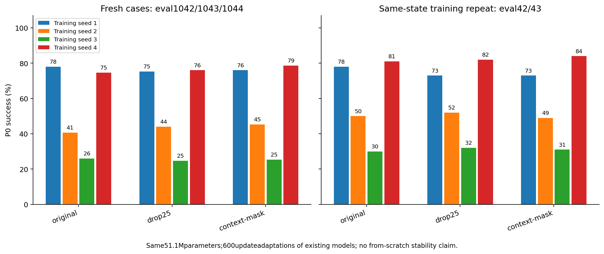

# Selected anchor leads: independent cases and numerical repeat

All120confirmation endpoints exited0. Fresh evaluation uses the first short-screenweights; strict600update repeats restart the same2epochfullstate/RNG. These are existing training seeds, not from-scratch repetitions.

| Method | Seed | First primary % | Fresh % | Repeat primary % | Fresh delta pp | Repeat delta pp | Agent R2 | Block position R2 |
| --- | ---: | ---: | ---: | ---: | ---: | ---: | ---: | ---: |
| original | 1 | 76.0 | 78.00 | 78.0 | +0.00 | +0.0 | 0.888 | 0.917 |
| original | 2 | 48.0 | 40.67 | 50.0 | +0.00 | +0.0 | 0.807 | 0.875 |
| original | 3 | 30.0 | 26.00 | 30.0 | +0.00 | +0.0 | 0.755 | 0.921 |
| original | 4 | 83.0 | 74.67 | 81.0 | +0.00 | +0.0 | 0.908 | 0.921 |
| drop25 | 1 | 80.0 | 75.33 | 73.0 | -2.67 | -5.0 | 0.888 | 0.920 |
| drop25 | 2 | 51.0 | 44.00 | 52.0 | +3.33 | +2.0 | 0.806 | 0.876 |
| drop25 | 3 | 35.0 | 24.67 | 32.0 | -1.33 | +2.0 | 0.749 | 0.921 |
| drop25 | 4 | 83.0 | 76.00 | 82.0 | +1.33 | +1.0 | 0.908 | 0.921 |
| context-mask | 1 | 77.0 | 76.00 | 73.0 | -2.00 | -5.0 | 0.888 | 0.919 |
| context-mask | 2 | 47.0 | 45.33 | 49.0 | +4.67 | -1.0 | 0.808 | 0.876 |
| context-mask | 3 | 34.0 | 25.33 | 31.0 | -0.67 | +1.0 | 0.756 | 0.922 |
| context-mask | 4 | 85.0 | 78.67 | 84.0 | +4.00 | +3.0 | 0.908 | 0.921 |

Full numerical/per-case evidence and conditional paired intervals: anchor-confirmation-results.json and anchor-confirmation-per-case.npz.

Adaptation gains alone do not establish stable89%or a causal explanation for the anchor effect. No automatic longer training is encoded in this confirmation plan.

[确认结论与完整限制（中文）](DECISION.md)：初筛 +3pp 未在新案例或训练复跑中稳定保留，不推广为更好的算法。
