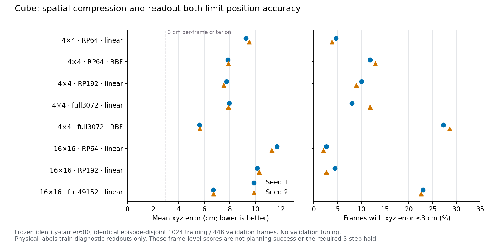

# Fresh2000与空间读出：完成复核

TwoRoom的进展在预先固定的fresh病例上保留；Cube仍弱。两项诊断共20个端点全部exit0，未增加训练或查询活动结果。

| 任务 | F identity | F free | F bounded | TF | released LeWM |
|---|---:|---:|---:|---:|---:|
| tworoom | 66/56 | 70/78 | 64/90 | 4/8 | 68 |
| cube | 8/6 | 12/6 | 10/6 | 6/6 | 24 |

数值为成功率%，每格seed1/2；F/TF均2000步，公开LeWM为之前同fresh病例的单checkpoint参考、训练预算不匹配。16项已逐一校验相同有序50病例、manifest、solver（含policy seed）、plan、protocol，以及checkpoint路径、权重/config预声明SHA、严格加载。相对primary2000仅换预声明病例与policy seed；相对旧fresh600参考保持评测协议。内部归一化一致；released保留其full-data归一化。

fresh仍来自相同validation pool（与primary精确pair重合0，episode重合TwoRoom34/Cube1），不是独立test。TwoRoom bound−free为−6/+12pp，不能据seed2的90%判定约束胜出。Cube各F为6–12%，TF6/6%，released24%，尚无稳定优势。

| 空间特征 / 读出 | xyz平均误差cm | ≤3cm比例% | 姿态平均误差° | ≤15°比例% |
|---|---:|---:|---:|---:|
| pooled4x4 / rp64 / linear | 9.26/9.51 | 4.69/3.79 | 21.72/22.20 | 33.71/36.16 |
| pooled4x4 / rp64 / rbf | 7.84/7.88 | 11.83/12.95 | 21.52/21.75 | 37.72/36.38 |
| pooled4x4 / rp192 / linear | 7.74/7.52 | 10.04/8.93 | 22.48/22.76 | 34.60/33.04 |
| pooled4x4 / full / linear | 7.95/7.88 | 8.04/11.83 | 21.74/21.13 | 36.38/37.72 |
| pooled4x4 / full / rbf | 5.64/5.65 | 27.23/28.57 | 22.09/21.87 | 39.29/38.39 |
| fullpatch / rp64 / linear | 11.68/11.27 | 2.68/2.01 | 21.03/21.37 | 38.84/38.39 |
| fullpatch / rp192 / linear | 10.13/10.30 | 4.46/2.68 | 22.47/21.92 | 35.27/35.04 |
| fullpatch / full / linear | 6.72/6.74 | 22.99/22.54 | 21.01/20.87 | 38.84/39.06 |

同RBF读出下，RP64→完整4×4把位置误差7.84/7.88降到5.64/5.65cm；同RP64下，linear→RBF把9.26/9.51降到7.84/7.88cm。两种因素均有作用。RP192线性位置也改善至7.74/7.52cm，故“RP192无改善”仅适用于没有姿态收益，不能泛指所有信息。

姿态仍约21–23°，常量参考23.13°、≤15°32.81%；最佳已测读出也仅约39%进入15°。完整patch线性读出位置6.72/6.74cm，但姿态实测21.01/20.87°，仍无明显突破。这些结果支持当前压缩/读出限制了可读位置精度，却不能证明姿态信息已丢失，更不能单独解释规划失败。

所有读出固定λ=.001，无验证调参；两seed同128训练clips×8帧、64验证clips×7未来帧，episode互斥。1024训练帧高度相关，维度/统计容量不同；高维失败仍可能涉及样本量、正则或归纳偏好。物理标签仅拟合诊断readout，未进入世界模型训练。阈值比例不是规划成功率，也未验证连续3物理步保持。原RP64线性/RBF姿态结果复现，最大R²差<2e−8、角度差0。

后续8F+4TF到6000步已由root于19:53启动；此报告未轮询这些运行。完整逐帧/逐病例数组保留EFS，[summary.json](summary.json)仅含标量、兼容性检查和原报告SHA。
