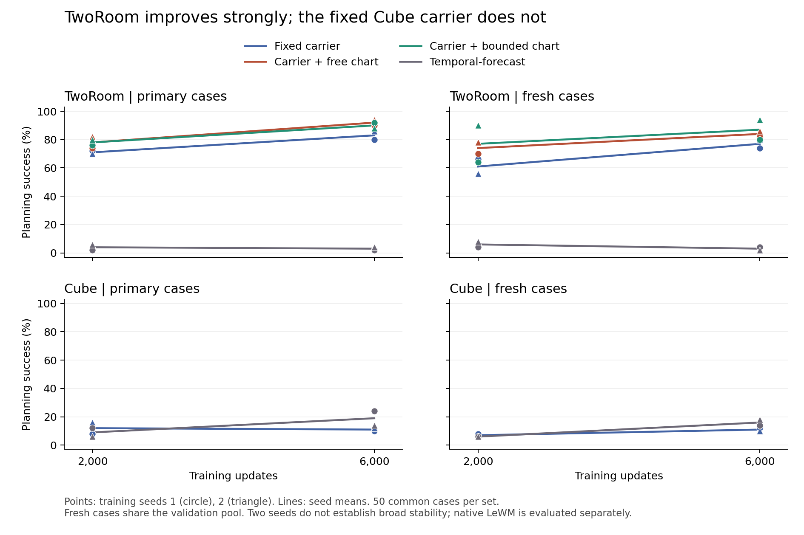

# Carrier/TF6000 complete review

All68 endpoints exit0; source `8e0f821bba84e7ed8c0f16500d7c880fde56d4cf`. All12 resume, full-state, strict-load and native evaluator contracts passed.

| Task | Arm | Primary2000→6000 seed1 /seed2 | Fresh2000→6000 seed1 /seed2 |
|---|---|---:|---:|
| tworoom | identity | 72→80% / 70→86% | 66→74% / 56→80% |
| tworoom | unconstrained | 74→90% / 82→94% | 70→82% / 78→86% |
| tworoom | bounded | 76→92% / 80→88% | 64→80% / 90→94% |
| tworoom | temporal-forecast | 2→2% / 6→4% | 4→4% / 8→2% |
| cube | identity | 8→10% / 16→12% | 8→12% / 6→10% |
| cube | temporal-forecast | 12→24% / 6→14% | 6→14% / 6→18% |

| Task/cases |6000 comparison| Seed1/2 Δpp | Mean [paired-case95% interval] |
|---|---|---:|---:|
| tworoom/primary | identity−temporal-forecast | +78/+82 | +80 [+71,+88] |
| tworoom/primary | unconstrained−temporal-forecast | +88/+90 | +89 [+81,+95] |
| tworoom/primary | bounded−temporal-forecast | +90/+84 | +87 [+78,+94] |
| tworoom/primary | unconstrained−identity | +10/+8 | +9 [+1,+18] |
| tworoom/primary | bounded−identity | +12/+2 | +7 [-1,+16] |
| tworoom/primary | bounded−unconstrained | +2/-6 | -2 [-5,+0] |
| tworoom/fresh | identity−temporal-forecast | +70/+78 | +74 [+63,+84] |
| tworoom/fresh | unconstrained−temporal-forecast | +78/+84 | +81 [+71,+90] |
| tworoom/fresh | bounded−temporal-forecast | +76/+92 | +84 [+75,+92] |
| tworoom/fresh | unconstrained−identity | +8/+6 | +7 [-3,+18] |
| tworoom/fresh | bounded−identity | +6/+14 | +10 [-1,+21] |
| tworoom/fresh | bounded−unconstrained | -2/+8 | +3 [-2,+8] |
| cube/primary | identity−temporal-forecast | -14/-2 | -8 [-17,+0] |
| cube/fresh | identity−temporal-forecast | -2/-8 | -5 [-14,+3] |

| Task/arm/seed | Clean/copy2000→6000 | Teacher/local-copy2000→6000 | Residual global bound6000 | late/recent loss change |
|---|---:|---:|---:|---:|
| tworoom/identity/1 | 0.2161→0.1466 | 0.1709→0.0877 | 0.0000 | -4.5% |
| tworoom/unconstrained/1 | 0.2064→0.1285 | 0.1969→0.1170 | 1.9167 | -9.5% |
| tworoom/bounded/1 | 0.2077→0.1378 | 0.1900→0.1041 | 0.5000 | -6.0% |
| tworoom/identity/2 | 0.1959→0.1285 | 0.1706→0.0809 | 0.0000 | -7.5% |
| tworoom/unconstrained/2 | 0.2067→0.1412 | 0.2029→0.1277 | 1.9940 | -12.3% |
| tworoom/bounded/2 | 0.1981→0.1397 | 0.1911→0.1027 | 0.5000 | -10.8% |
| cube/identity/1 | 0.1944→0.1466 | 0.2915→0.2410 | 0.0000 | -6.4% |
| cube/identity/2 | 0.1853→0.1484 | 0.2935→0.2468 | 0.0000 | -7.3% |
| tworoom/temporal-forecast/1 | not scheduled | not scheduled | — | -1.1% |
| tworoom/temporal-forecast/2 | not scheduled | not scheduled | — | -6.0% |
| cube/temporal-forecast/1 | not scheduled | not scheduled | — | -11.6% |
| cube/temporal-forecast/2 | not scheduled | not scheduled | — | -12.4% |

Clean/copy compares causal forecast to initial-state persistence; teacher/local-copy has extra real past observations. Identity-carrier coordinates are fixed across checkpoints. Learned-chart normalized ratios still change with chart geometry; they do not by themselves establish common-coordinate dynamics improvement. Residual Lipschitz bound≥1 loses a sufficient global invertibility certificate; it does not establish noninvertibility.

Late/recent losses compare recorded training minibatches at steps5500–6000 vs4500–5000 (six recorded minibatches per interval). Decreasing loss is evidence against a clear training-loss plateau, not proof that planning will improve with more updates. No transition assay was scheduled for TF.

Released LeWM references: TwoRoom primary72/fresh68%, Cube primary30/fresh24%; training budget, exposure, capacity and normalization differ. Internal F/TF have equal updates/data/native planner but differ in frozen/trainable capacity,8320 chart parameters and 128-frame train-only calibration. All parents and source snapshots remain preserved.

Both seeds retained. Fixed50 primary and50 fresh validation cases; reused validation is not independent test. Paired case intervals condition on two fixed training seeds, without seed-level uncertainty or multiplicity correction. F/TF share6000updates/data/planner; capacity, frozen parameters, calibration and training compute differ. No new physical-label training. No TF transition audit was scheduled.

判断与下一步：TwoRoom的三种F在primary/fresh均继续改善，有依据再进行一个有上限的训练阶段；free/bound没有跨病例集一致胜者，仍需保留配对控制。Cube固定RP64载体的clean预测确实改善，但规划未一致提升，且全部四个seed×病例条件都低于同6000步TF。建议原Cube F保持6000，优先等待空间机制短gate；Cube TF两病例集均较2000平均+10pp，作为继续训练的对照有实际任务依据。这不是证明F已经收敛，而是继续优化当前目标的任务回报不足。TwoRoom TF仍失败，不能仅因renderer loss下降宣称世界模型持续改善。更长F与更短TF对比需明确预算差异，或保留必要的同预算TF控制；本报告不启动下一阶段。

Full per-case outcomes, audit records and traces remain in EFS `results.json`. Small `summary.json` records its SHA. No new experiment, GPU job, model modification, baseline BN calibration or local1024 gate is part of this collector.

