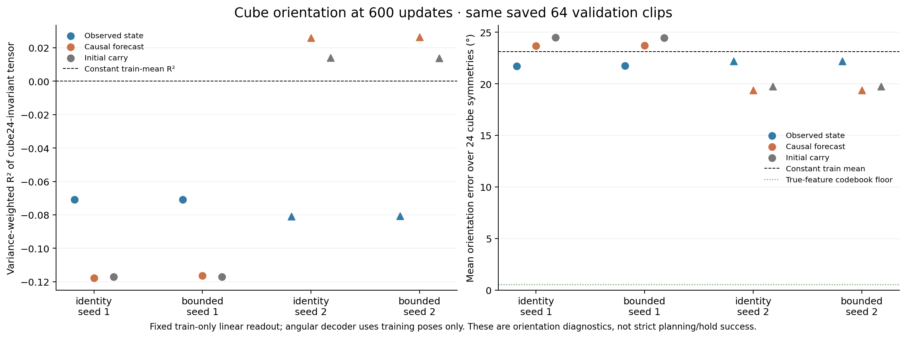

# Frozen carrier orientation diagnostic

The four Cube F600 checkpoints have weak held-out linear orientation readout under this fixed probe. The bounded chart does not materially improve it. This narrows a gap left by the earlier xyz probes; it does not establish that orientation information is absent, or that orientation alone causes planning failure.

| Arm / seed | Observed invariant R² | Observed angle | Forecast angle | Initial-carry angle | Observed / forecast within 15° |
|---|---:|---:|---:|---:|---:|
| identity / 1 | -0.0708 | 21.72° | 23.67° | 24.47° | 33.7% / 27.5% |
| bounded / 1 | -0.0709 | 21.73° | 23.72° | 24.44° | 33.7% / 26.3% |
| identity / 2 | -0.0809 | 22.20° | 19.36° | 19.76° | 36.2% / 45.8% |
| bounded / 2 | -0.0808 | 22.19° | 19.36° | 19.75° | 35.9% / 45.5% |

The constant training-mean reference has 23.13° mean error and 32.8% within 15°. The exact true-feature training-codebook decoder has only 0.552° mean error and 100% within 15°, so the poor readout is not explained by coarse codebook coverage. This decoder control uses true orientation only to measure the diagnostic's resolution; it is not a model result.

Forecast versus copying the initial state is mixed in R² and small in angular improvement: roughly 0.8° for seed 1 and 0.4° for seed 2. Identity versus bounded forecast angles differ by less than 0.05°. Teacher-forced and shifted-observed controls are retained in results.json; they receive new real observations and are not free dynamics predictions.

The conventional rotation-matrix9 control also has negative observed variance-weighted R² (approximately −.148 to −.176). Unlike the primary target, its component labels distinguish physically equivalent cube orientations; it is reported as a stricter control, not evidence against the cube-symmetry-aware result.

## Target and decoding

The pinned evaluator uses wxyz quaternions, minimum geodesic angle over 24 proper cube rotations, and a 15° threshold. We convert quaternions with its own implementation. For rotation matrix R with columns a₁,a₂,a₃, the primary linear target is the 81-component fourth-order tensor M(R)=Σⱼ aⱼ⊗aⱼ⊗aⱼ⊗aⱼ. It is invariant to quaternion sign and to signed permutations of cube axes. For unit v, contraction M[v,v,v,v]=Σⱼ(v·aⱼ)⁴ attains its maximum 1 precisely on the six unoriented axes. Thus equal tensors identify the same cube orientation up to the evaluator's proper cube symmetries. This is an established invariant construction, not an algorithm novelty claim.

A fixed training-quaternion codebook decodes predicted tensors by nearest tensor distance, with no validation tuning or fitted nonlinear decoder. The rotation9 control uses the nearest SO(3) matrix from SVD. Both report physical angles with the same pinned 24-symmetry function. Feature R² and angular error measure different losses; their apparent ordering need not agree.

## Data and fairness

Reuse only the existing metric-calibration 128 training clips ×8 frames and state-audit 64 validation clips ×8 frames; score the same 448 future frames across all conditions. Exact HDF5 rows and episode IDs are checked. Training/validation episodes are disjoint; saved embedding, model-weight, dataset, manifest and source hashes are retained. The readout is the existing benchmark protocol: training-only standardization, coordinate std floor1e−12, ridge .001 in mean-squared-error units. No encoder or GPU is used, and no model, planner, goal metric or evaluation case is changed. Privileged quaternion labels fit this diagnostic readout only.

This fixed small linear probe can fail because of nonlinear encoding, readout estimation, or representation limitations. Negative held-out R² alone cannot distinguish these. The comparison does show that earlier strong position probes were insufficient evidence of a usable full pose representation, and that the bounded chart has not resolved this particular gap.

## Hold is not measured

Strict Cube requires position ≤3 cm and symmetry-aware orientation ≤15° for three consecutive physical steps. The pinned runner resets and updates a goal-dependent counter. Saved embeddings and predictions are five physical steps apart; neither the between-frame states nor this evaluation-specific counter is available. HDF5 `success` is the upstream dataset flag and is not silently treated as strict hold. We therefore do not fit a purported hold label or equate the orientation-within15 fraction with planning success.

No extra cases, model training, hyperparameter search, encoder calls or GPU jobs were used. Raw readout weights and predicted orientation features remain on EFS; the small results JSON contains all per-frame errors, feature metrics, constants and provenance.

