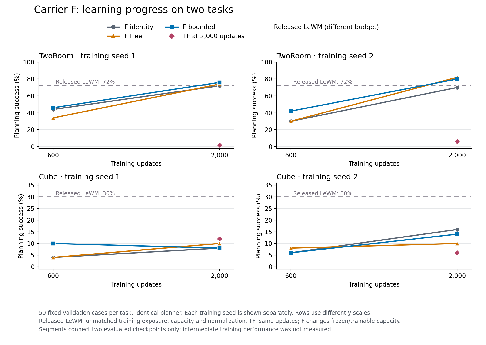

# Carrier 600→2000：完成结果

TwoRoom 的F家族随训练明显提高：三种F在2000步均达到70–82%，明显超过同更新数TF的2/6%。Cube只有8–16%，尚无跨任务性能突破。以下保留两seed，不以平均数掩盖差异。

| 任务 | 方法 | seed1：600→2000 | seed2：600→2000 |
|---|---|---:|---:|
| TwoRoom | F identity | 44→72 | 30→70 |
| TwoRoom | F free | 34→74 | 30→82 |
| TwoRoom | F bounded | 46→76 | 42→80 |
| TwoRoom | TF，2000步 | 2 | 6 |
| Cube | F identity | 4→8 | 6→16 |
| Cube | F free | 4→10 | 8→10 |
| Cube | F bounded | 10→8 | 6→14 |
| Cube | TF，2000步 | 12 | 6 |

数值均为成功率%。每任务同50个固定validation cases、同规划器；公开LeWM在同病例上为TwoRoom72%、Cube30%，但训练预算、数据暴露、容量与归一化不同，虚线仅作参考，不是匹配预算复现。F/TF更新数匹配，但F额外8320参数、冻结encoder/pool、使用128个训练帧校准，训练计算与优化器状态不同。

TwoRoom bound−free分别为+2/−2个百分点，均值0，配对case bootstrap 95%区间[−11,+11]；Cube为−2/+4，均值+1，区间[−5,+7]。约束真实存在，但尚无性能优势证据。区间仅反映固定两训练seed下的病例不确定性，未涵盖seed不确定性或多重比较。

TwoRoom free的全局残差Lipschitz上界为1.2711/1.3238，已不满足小于1的充分可逆性证书；这不证明映射不可逆。bound为0.499999/0.499883，仍有严格全局双Lipschitz保证（下界约0.5000，上界约1.5000）。Cube free为0.9459/0.9225，bound为0.4966/0.4783。

## 600步fresh病例确认

| 任务 | F identity | F bounded | TF | 公开LeWM单checkpoint |
|---|---:|---:|---:|---:|
| TwoRoom | 42 / 28 | 48 / 26 | 4 / 8 | 68 |
| Cube | 2 / 6 | 2 / 2 | 8 / 12 | 24 |

斜线两侧为seed1/2；这里只评估600步模型。新50例与primary精确(episode,start,goal)重合为0，但仍来自相同validation pool，episode重合TwoRoom34、Cube1；不是独立test set。病例抽样seed与policy seed均预先固定为2026103101，不可将primary/fresh差异只归因为病例变化。

## Cube 600步规划度量控制

| 病例 | 方法 | native | observation | increment |
|---|---|---:|---:|---:|
| primary | F identity | 4 / 6 | 2 / 2 | 4 / 8 |
| primary | F bounded | 10 / 6 | 6 / 4 | 2 / 6 |
| fresh | F identity | 2 / 6 | 0 / 2 | 2 / 6 |
| fresh | F bounded | 2 / 2 | 0 / 6 | 2 / 4 |

改度量未跨两seed、两病例集一致提高成功率；这里仅干预controller cost，模型权重与sample-level训练目标不变。

已完成96个2000阶段端点与34个diagnostics端点均exit0。下一阶段8个F与4个TF到6000步已获授权；本报告不声明已启动或完成。

完整数组保留EFS原报告；小型[summary.json](summary.json)记录原results SHA256、全部两seed数值及证书。

来源：

- learn2000: `/efs/prescottsun/SPT-JEPA/reports/carrier-learn2000-20261031/results.json`，SHA256 `a9bd6c9ac94b5e0fcb393ecca98ff355fc9e3c4a573d4690a1dc048994bb2b53`
- diagnostics600: `/efs/prescottsun/SPT-JEPA/reports/carrier-diagnostics-20261031/results.json`，SHA256 `6c73fe132317d42a79431e59bad2bebfb55291711d2962c6af1ce7a49d168577`
- initial600: `/efs/prescottsun/SPT-JEPA/reports/ideas-validate600-20261031/results.json`，SHA256 `692ef379d4a64f9c338139a749cef16e409d3f8023f308fb8430af8ad6408b0b`

冻结训练源码：`a499fc2b543214173ea3866b76df6636a859faa0`。
