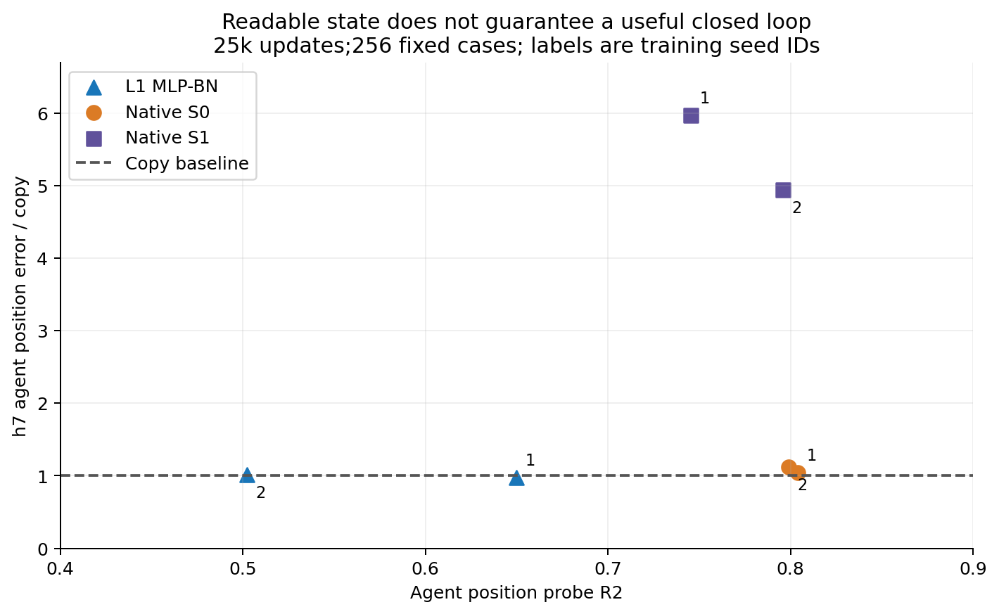

# 25k匹配终点：probe、生成与控制分别报告

这六个终点都已跑完完整评估，训练为25k更新、生成用同一256例和同一pose/I3D协议。架构、训练目标和每窗口帧数不同，这张表不是最终完整预算下的架构排名。

| 模型 | agent/block位置probe R2 | h7 agent / moving-block相对copy误差 | FVD | 动作识别(%) | P0均值(%) |
| --- | --- | --- | --- | --- | --- |
| L1 seed1 | 0.650 / 0.895 | 0.973 / 0.423 | 637.3 | 37.1 | 27.3 |
| L1 seed2 | 0.502 / 0.875 | 1.016 / 0.442 | 669.1 | 36.3 | 16.0 |
| S0 seed1 | 0.804 / 0.856 | 1.039 / 1.084 | 1099.8 | 30.5 | 未运行（原规格可选） |
| S0 seed2 | 0.799 / 0.910 | 1.123 / 1.308 | 1242.8 | 29.7 | 未运行（原规格可选） |
| S1 seed1 | 0.745 / 0.823 | 5.971 / 2.909 | 1937.5 | 25.8 | 未运行（原规格可选） |
| S1 seed2 | 0.796 / 0.847 | 4.943 / 3.995 | 2318.8 | 25.0 | 未运行（原规格可选） |

两个NativeS1新种子的agent probe约.75/.80，但h7误差约为copy的5.97/4.94倍；可线性读取物理位置不保证自由闭环有效。这个结果支持继续验证语义记忆/图像反馈对照，不能单凭它认定某个反馈修复已经成功。

NativeS0 seed2的FVD约1243，优于copy的1629，但h7 agent/moving-block误差比约1.12/1.31，均比copy差。更好的FVD本身也不足以证明动力学或动作控制。L1两个种子的物块生成优于copy，但agent仍近copy，P0分别约27.3%和16.0%。

[完整逐模型数值和每例动作/规划记录](baselines-25k.json)包含模型配置、checkpoint哈希、全部horizon的质量指标、50k帧训练probe、5k帧测试probe及case身份。baseline-*-quality.npz保留逐例数值误差；像素、权重、视频和原始数据均留在EFS。其余训练种子和完整10epoch结果仍在继续。
