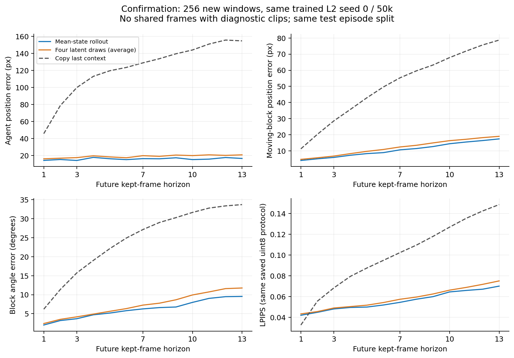

# 新窗口确认：同一训练模型的正面生成结果

模型保持原L2 beta=.01 /50k /training seed0。新256例在看到候选最终结果前固定，移除了与旧诊断16帧clip共享帧的2785个窗口起点。它仍来自同一test episode split，不是新训练种子或独立数据集；不应该把与旧case数值的差别叫训练提升。

- h7 agent/copy = **0.1260**，moving-block/copy = **0.1932**。
- FVD = **230.72**，copy = **1345.11**。四个latent draw分别为232.97, 226.38, 222.68, 230.69。
- h7 mean LPIPS=0.0518，SSIM=0.8239，block angle=6.27°；mean LPIPS原始浮点与图中统一uint8版本分别保留。

反事实动作识别=86.72%（新case seed142，排除旧case时间段）。P0已有3/3个确认评估种子的结果，当前值为68.0%/66.0%/66.0%。

FVD仍是256real/256fake的16帧协议，3帧真实context+13帧生成、64→224双线性、I3D400；每个draw独立计算，未把四个draw合并成1024个real样本。这个确认支持已有单种子模型的动力学收益；最终跨训练种子稳定性和原始全量方案仍待完成。

[完整JSON与case身份](confirmation-results.json)，[逐例质量数值](confirmation-quality-metrics.npz)，[逐例copy/sample完整质量数值](confirmation-additional-metrics.npz)。原始像素和视频保存在EFS，未放Git。
