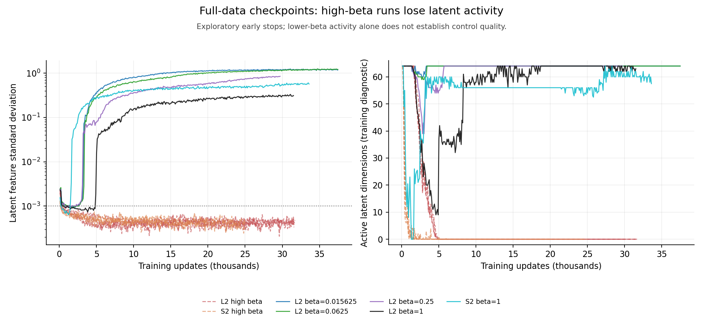

# 关键 insight 优先：停止持续坍塌的运行

核查时间：2026-10-29T00:12:19.848650+08:00。关键结论优先，不以跑满所有条件网格作为交付前提。

高 β 运行保留配置、代码、日志和完整检查点后提前停止；健康的额外种子是暂缓，不能记为失败。原始完整预算方案仍未完成。

| 运行 | 最后日志步 | active dims | feature std | 独立 checkpoint audit |
| --- | ---: | ---: | ---: | --- |
| full-L2-beta4-stage3-seed0 | 29967 | 0.0 | 0.000495987 | COLLAPSED; active=0; posterior/anchor=0.6722 |
| full-L2-beta16-stage3-seed0 | 31557 | 0.0 | 0.000379528 | COLLAPSED; active=0; posterior/anchor=0.6360 |
| full-L2-beta64-stage3-seed0 | 31700 | 0.0 | 0.000483498 | COLLAPSED; active=0; posterior/anchor=0.6375 |
| full-L2-beta256-stage3-seed0 | 31567 | 0.0 | 0.000331767 | COLLAPSED; active=0; posterior/anchor=0.6530 |
| full-S2-beta4-stage3-seed0 | 24399 | 0.0 | 0.00029911 | COLLAPSED; active=0; posterior/anchor=0.7096 |
| full-S2-beta16-stage3-seed0 | 20199 | 0.0 | 0.000503704 | COLLAPSED; active=0; posterior/anchor=0.6888 |
| full-S2-beta64-stage3-seed0 | 12999 | 0.0 | 0.000579201 | stopped; independent audit pending |
| full-S2-beta256-stage3-seed0 | 24999 | 0.0 | 0.000390209 | COLLAPSED; active=0; posterior/anchor=0.6689 |

筛选要求连续 10 个日志点均为零活跃维度，且表征标准差小于 0.001。独立 audit 使用既有含噪后验、训练窗所有目标帧、256 固定 case 的正式判据。Native audit 可使用更早的周期导出；全部精确 checkpoint 和指标保存在 JSON。

已训练候选的共同基线、噪声对照及 checkpoint 的生成/动作/规划评测优先。I08 seed1/seed2 语义反馈、匹配 pixel finetune 和同权重开关并行。原始全数据模型直接评测三个 epoch checkpoint，不等十个 epoch；这是中期诊断。目标是约 6–12 小时形成一轮关键结论，必要复现约 12–24 小时；暂停项不记为完成。

这些运行都已观察到数千步持续零活跃维度；不能把初始化阶段短暂退化直接记为终局坍塌。图中的 L2 β=1 曾退化后恢复，所以仍保留。
