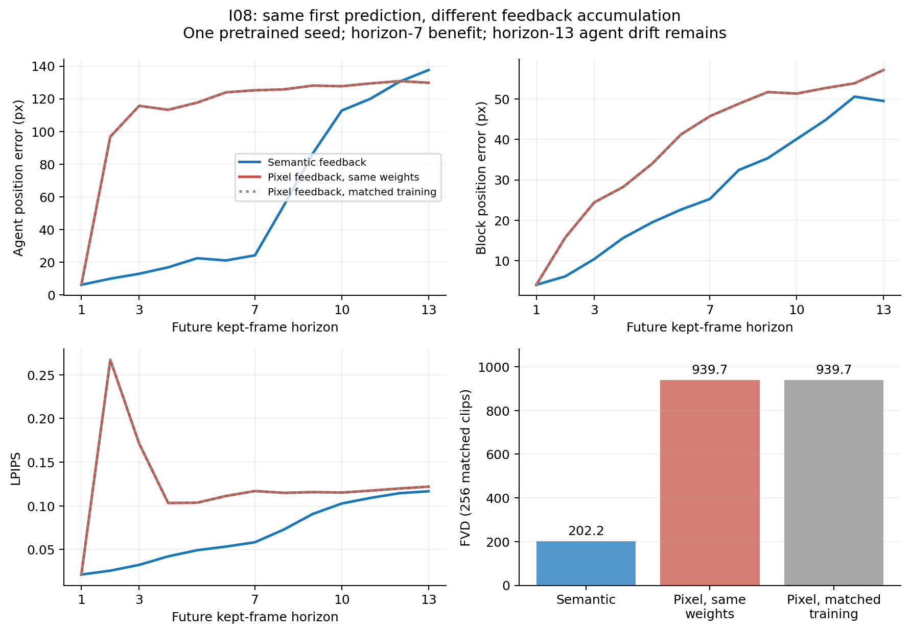

# I08正面机制结果：中期误差主要受反馈路径影响

从同一份NativeS1精确25k检查点出发，冻结frame encoder，再训练25k。一个分支学习semantic token转移，另一个有相同模块和计算但辅助项权重为0。最关键的推理对照使用**同一套权重/hash**，只切换是否重新编码生成图像；不是换模型或换训练预算。

| 反馈方式 | h7 agent /moving-block误差比 | FVD | 反事实动作识别 |
| --- | --- | --- | --- |
| 语义反馈 | 0.182 / 0.781 | 202.2 | 83.59% |
| 同权重切回像素反馈 | 0.944 / 1.129 | 939.7 | 仍在评估 |
| 相同finetune预算的像素反馈 | 0.944 / 1.129 | 939.7 | 31.64% |

首步agent/block误差两种反馈完全相同，为6.12/3.98px；h7时语义反馈agent24.15px，切回pixel反馈125.20px。语义反馈h7移动物块也优于copy。这个控制把中期改善定位到生成图像重新编码所引入的反馈误差；匹配训练的pixel控制进一步检查额外finetune预算。

**长时问题没有解决。** h13时semantic agent误差137.58px，pixel为129.80px，语义记忆自身仍会漂移。不能凭h7/FVD改善就叫稳定世界模型，更不能用单个训练种子宣称最终benchmark通过。当前是预训练seed0的一次机制实验；其他训练种子的确认、真观测校正以及长时稳定性仍待验证。

语义分支的动作识别83.59%，匹配训练pixel控制31.64%；同权重pixel的反事实项若尚未结束会明确保留pending，不把generation结果替代它。新窗口确认也已排入队列，使用与旧诊断clip无共享帧的case。

[完整数值、checkpoint身份、每horizon指标、反事实逐case结果和各阶段状态](I08-SEMANTIC-FEEDBACK.json)。I08-*-quality.npz保留逐例指标，视频在EFS。训练成本应计25kS1预训练+25kfinetune，不能只报新增25k。
