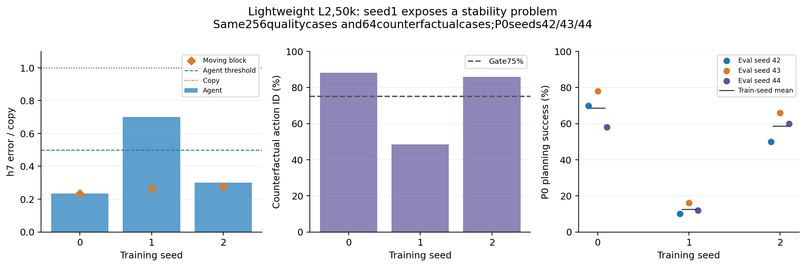

# 轻量L2的50k三训练种子：正面结果存在，稳定性尚未解决

三个训练种子和g0对照的全部终点评估均结束，包括50k帧train/5k帧testprobe、含噪后验坍塌检测、256例mean/sample生成、64例动作反事实和P042/43/44。以下全部case和测量协议相同，失败种子未被筛掉。

| 训练配置 | noisy agent/block位置R2 | h7 agent /moving-block误差比 | 动作识别(%) | P042/43/44(%) | P0均值(%) |
| --- | --- | --- | --- | --- | --- |
| seed0 | 0.867 / 0.972 | 0.234 / 0.234 | 88.28 | 70/78/58 | 68.67 |
| seed1 | 0.657 / 0.950 | 0.700 / 0.266 | 48.44 | 10/16/12 | 12.67 |
| seed2 | 0.840 / 0.946 | 0.300 / 0.275 | 85.94 | 50/66/60 | 58.67 |
| g0seed0 | 0.917 / 0.920 | 0.218 / 0.268 | 85.55 | 70/70/70 | 70.00 |

- 三种子h7 agent/copy平均0.411±0.252，移动物块0.258±0.022，按平均生成误差的数值条件通过。
- 动作识别平均74.22±22.36%，**未达到75%**。seed1的48.44%同时伴随规划均值12.67%，不能把这个配置称作稳定解决任务。
- P0先平均每个训练种子的三个eval seed，再计算训练种子间统计：46.67±29.87%。9次评估没有被当成9个训练种子。
- g0seed0仍有较好的生成/动作跟随，P0三个eval seed均为70%。这是单训练种子的anchor消融，不能推导所有种子都无需distantanchor。
- 所有三个主种子都通过含噪后验重建坍塌检测，seed1仍未获得强动作控制。只排除“空状态”不足以保证工作；可预测的视觉状态与任务控制之间仍存在差距。

正式generation gate仍未通过：动作识别平均低于阈值，人工32例检查也未签收。新窗口seed0确认的[正面结果](CONFIRMATION.md)不能替代这里的三训练种子稳定性结论。

同一个seed0检查点在新终点评估中的P0为70/78/58%，历史冻结报告为74/76/60%。两组原始值均保留，没有选择更好的重测值；这提示应显式记录GPU规划实现的重复运行波动，而不能声称跨机器bitwise可复现。

这是小renderer、单frameskip相位、50k且一次初始化缩放的探索结果。原始全数据/10epoch网格、最终选择和十候选验证仍在继续；不能与25k基线表直接当作相同预算的最终排名。

[完整逐种子数值、逐例反事实/规划、配置和hash](L2-50K-STABILITY.json)。L2-50k-*-quality.npz保留逐例每horizon的误差；GPU媒体位于EFS。
