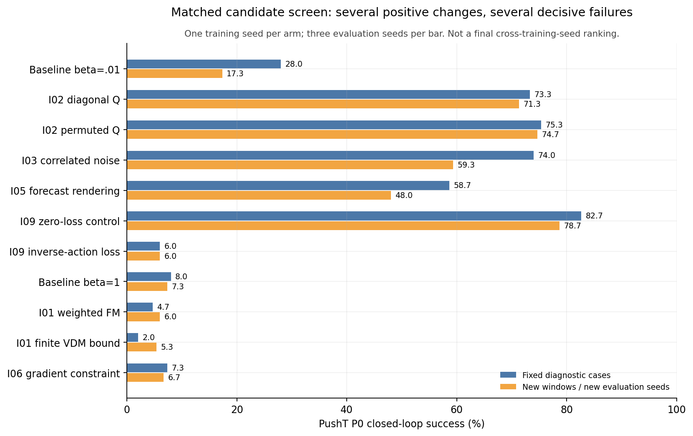
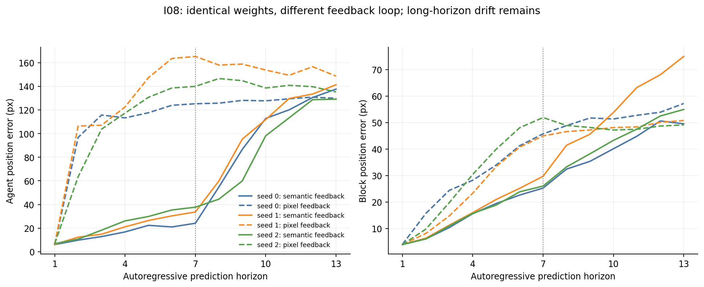
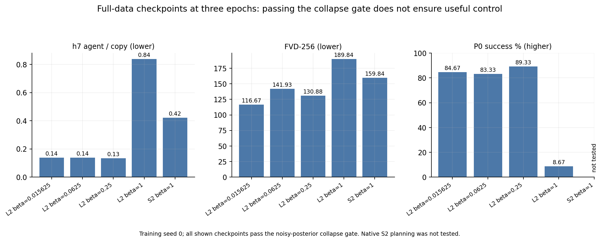
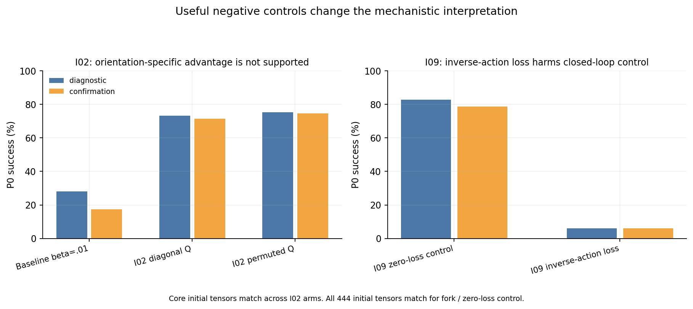
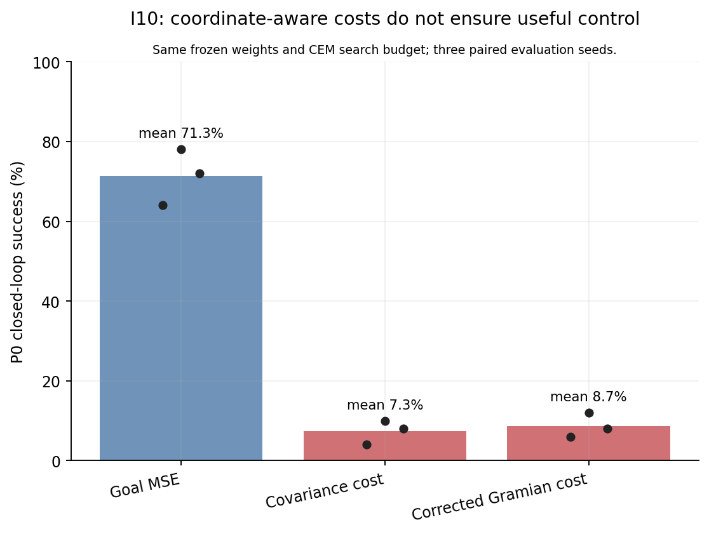

# 主要结论

本报告只汇总能直接回答主要问题的结果。原始十 epoch 及其他条件扩展仍暂缓。

## 关键结论

1. 原始全数据模型的三 epoch P0 结果为（L2-beta0.015625=84.67%, L2-beta0.0625=83.33%, L2-beta0.25=89.33%, L2-beta1=8.67%）；低 beta 配置已有真正闭环规划的正面结果，但这仍是单训练种子，不是完整十 epoch 或等预算架构胜出。
2. 八条高 beta 运行均由独立含噪后验评测确认零活跃维度，已提前停止。早期短暂退化不等于最终坍塌：原始 L2 beta=1 的表征活跃维度出现延迟恢复，因此只对成熟且持续退化的运行早停；表征恢复不等于规划恢复。
3. 坍塌门不是唯一的早停依据：原始 L2 beta=1 在三 epoch 的活跃维度为 55，h7 agent/copy=0.838，但 P0 只有 8.67%。非空表征和可用控制是不同门槛。
4. I08 已完成 3 个训练种子的语义反馈终点；同权重开关和第一生成步一致性检查用于隔离反馈路径。中期 agent 误差和动作识别的改变，不等于长时域物块控制或规划已解决；完整逐种子结果见表。
5. I08 的反事实 agent 识别均值为 82.81%，block 识别均值为 37.89%。合并动作识别率受较大 agent 位移影响，不能把它当作物块动力学或规划成功率。
6. I02 对角噪声有单种子收益，但方向打乱的对照同样好：D P0=73.33% vs 75.33%，C P0=71.33% vs 74.67%。不能把改善归因于 Jacobian 方向对齐；基础初始参数逐 tensor 相同。
7. I03 相关噪声与 I05 forecast rendering 是值得保留的单种子正面候选。I03 D/C P0=74.00/59.33%，匹配 baseline=28.00/17.33%。这些不是多训练种子稳定收益的证明。
8. I09 逆动作损失是强负面对照：D/C P0=6.00/6.00%，零损失对照=82.67/78.67%；两组全部 444 个初始 tensor 一致。辅助任务拟合好不保证可规划动力学。
9. I10 的 covariance / 修正 Gramian 规划代价，在相同冻结权重及 CEM 搜索预算下显著差于 GoalMSE；坐标不变性本身不保证有用的规划代价。I01 当前权重下的两种目标、I04 canonicalizer、I06 gradient constraint、I07 learned variance 未给出可靠任务收益。改变目标单位后的单一 beta 失败不能否定该目标在所有超参数下有效的可能性。
10. 保留旧轻量 L2 三训练种子的负面稳定性结果：P0=68.67/12.67/58.67%。新 full-data 单种子好结果不能抹去这个失稳证据。

## 原始全数据与 renderer：三个 epoch

| 配置 | 活跃维度 | h7 agent/copy ↓ | h7 moving block/copy ↓ | FVD-256 ↓ | 动作反事实识别 % ↑ | P0 三评测种子 % ↑ |
| --- | ---: | ---: | ---: | ---: | ---: | --- |
| L2-beta0.015625 | 64 | 0.138 | 0.232 | 116.67 | 87.50 | 88 / 88 / 78 |
| L2-beta0.0625 | 64 | 0.138 | 0.230 | 141.93 | 89.45 | 88 / 86 / 76 |
| L2-beta0.25 | 64 | 0.134 | 0.189 | 130.88 | 89.84 | 92 / 88 / 88 |
| L2-beta1 | 55 | 0.838 | 0.443 | 189.84 | 35.94 | 8 / 12 / 6 |
| S2-beta1 | 60 | 0.422 | 0.233 | 159.84 | 60.94 | 未测 |

上述是三 epoch 的中期 checkpoint，单训练种子；不能宣称完成原方案或优于未做的等预算 LeWM 基线。高 beta 的八条运行全部由独立含噪后验判据确认零活跃维度，已保存检查点并提前停止。

## 十候选及关键对照

D = 旧固定诊断 case；C 的生成窗口排除旧 clip 的重帧，规划换用评测 seed242/243/244，不保证所有 reset 与旧评测完全不重合。两者仍来自同一 test episode split、同一训练种子。颜色/点域不伪造 PushT 规划结果。

| 方法/对照 | D agent/copy ↓ | C agent/copy ↓ | D P0 % ↑ | C P0 % ↑ |
| --- | ---: | ---: | ---: | ---: |
| Research baseline beta=.01 | 0.630 | 0.313 | 28.00 | 17.33 |
| I01 weighted FM | 1.327 | 1.197 | 4.67 | 6.00 |
| I01 finite VDM bound | 1.186 | 1.107 | 2.00 | 5.33 |
| I02 diagonal Q | 0.238 | 0.130 | 73.33 | 71.33 |
| I02 permuted Q control | 0.227 | 0.097 | 75.33 | 74.67 |
| I03 correlated noise | 0.288 | 0.126 | 74.00 | 59.33 |
| I04 frame canonicalizer | 0.997 | 0.661 | — | — |
| I04 anchor canonicalizer | 0.850 | 0.511 | — | — |
| I05 forecast rendering | 0.402 | 0.156 | 58.67 | 48.00 |
| I06 gradient constraint | 1.048 | 0.737 | 7.33 | 6.67 |
| I07 learned variance | 1.201 | 1.231 | — | — |
| I09 inverse-action loss | 1.045 | 0.689 | 6.00 | 6.00 |
| I09 zero-loss control | 0.185 | 0.100 | 82.67 | 78.67 |
| Research baseline beta=1 | 1.053 | 0.710 | 8.00 | 7.33 |
| Color baseline | 0.594 | 0.268 | — | — |
| Dot baseline | 1.112 | 0.745 | — | — |

## I08：同权重反馈开关

| 训练种子 | semantic h7 agent px ↓ | pixel-toggle h7 agent px ↓ | semantic CF % ↑ | pixel-toggle CF % ↑ | semantic h13 agent px ↓ |
| --- | ---: | ---: | ---: | ---: | ---: |
| 0 | 24.15 | 125.20 | 83.59 | 31.64 | 137.58 |
| 1 | 33.69 | 165.21 | 80.86 | 23.83 | 141.27 |
| 2 | 37.72 | 139.90 | 80.86 | 29.30 | 129.02 |

I08 反事实识别进一步拆分如下；不能将合并识别率解释为 PushT 成功率。

| 训练种子 | semantic agent CF % | semantic block CF % | pixel-toggle agent CF % | pixel-toggle block CF % |
| --- | ---: | ---: | ---: | ---: |
| 0 | 83.59 | 36.72 | 31.25 | 28.12 |
| 1 | 82.03 | 41.41 | 27.34 | 27.34 |
| 2 | 82.81 | 35.55 | 30.47 | 27.73 |

## 关键配对差异

以下 P0 区间为 episode-cluster 95% bootstrap，条件于这些已训练权重。跨训练种子的泛化仍由独立复现判断。

| 对照 | D P0 差值及 95% CI，百分点 | C P0 差值及 95% CI，百分点 |
| --- | --- | --- |
| geometry − base001 | +45.33 [+35.86, +54.78] | +54.00 [+45.14, +62.50] |
| permuted − geometry | +2.00 [-4.90, +9.46] | +3.33 [-3.97, +10.67] |
| correlated − base001 | +46.00 [+36.67, +55.13] | +42.00 [+32.43, +51.32] |
| forecast − base001 | +30.67 [+21.23, +40.26] | +30.67 [+21.62, +39.60] |
| fork − fork_null | -76.67 [-83.33, -69.54] | -72.67 [-80.13, -65.13] |

I08 同权重 h7/h13 agent 差值、反事实识别差值与 I10 配对规划差值的全部区间保存在 JSON。研究 baseline 与 zero-loss 对照的额外分支/RNG 消耗不同，不能把 zero-loss 对照自身的高分当成新方法收益。

## I10：几何规划代价的负面对照

同一组冻结模型权重、相同 CEM 搜索预算与配对 reset；几何代价仍会增加模型调用，不能声称等计算。

| 代价 | 三评测种子 P0 % | 均值 % |
| --- | --- | ---: |
| goal_mse | 64 / 78 / 72 | 71.33 |
| covariance | 4 / 10 / 8 | 7.33 |
| gramian-contextfix | 6 / 12 / 8 | 8.67 |

Gramian 使用已修正的精确缓存身份版本；旧 moment-cache 结果继续标为无效，不混入数值。

I08 成本为 25k 预训练 + 25k finetune；frame encoder 冻结。相同权重只切换反馈路径，第一步应相同。中期 agent 改善不等于长期物块控制或规划已解决。

历史对照另见 L2-50K-STABILITY.md、STATE_CAPACITY.md 与 EARLY-STOP-TRIAGE.md。

协议：生成评测为 256 段 16 帧（3 真 context + 13 生成），I3D400、64→224 bilinear；与继承 RGB16 FVD-2048 不同。h7 moving block/copy 在移动物块 case 子集计算。位置误差以 simulator 像素坐标报告，真实帧 pose estimator 的误差底也完整保存。规划为 P0、CEM 300×30、horizon5/history3、goal offset25、budget50，每个评测种子50回合。

配对置信区间以 episode 为 cluster，5000 次 bootstrap；只描述这组已训练权重的测试不确定性，不代表跨训练种子显著性。十候选比较是探索筛选，确认窗口来自同一 test episode split 的时间不重叠片段。

## 尚未完成

本报告列出的主要结论终点已完成。其他长预算/额外扩展保持暂缓，未记为完成。

