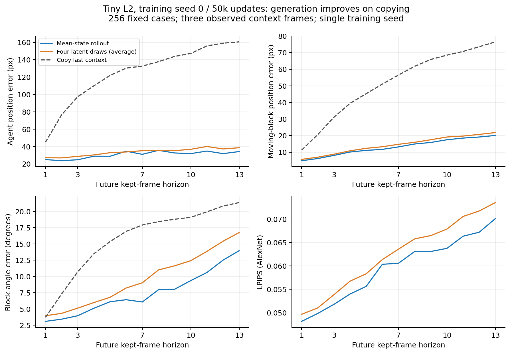
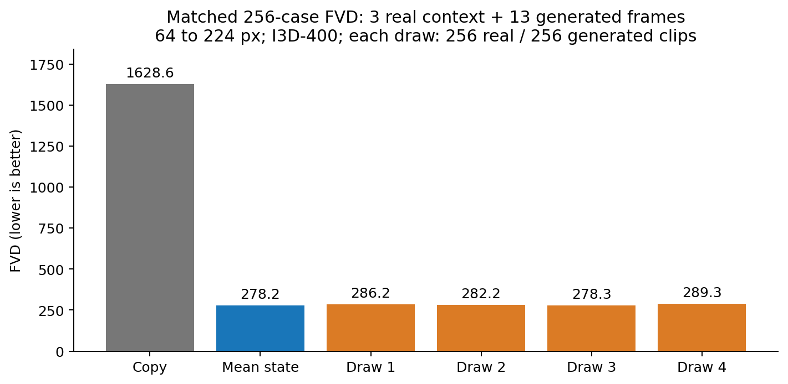
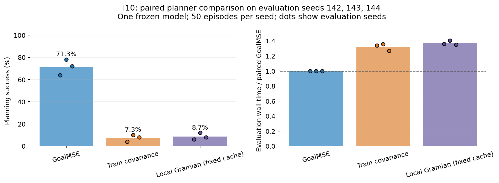
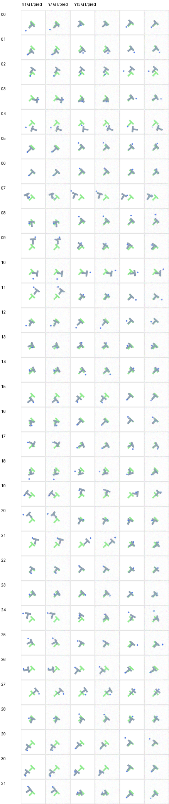

最新：[持续坍塌的早停证据与曲线](EARLY-STOP-TRIAGE.md)。关键 insight 优先，完整长预算方案未完成。

# 追加结果：生成指标与规划度量

原始全量实验和候选长跑仍在继续。这里仅报告已完成、可复核的额外结果；一个训练种子的三组评估seed不能作为三训练种子统计。

轻量L2 beta=.01 /50k /seed0的FVD为278.21，复制末帧为1628.62；四次latent采样FVD为286.18, 282.16, 278.33, 289.32。每个分数独立使用256real/256fake、16帧视频，其中3帧真实context加13帧预测，64→224双线性缩放、I3D400特征。这不是继承RGB16的FVD2048协议，也不能跨协议比绝对值。

h7 agent/copy=0.2339，moving-block/copy=0.2337；mean LPIPS=0.0606，SSIM=0.7990，角度误差=6.07°（copy=17.90°）。长horizon仍有明显误差增长。32例缩略图按固定顺序全部保留，不能当作正式人工gallery签收。

I10在同一个冻结模型上比较原GoalMSE、训练协方差距离与局部Gramian。每个eval seed的episode、start和solver RNG均配对，CEM预算相同。局部Gramian已修正缓存，按完整pixels和action-history确认context，并记录额外模型调用和准备耗时。

| 规划成本 | seed142 /143 /144成功率(%) | 均值(%) |
| --- | --- | --- |
| GoalMSE | 64 / 78 / 72 | 71.33 |
| Train covariance | 4 / 10 / 8 | 7.33 |
| Local Gramian (fixed cache) | 6 / 12 / 8 | 8.67 |

这个实现没有显示规划收益。坐标变换下的不变性仍有数学意义，但不是任务有效性的充分条件；训练协方差的条件数为2.41e+06，低方差方向被逆矩阵放大只是可能原因，尚未确认为因果解释。没有依据这批test结果继续调alpha。旧Gramian试验的像素矩缓存可能混淆平移后的context，已标记无效并完整保留在JSON，未纳入比较。

逐例、逐horizon及四个sample的全部质量数值另见
[quality-per-case-metrics.npz](quality-per-case-metrics.npz)和[quality-additional-per-case.npz](quality-additional-per-case.npz)。这些是小型数值结果，没有像素或权重。完整数值、每例规划成功/失败、case身份、计时、源版本、参数和证据哈希见[additional-results.json](additional-results.json)；图提供PNG及SVG。原始RGB数组、视频、训练日志和权重均在EFS，Git中不含这些大文件。生成结果仍须匹配其他模型和训练种子，完整方案的完成状态见[执行进度](../README.md)。

补充：[九个25k匹配终点的完整结果与probe/闭环图](BASELINES_25K.md)。

新窗口确认：[完整数值和horizon图](CONFIRMATION.md)。同一训练seed0，clip不与旧诊断窗口共享帧；跨训练种子评估继续。

主要复现：[L2 50k三训练种子及g0对照](L2-50K-STABILITY.md)。包含seed1动作/规划失败；正式gate未通过。

方法/机制结果：[I08语义记忆的同权重反馈对照](I08-SEMANTIC-FEEDBACK.md)。

方法/机制结果：[128维状态容量检查](STATE_CAPACITY.md)。
