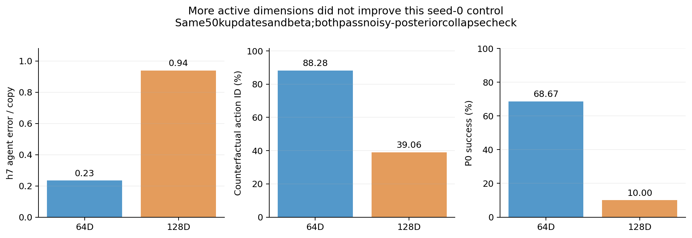

# 64→128维容量检查：该单种子对照退化

原成功seed0的64个state维度都active，因此按计划加倍token宽度到128维，同样训练50k。128维仍全部active，并通过含噪后验重建坍塌检测；但生成与控制退化：

| state维度 | h7 agent /moving-block误差比 | 动作识别 | P0均值 |
| --- | --- | --- | --- |
| 64 | 0.234 / 0.234 | 88.28% | 68.67% |
| 128 | 0.939 / 0.414 | 39.06% | 10.00% |

active_dims衡量的是本定义下每维支付的可变rate，不是有效任务信息。128维“活跃”与非空后验并未换来更强动作控制。这个对照不足以证明64维最优：加倍容量同时增加了总rate、模型参数和计算，只有一个训练种子，未做等rate比较。应把它作为“盲目加维度未解决当前问题”的负面证据。

[完整各horizon、逐维rate与规划记录](STATE_CAPACITY.json)。原始全数据10epoch cohort的选定配置还会按相同条件做自己的容量检查。
