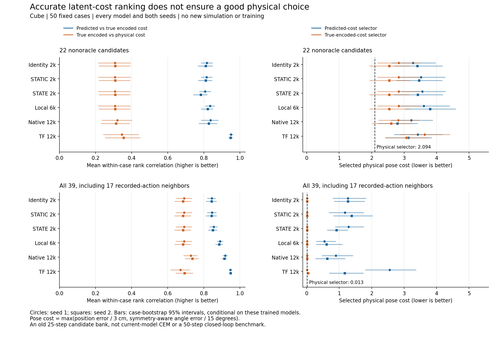

# Cube common-pool ranking: all twelve held models

The new scoring confirms two distinct limitations. Better factual STATE prediction does not consistently improve ordering among nonoracle actions. Separately, accurately predicting a model’s own latent goal cost does not ensure its true encoded metric selects physically successful outcomes. These are conditional diagnoses on one old executed candidate bank, not a causal explanation or a new planning score.

All cells are seed1/seed2. Fifty cases,22 nonoracle candidates/case. Physical-oracle endpoint pose cost is2.094 and its hold3 success40% for every model; any-candidate endpoint-pose coverage46% and hold coverage40%. Pose cost is max(position/3cm,symmetry-angle/15°).

|Model|Physical↔encoded rank|Encoded↔predicted rank|Encoded selector pose cost|Predicted selector pose cost|Encoded hold %|Predicted hold %|
|---|---:|---:|---:|---:|---:|---:|
|identity|0.308/0.309|0.817/0.811|2.832/2.540|3.270/3.410|18/24|20/16|
|static|0.308/0.309|0.816/0.811|2.832/2.540|3.519/3.456|18/24|16/16|
|state|0.308/0.309|0.807/0.783|2.832/2.540|3.557/3.417|18/24|16/24|
|local6000|0.308/0.309|0.835/0.821|2.832/2.540|3.607/3.798|18/24|20/14|
|native12000|0.321/0.313|0.837/0.827|2.822/2.600|3.218/2.792|22/24|20/20|
|tf12000|0.346/0.355|0.951/0.949|3.631/3.076|3.421/3.126|14/18|16/14|

All201 local encoder/projection/normalization tensors match within each seed, and the actual encoded selectors agree exactly across identity/STATIC/STATE2000 and local6000. Thus STATE has not changed the actual goal geometry. Nonoracle STATE−identity rank differences are−.0098 [−.0324,.0125] and−.0284 [−.0509,−.0063]. Its hold-success differences are−4 [−12,4]pp and+8 [2,16]pp. In particular seed2 has worse global rank but better selected hold success; it would be wrong to call STATE uniformly worse or claim rank loss explains its planning outcome. Its conditional mean selected physical-cost changes,+.286 [−.151,.787] and+.008 [−.364,.394], are inconclusive.

STATE’s lower factual MSE therefore does not transfer uniformly to the action-comparison distribution. The contrary evidence matters: in the17 recorded-action-neighborhood candidates, its encoded/predicted rank increases by+.0556 and+.0363 (both conditional CIs include0), while nonoracle rank declines. All39 combined ranks also increase slightly. The mixture can hide the nonoracle behavior; neither aggregate rank nor factual average MSE is a sufficient selected-action statistic.

TF12k strongly preserves its own nonoracle cost ordering (.951/.949), yet exact encoded-goal selection gives14/18% hold success versus the physical selector40%. Its metric regrets are1.537 [.875,2.280] and.982 [.528,1.544], while signed additional prediction-selection regrets are−.210 [−.743,.273] and+.051 [−.460,.594]. This supports a goal-metric limitation on this bank, with no established sign of additional mean physical regret from prediction in this group. It does not prove a training-objective cause or identify which latent factor caused it.

For local models both losses remain: the shared metric regrets are.739 [.364,1.207] and.446 [.230,.744], with additional signed prediction regrets varying across models. Native12k has nonoracle metric regrets.728/.506 and prediction regrets.396/.193; its20/20% selected hold does not establish broad superiority from this50-case library. Cross-family exposure and capacity differ; the eight local checkpoint states are1024-dimensional, native192 and TF64. No cross-family raw latent MSE is used.

|Model|Nonoracle selected distance cm|Selected angle °|Position≤3cm %|Angle≤15° %|Endpoint joint %|Hold3 %|
|---|---:|---:|---:|---:|---:|---:|
|identity|9.28/9.61|14.31/12.89|32/32|62/64|20/16|20/16|
|static|9.97/9.76|15.94/14.43|26/28|60/62|16/14|16/16|
|state|10.17/9.67|14.58/12.44|26/36|64/70|16/22|16/24|
|local6000|10.15/10.81|13.68/13.20|34/26|68/66|20/16|20/14|
|native12000|8.93/7.83|14.07/11.53|30/32|66/72|18/22|20/20|
|tf12000|9.58/8.78|12.96/10.79|34/36|70/78|22/26|16/14|

Hold success means the saved trajectory sustained the criterion at some point. Endpoint joint success is a different condition; either can exceed the other. Zero actions give18.06cm mean position error,7.77° angle,2% endpoint joint/hold success, and pose cost6.037. Their relatively good82% angle pass does not solve position.

|Model|Recorded-neighborhood selected hold %|All39 selected hold %|All39 predicted/encoded rank|All39 selected pose cost|
|---|---:|---:|---:|---:|
|identity|56/48|50/36|0.844/0.843|1.267/1.268|
|static|52/46|50/36|0.845/0.843|1.177/1.386|
|state|50/52|38/46|0.855/0.851|1.287/0.915|
|local6000|54/56|52/50|0.890/0.886|0.545/0.613|
|native12000|58/56|48/50|0.919/0.914|0.898/0.629|
|tf12000|54/46|26/26|0.947/0.948|2.556/1.169|

Adding the17 recorded-neighborhood candidates increases hold coverage to82%; physical and encoded selectors both have56% hold success, although the physical endpoint-pose oracle is nearly exact. The56% is not a success ceiling: endpoint pose minimization does not optimize hold. In this enriched bank, TF’s high overall rank still produces26/26% selected hold, versus raw native48/50% and local6000 52/50%. Native−TF all39 case-paired hold differences and CIs are preserved in review.json. This is not deployable imitation performance or evidence of new-model CEM coverage. TF also has excellent endpoint accuracy when restricted to recorded-neighborhood candidates (mean distance.59/.62cm), which must not be erased by the all39 failure.

Even normalized encoded-selection regret can conceal task-relevant errors: TF’s all39 regret is only.00333/.00296 of the within-case encoded cost range, but selected physical pose cost is2.556/1.169 versus physical oracle.0135. Relative-to-worst-candidate error and global rank do not control gaps at the relevant minimum. Signed dynamics regret may be negative because prediction errors can cancel metric errors.

Integrity: all12×50 model/case outputs complete with exit0 and unchanged complete parameters/buffers and RNG. Actual calls equal the frozen budget:12,300 RGB,1800 encoder forwards,3000 predict,600 action_encoder;0 renderer/simulator/training/fit. The six unique encoded banks retain owner/checkpoint/geometry/pool hashes, and all600 scored files retain39 individual costs, original commands and physical truth. Helper ea11036; original model sources32fad0c/d6d0a9f/7a1ab4f/8e0f821 remain separate. Raw native eval BatchNorm was preserved.

Actual first input was the saved dataset image, matching frozen World dataset-infos injection. Candidate reset images differ by at most16.58092 uint8 MSE; prior recorded replay discrepancy is at most3.07mm and duplicate qpos replay is exact. Raw commands were not clipped; Gaussian and old CEM families include values outside training[-1,1]. Native float32 scaler subtraction/division is explicit, rather than the old scorer’s float64 intermediate. These fixed outcomes describe one old environment realization, not repeat-averaged native evaluation. The bank lacks warm3+5, fresh cases, current-model CEM proposals and second-plan outcomes. No causal attribution or50-step closed-loop success claim follows. All bootstrap intervals resample50 cases, never39 candidates, and are conditional on fixed trained seeds.

All12 owned slots were verified empty and exact dispatchers/monitors closed; the root is held. Full data: B/reports/cube-pool-reuse2000-20261031/results.json and B/runs/cube_pool_reuse2000_20261031. Small summary/review preserve all models, all groups and paired intervals. No additional experiments are launched.

The figure retains both seeds and separates the22 nonoracle candidates from all39 with recorded-action neighbors. Horizontal intervals resample cases conditional on fixed models. The dashed line is the physical endpoint-cost selector, not a hold-success ceiling. The identical local encoded selectors and the high-rank/poor-minimum TF counterexample are both visible; neither is a closed-loop claim. The PDF and exact input/script hashes are in the same figure directory.
