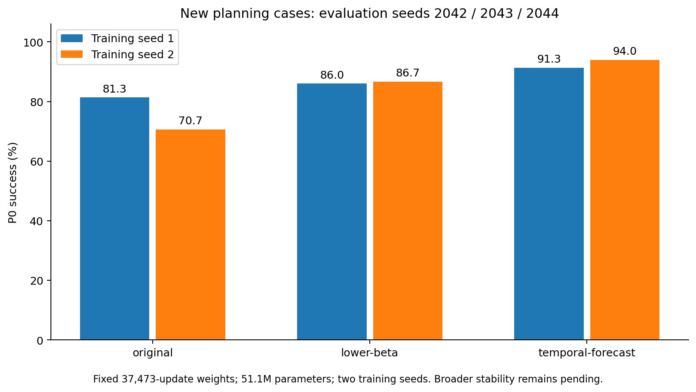

# Third-epoch planning on additional case seeds

| Method | Training seed | P0% | Excluding exact prior queries% | Prior query overlap |
| --- | ---: | ---: | ---: | ---: |
| original | 1 | 81.33 | 81.33 | 0 |
| original | 2 | 70.67 | 70.67 | 0 |
| lower-beta | 1 | 86.00 | 86.00 | 0 |
| lower-beta | 2 | 86.67 | 86.67 | 0 |
| temporal-forecast | 1 | 91.33 | 91.33 | 0 |
| temporal-forecast | 2 | 94.00 | 94.00 | 0 |

Fixedweightconfirmation,notnewtrainingseedstability.Completenumbers,conditionalpairedintervalsandqueryidentitiesinJSON/NPZ.
