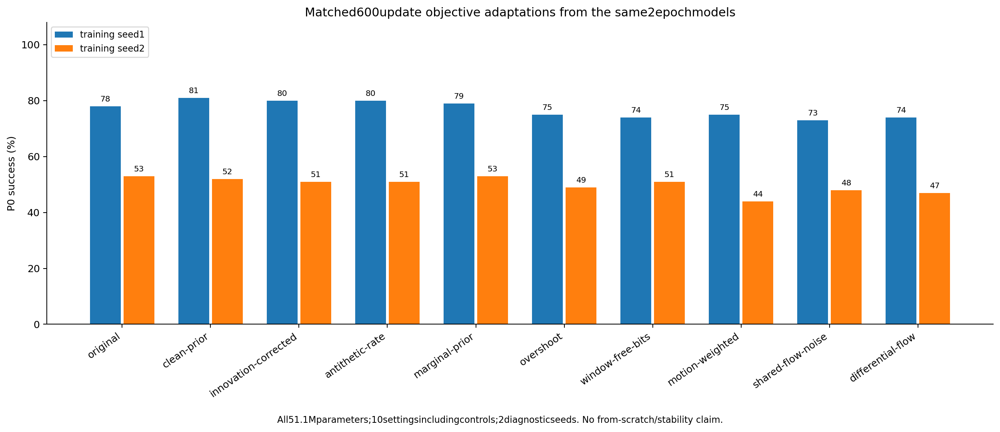

# Sample-level目标：600更新配对适应筛选

全部方法从同一训练种子对应的原算法2epoch完整状态出发，只适应600更新。模型参数固定51,097,134，batch128，beta=.25，sigma=.1，学习率日程124910步。

这不是从头训练稳定性，也不是划时代或新颖性的证明。包含原算法续训及必要对照，未修正多重比较；后续胜者必须独立确认。

| 方法 | 训练种子 | P0均值 % | 相对原算法续训百分点 | h7 agent/copy ↓ | h7 moving block/copy ↓ | 动作识别 % | 训练秒数 |
| --- | ---: | ---: | ---: | ---: | ---: | ---: | ---: |
| original | 1 | 78.0 | +0.0 | 0.178 | 0.259 | 81.25 | 688.5 |
| original | 2 | 53.0 | +0.0 | 0.294 | 0.354 | 87.50 | 681.9 |
| clean-prior | 1 | 81.0 | +3.0 | 0.179 | 0.203 | 81.25 | 665.9 |
| clean-prior | 2 | 52.0 | -1.0 | 0.298 | 0.300 | 89.06 | 647.9 |
| innovation-corrected | 1 | 80.0 | +2.0 | 0.176 | 0.233 | 82.81 | 673.5 |
| innovation-corrected | 2 | 51.0 | -2.0 | 0.266 | 0.331 | 85.94 | 657.3 |
| antithetic-rate | 1 | 80.0 | +2.0 | 0.192 | 0.218 | 81.25 | 675.1 |
| antithetic-rate | 2 | 51.0 | -2.0 | 0.312 | 0.354 | 85.94 | 668.0 |
| marginal-prior | 1 | 79.0 | +1.0 | 0.203 | 0.237 | 79.69 | 652.0 |
| marginal-prior | 2 | 53.0 | +0.0 | 0.279 | 0.357 | 87.50 | 669.3 |
| overshoot | 1 | 75.0 | -3.0 | 0.157 | 0.278 | 84.38 | 732.3 |
| overshoot | 2 | 49.0 | -4.0 | 0.322 | 0.304 | 82.81 | 707.8 |
| window-free-bits | 1 | 74.0 | -4.0 | 0.173 | 0.255 | 81.25 | 627.7 |
| window-free-bits | 2 | 51.0 | -2.0 | 0.296 | 0.362 | 87.50 | 656.7 |
| motion-weighted | 1 | 75.0 | -3.0 | 0.210 | 0.384 | 82.81 | 640.5 |
| motion-weighted | 2 | 44.0 | -9.0 | 0.258 | 0.349 | 84.38 | 654.6 |
| shared-flow-noise | 1 | 73.0 | -5.0 | 0.191 | 0.172 | 82.81 | 651.0 |
| shared-flow-noise | 2 | 48.0 | -5.0 | 0.326 | 0.224 | 84.38 | 634.9 |
| differential-flow | 1 | 74.0 | -4.0 | 0.209 | 0.169 | 82.81 | 614.6 |
| differential-flow | 2 | 47.0 | -6.0 | 0.300 | 0.257 | 84.38 | 644.5 |

[完整逐例结果、配对episodebootstrap、检查点身份与成本](frontier-short-results.json)、[生成逐例数值](frontier-short-per-case.npz)。

所有新运行均已停在600更新上限。根据两种子的规划/生成/动作结果及成本作继续决定，不自动延长整组。
