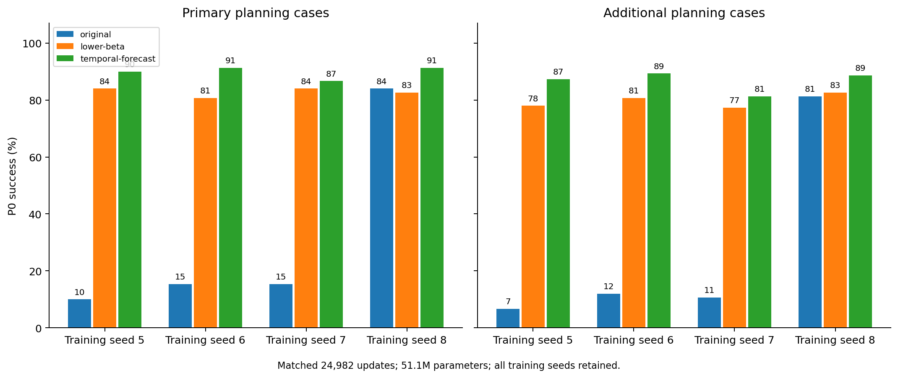

# Two-epoch replication

| Method | Training seed | PrimaryP0% | AdditionalP0% | h7agent/copy | h7movingblock/copy |
| --- | ---: | ---: | ---: | ---: | ---: |
| original | 5 | 10.00 | 6.67 | 0.743 | 0.433 |
| original | 6 | 15.33 | 12.00 | 0.788 | 0.452 |
| original | 7 | 15.33 | 10.67 | 0.558 | 0.317 |
| original | 8 | 84.00 | 81.33 | 0.128 | 0.248 |
| lower-beta | 5 | 84.00 | 78.00 | 0.130 | 0.160 |
| lower-beta | 6 | 80.67 | 80.67 | 0.128 | 0.238 |
| lower-beta | 7 | 84.00 | 77.33 | 0.104 | 0.210 |
| lower-beta | 8 | 82.67 | 82.67 | 0.113 | 0.192 |
| temporal-forecast | 5 | 90.00 | 87.33 | 0.124 | 0.223 |
| temporal-forecast | 6 | 91.33 | 89.33 | 0.114 | 0.232 |
| temporal-forecast | 7 | 86.67 | 81.33 | 0.142 | 0.280 |
| temporal-forecast | 8 | 91.33 | 88.67 | 0.114 | 0.228 |

Allnumericalendpointsandconditionalpairedintervals:replication-results.jsonandreplication-per-case.npz. Nooutlierremoval;notafinalthird-epochclaim.
