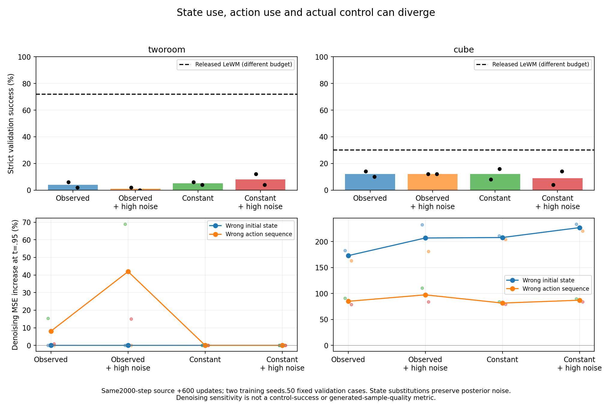

# Clean visual information versus corruption

All48 endpoints exit0. All branches start from the same ordinary-noise temporal-forecast2000 full checkpoint within task/seed, then receive exactly600 updates. All16 full-state audits pass.

| Task | Method | Seed1% | Seed2% |
|---|---|---:|---:|
| tworoom | observed-base | 6.0 | 2.0 |
| tworoom | observed-highnoise | 2.0 | 0.0 |
| tworoom | constant-base | 6.0 | 4.0 |
| tworoom | constant-highnoise | 12.0 | 4.0 |
| cube | observed-base | 14.0 | 10.0 |
| cube | observed-highnoise | 12.0 | 12.0 |
| cube | constant-base | 8.0 | 16.0 |
| cube | constant-highnoise | 4.0 | 14.0 |

TwoRoom: retaining clean anchor access produces action-sensitive denoising while the encoded initial-state intervention remains negligible. Removing that access suppresses the action effect without recovering useful state encoding or strong control in this short adaptation. This rules out treating a noise shift or anchor cut as an already validated cure; it does not settle a fresh no-anchor model's eventual performance.

Cube: state/action interventions materially worsen denoising, yet all four control rates stay9–12% on average. Strong denoising state use is therefore insufficient to establish good latent-goal planning.

Code inspection identifies a further mismatch: the rate constrains a teacher-forced one-step prior, whereas the rendering objective also trains free-running forecasts. The next minimal test replaces only the rate prior with that same causal forecast, preserving loss weights and parameters. This is related to known multistep latent consistency/overshooting and is not an established novelty claim.

