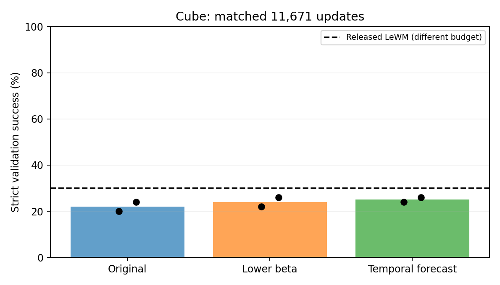

# Cube: first window epoch

All 18 training, health and planning endpoints exit 0 and stop at 11,671 updates. Both seeds and every method are retained. These are validation results, not a final test claim.

| Method | Seed 1 % | Seed 2 % | Mean % |
|---|---:|---:|---:|
| original | 20.0 | 24.0 | 22.0 |
| lower-beta | 22.0 | 26.0 | 24.0 |
| temporal-forecast | 24.0 | 26.0 | 25.0 |

Original and lower-beta resume their exact 2000-step full checkpoints. Temporal-forecast reuses its unchanged ordinary 2600-step continuation. Total update counts, data, planner and cases match at this endpoint; parameter count matches within Cube. Update matching does not imply identical FLOPs.

The cap covers 1,493,888 of 1,494,000 natural windows at batch 128. LR horizon remains 124,910. No second epoch or candidate grid is automatically authorized. Released LeWM scored 30% and random 2% on these cases, with different model/training/data-exposure conditions.

## Review decision

Temporal-forecast improves from9% at2000 updates to25%; original improves9% to22%, and lower-beta6% to24%. More learning helps all three. The final advantage is only+3 percentage points over original and+1 over lower-beta on average. With two training seeds and50 fixed validation cases, this is not evidence of the requested substantial gain, nor proof of equivalence. All six remain held at11671; no automatic second epoch. Test cases remain untouched.

Per-seed paired gains/losses and the review decision are preserved in review-decision.json. All19 workflow endpoints, including aggregation, exit0; all six complete-state and gradient audits pass.
