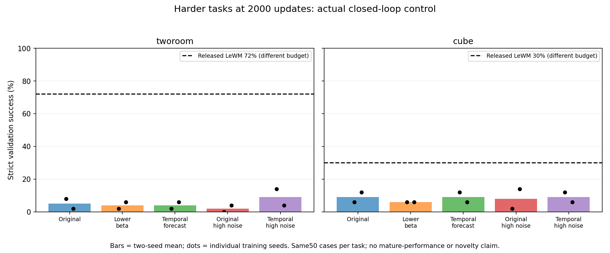

# Harder-task first learning screen

All60 endpoints exit0. Each method uses the same2000 updates, both training seeds, and the same50 validation episodes per task. Test episodes remain held out.

| Task | Method | Seed1% | Seed2% |
|---|---|---:|---:|
| tworoom | original | 8.0 | 2.0 |
| tworoom | lower-beta | 2.0 | 6.0 |
| tworoom | temporal-forecast | 2.0 | 6.0 |
| tworoom | original-highnoise | 0.0 | 4.0 |
| tworoom | temporal-forecast-highnoise | 14.0 | 4.0 |
| cube | original | 6.0 | 12.0 |
| cube | lower-beta | 6.0 | 6.0 |
| cube | temporal-forecast | 12.0 | 6.0 |
| cube | original-highnoise | 2.0 | 14.0 |
| cube | temporal-forecast-highnoise | 12.0 | 6.0 |

Released-reference scores on these same cases: TwoRoom72%, Cube30%; random0%/2%. Released weights are not training-budget/model-size/data-exposure matched controls.

TwoRoom remains nearly state-independent at2000 despite denoising improvement; a larger timestep shift alone has not solved it. Cube learns appreciable state/action dependence, but that must be distinguished from task success. The next causal check changes only clean anchor availability and the same global noise shift, with identical2000-step temporal-forecast source state per task/seed and only600 further updates. All existing snapshots remain held.

