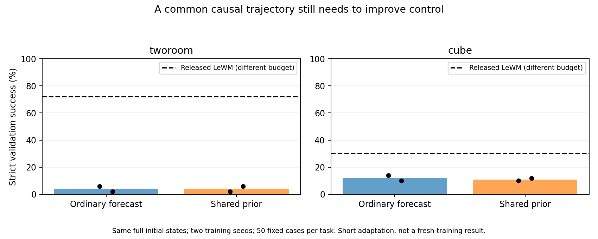

# Sharing the causal prior between rate and DiT

All 12 new endpoints exit 0. Four full-state and gradient audits pass. Each candidate starts from the exact full checkpoint used by its completed ordinary temporal-forecast control and receives 600 updates, ending at 2600. Default-loss, gradient and RNG equivalence is separately recorded.

| Task | Method | Seed 1 success % | Seed 2 success % |
|---|---|---:|---:|
| tworoom | temporal-forecast | 6.0 | 2.0 |
| tworoom | shared-forecast-prior | 2.0 | 6.0 |
| cube | temporal-forecast | 14.0 | 10.0 |
| cube | shared-forecast-prior | 10.0 | 12.0 |

| Task | Method | Seed | State substitution MSE increase % | Action substitution MSE increase % | Encoder std |
|---|---|---:|---:|---:|---:|
| tworoom | temporal-forecast | 1 | -0.0008 | 15.35 | 0.000126 |
| tworoom | shared-forecast-prior | 1 | 0.0001 | -0.11 | 0.000129 |
| tworoom | temporal-forecast | 2 | -0.0006 | 0.86 | 0.000172 |
| tworoom | shared-forecast-prior | 2 | -0.0001 | 0.00 | 0.000179 |
| cube | temporal-forecast | 1 | 182.6235 | 90.88 | 0.295695 |
| cube | shared-forecast-prior | 1 | 175.6311 | 87.39 | 0.270890 |
| cube | temporal-forecast | 2 | 162.9607 | 78.84 | 0.274438 |
| cube | shared-forecast-prior | 2 | 164.8870 | 81.42 | 0.250702 |

Substitutions use identical posterior and rendering noise at corruption t=.95. These are denoising sensitivity measurements, not generated-sample quality or control success. Released LeWM differs in training budget, model size and possible evaluation-data exposure. Only paired internal controls support method comparisons.

The objective shares a free-running forecast between rendering and rate with no new head, coefficient or parameter. It is related to latent overshooting and multistep consistency; this experiment does not establish academic novelty.

Decision: hold all shared-prior adaptations. TwoRoom changes -4/+4 percentage points and Cube -4/+2 points versus exact controls do not justify candidate promotion. TwoRoom encoded-state dependence remains negligible. Continue only the established Cube original/lower-beta/temporal-forecast comparison to a first window epoch to distinguish undertraining from method effectiveness.
