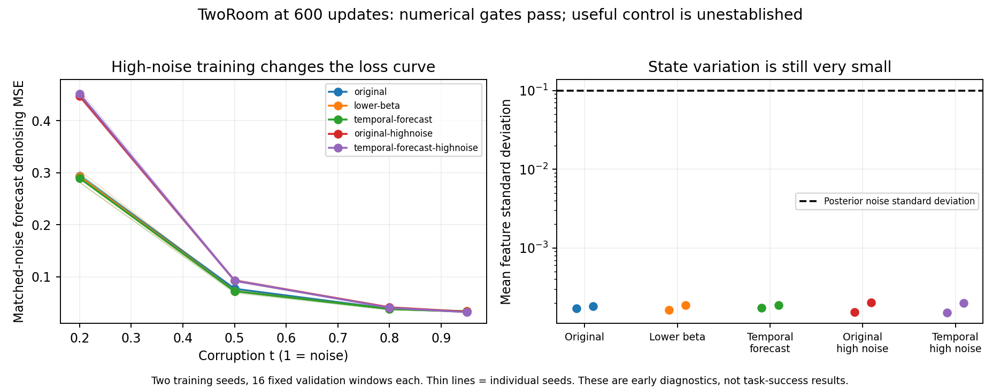

# TwoRoom 600-update review

All10 training endpoints and10 full-state/gradient checks exit0. All550 initial tensors match the original within each training seed. Model/optimizer/scheduler values are finite, sample cursors and RNG are retained, and portable weights exactly match full checkpoints.

Functional evidence remains weak: validation feature standard deviation is0.000152–0.000203 against posterior noise0.1; correct-versus-wrong-action denoising differences are below1.2e-6 relative. Removing the state entirely can change denoising, but this may remove a learned constant bias and does not establish state information use. The next diagnostic adds different-video state conditions while preserving identical posterior-noise draws.

High-noise training does not yet demonstrate a task advantage. The learning-rate warmup ends at1249 updates, so600 updates neither prove persistent collapse nor justify a large performance claim. Preserve all five arms and both seeds; a bounded continuation only to2000 with fixed50-case strict validation and stronger state-use checks is appropriate after the Cube execution/short-state review. No automatic10,000-update or multiepoch run.

