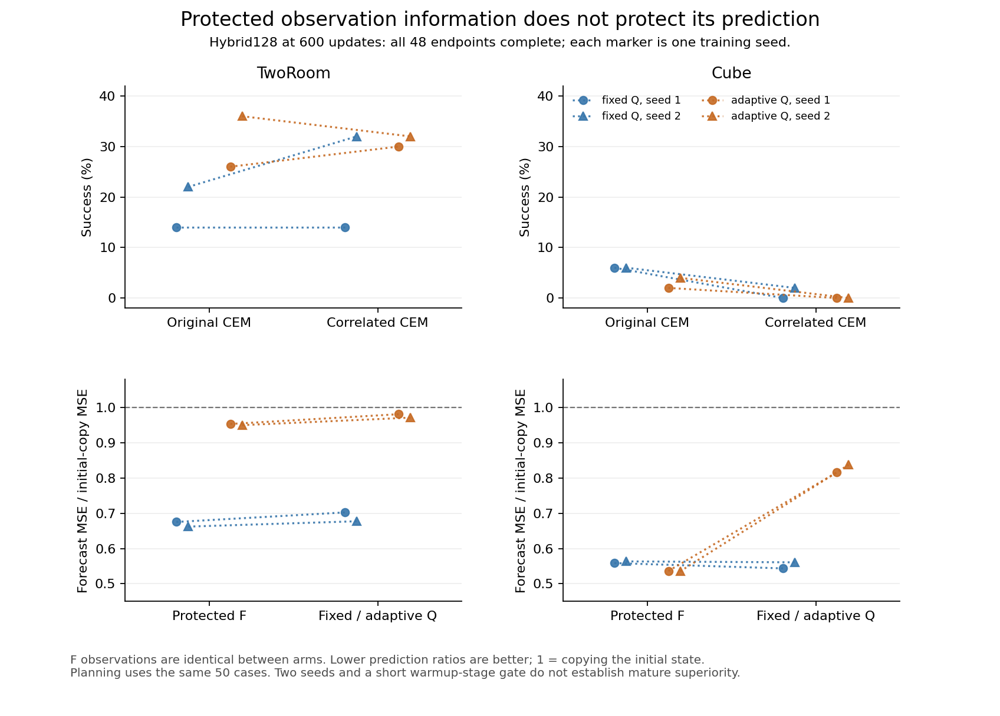

# Hybrid128: complete600-update paired review

**Adaptive Q improves TwoRoom planning relative to fixed Q at this budget, but does not produce a stronger cross-task world model.** Cube planning remains weak; TwoRoom's improvement accompanies substantially worse prediction in the exactly shared F coordinates. All48 endpoints exited0. All eight native model/AdamW/scheduler restoration checks passed, including saved CPU RNG and cursor76800; CUDA RNG records were verified without a GPU call. Every555 initial tensor matches the paired arm and reviewed preflight. FixedQ9 remain initial-exact, gradient-absent and without AdamW state; adaptiveQ9 have finite gradients/states and positive group norm. All other native fullstate/health checks passed. Exact owned workers/monitors are closed and this stage is held.

Values retain seeds1/2; planning uses the same strict50 cases under both controllers.

| Task | Arm | Original CEM success% | Common f4 success% | Clean rollout / initial-copy MSE | One-step / shifted-copy MSE |
|---|---|---|---|---|---|
| TwoRoom | fixed Q | 14 /22 | 14 /32 | .691 /.671 | .789 /.780 |
| TwoRoom | adaptive Q | 26 /36 | 30 /32 | .965 /.958 | .991 /.991 |
| Cube | fixed Q | 6 /6 | 0 /2 | .550 /.562 | .734 /.740 |
| Cube | adaptive Q | 2 /4 | 0 /0 | .575 /.577 | .780 /.780 |

Adaptive−fixed paired mean differences and shared-case bootstrap95% intervals are TwoRoom original+13pp[3,23], f4+8[−5,20]; Cube original−3[−7,1], f4−1[−3,0]. These intervals condition on the two trained seeds, jointly resample common cases, and do not estimate seed-population uncertainty or correct exploratory selection. Both controllers and every seed remain in `summary.json`, including all per-case differences and within-checkpoint controller comparisons.

| Task | Arm | Q mean RMS | Q centered RMS | Q total RMS | F rollout / copy | Q rollout / copy |
|---|---|---|---|---|---|---|
| TwoRoom | fixed Q | .331 /.338 | 1.038 /1.027 | 1.090 /1.081 | .675 /.662 | .702 /.677 |
| TwoRoom | adaptive Q | 3.977 /3.814 | .734 /.726 | 4.045 /3.883 | .953 /.950 | .981 /.971 |
| Cube | fixed Q | .135 /.142 | 1.040 /1.064 | 1.048 /1.074 | .559 /.564 | .544 /.561 |
| Cube | adaptive Q | .599 /.435 | .376 /.358 | .707 /.563 | .536 /.535 | .816 /.837 |

All four paired F observation arrays are **elementwise identical** on the existing64-window cohort. Thus adaptiveQ makes TwoRoom prediction in common F coordinates about41/43% worse, while Cube F prediction improves about4/5%. Total absolute latent MSE is not directly comparable after Q changes scale: Cube's apparent halving includes a large Q contraction. The Q mean offsets are not centered information; a common constant offset alone cancels in pairwise goal distances, so these observations do not identify the cause of the planning gain. No physical-label probe was fitted.

TwoRoom adaptive forecasting uses actions very weakly: other-episode-action/clean MSE ratios are approximately1+3×10⁻⁶ in F and1+3×10⁻⁷ in Q. Cube F ratios are1.64/1.71 and Q ratios1.099/1.110, retaining real action-dependent prediction. DiT remains weakly conditional across this screen: at t=.95 all wrong-action/correct-forecast error ratios lie between approximately1.0000 and1.0019. Zero-state changes alone cannot distinguish useful conditioning from offset sensitivity; all state, action, carry, zero and posterior permutations are preserved in the report.

The optimization issue persists beyond the initial spike. Logged adaptiveQ raw-gradient peaks are TwoRoom192 atstep500 /8025.62 atstep200, and Cube5.39 atstep600 /15.72 atstep200; at600 they are121.60/55.69 and5.39/2.14 respectively. Original clipping1, LR and calibration were unchanged. A dominant Q gradient necessarily reduces the common clipped gradient scale on that step, but these100-step samples do not measure every update, and AdamW parameter changes are not proportional to raw clipping factors. Protected observation information does not by itself protect its downstream optimization.

This600 stage is still inside1249 warmup. All runs' flow and rate objectives continue decreasing between300 and600; numerical health and continued loss reduction do not establish eventual task gains or saturation. Historical64-D identity Carrier600 had TwoRoom44/30%, Cube4/6%, with rollout/copy.581/.585 and.528/.518. Historical TF600 scalars were6/8% and14/10%; their original primary per-case artifacts were not located, so they are context only and excluded from paired inference. The128-D model, effective trainable capacity, frozen-vs-learning encoder and globalRMS-vs-historical diagonal normalization differ. These are contextual references, not matched architectural controls.

Both hybrid arms instantiate the same51.188M TwoRoom /51.196M Cube parameters and initial functions. AdaptiveQ has152,464 additional effective learning parameters; fixedQ's nominal requires_grad count includes its stop-gradient parameters and must not be called matched active capacity. Peak memory106.05–106.64GiB. Existing50-case evaluation times are44–49s TwoRoom and86–90.4s Cube, including setup and variable executed horizons; no timing assay was added. Frozen sources: model `f2ae93d4`, gate helper `109e69a6`, controller `f4fd69a5`. Full CPU evidence is `/efs/prescottsun/SPT-JEPA/reports/hybrid-carrier600-20261031/summary.json`. No model forward, new cohort, fit, or update was used for collection; no continuation is authorized by this report.

[PDF figure](figure/hybrid600.pdf); plotting uses only the completed summary and checks percent units against every per-case success vector.
