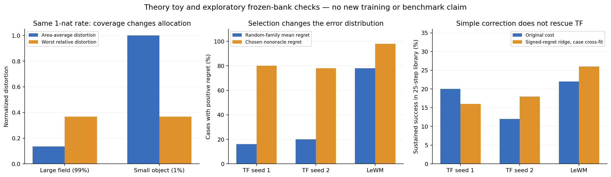

# Cube / TwoRoom：四个独立设计及淘汰记录

2026-10-30。先写 [设计原稿](DESIGN_FIRST.md)，再检索原始论文。下面保留三项可操作、可证伪的研究假说，以及一项应淘汰的抽象。**这不等于已经得到三个新颖算法，更不等于有任何超过 TF/LeWM 的结果。** D1 最直接针对两任务的表示问题；D2 的公开近邻密集；D3 的简单版本已出现阴性结果；D4 有结构性反例。

所有学习目标均逐轨迹/逐样本定义，可在一个样本内部比较查询或时间切点，不需要跨 batch 的负例、方差或协方差。输入是图像、已执行动作及其后果；没有“下一个最优动作”标签。诊断中的物理坐标不进入任何候选训练。未启动 GPU，未改主代码或冻结实验。

## 共同出发点：哪一层失败，哪一层才应改变

TwoRoom 的固定 64 维空间读出在 2000 步有 agent xy R² 约 .89–.96，QueryPool 只有约 .11–.29；局部分区600步把规划从6/8%提高至12/16%，但尚未形成强模型。这要求研究压缩前后究竟保留了什么，不能先把规划器改得更复杂。

Cube TF 的预测/真实编码代价排序为 .948/.951，物块预测坐标 R² 为 .816/.772，机械臂末端则 .977/.976。实际目标距离控制物块位姿后仍高度跟随机械臂（partial rank .928/.935）。删去一个 effector 线性读出子空间并未消除 effector 信息，也未改善非 oracle 规划；因此“减去机械臂方向”不是一个成立的方法。

两任务还共享一个限制：单张目标图不提供“只要求物体、允许手不同”的完整语义。任何无语义标签方案最多能提出可检验的归纳偏置，不能宣称普遍识别任务无关因素。以下方法都不偷偷使用物块 mask、坐标或成功函数来学习目标度量。

## D1：对可预测观测查询作覆盖约束

### 机制与可学习目标

当前均方失真按图像面积和特征幅度分配预算。D1 改变的是**哪些可预测区别允许被压缩掉**，不是再给一种 noise schedule。

令 q 是固定的多尺度空间地址及有界图像函数，例如矩形内 RGB/Haar 响应；查询族对两个任务相同，无物体类别。目标为真实未来相对起始图的查询变化 y_q。b_q 仅使用允许的旁路/静态复制信息；t_q 使用完整的过去图像及实际动作；d_q 只能使用被压缩的状态和动作。t_q 是独立校准后冻结的教师，没有额外观测、动作最优性或物理标签。其参数/预训练和调用开销必须计入预算，基线获得相同数据与计算。

训练段估计可解释增益 A_q=R_q(b)-R_q(t)，只保留估计稳定且 A_q>0 的查询；它不是根据验证成功率选出来的。设计的总体约束是

\[
\min I(X;Z),\qquad R_q(d)-R_q(t)\le\epsilon A_q,\quad\forall q\in\mathcal Q.
\]

可实现的逐样本保守代理为

\[
\ell_{\rm query}(\tau)=\max_{q\in\mathcal Q}
\frac{\ell_q(d_q,y_q)-\operatorname{sg}\ell_q(t_q,y_q)}{\operatorname{sg}A_q},
\qquad L=\beta R(Z)+\mathbb E_\tau\ell_{\rm query}.
\]

A_q 是训练段冻结统计，不能在 minibatch 内重新定义；教师不接受这个 max 的梯度。由于 E[max]≥max E，这个代理比总体最坏查询约束保守，并不假装是无偏的总体 minimax 估计。单样本偶然噪声可能支配 max，必须测量；若如此应否定当前代理，而不是不断调截断阈值掩盖失败。

同一查询族可以提供部署代价

\[
C_Q(\hat z,g)=\max_q\frac{|h_q(\hat z)-\phi_q(g)|^2}{A_q},
\]

其中 h_q 用真实观测样本训练读取状态。先以原 GoalMSE 单独检验表示，再单独检验 C_Q，不能把两项同时改变后的收益全部归于编码器。C_Q 仍要求匹配目标图中的所有保留因素；它没有自动发现“手可不同”。

### 精确性质与已跑 CPU 反例

若约束成立，对于查询族内的任务量 q，其 MSE≤教师风险+εA_q。这是约束的直接推论，不是新定理。若查询响应整体作 aφ+b，平方损失与 A_q 同乘 a²，目标和约束不变；这避免逐查询单位改变决定资源分配，仍不等于任意 nonlinear latent 重参数化不变。

CPU toy 用两个独立单位方差 Gaussian 因素，面积权重 .99/.01，总码率1 nat，失真 D_i=exp(−2R_i)。面积平均失真最优分配为 R=(1,0)，小因素失真为1；最坏相对失真最优分配为(.5,.5)，两者失真均为 .3679。**在完全相同码率下，平均重建确实可以理性地丢掉一个小因素。** 若容量不够满足所有查询约束，该问题会不可行；D1 不能凭空制造容量。

### 两任务的判别实验与停止条件

TwoRoom 先看小 agent 的查询增益是否为正，以及训练后的 query coverage、干净/噪声位置读出、实际动作响应是否共同恢复。Cube 看 block 位置/方向的冻结诊断读出与非 oracle 动作排序，不以更高 effector R² 当作成功。只做600步门控；一个总体 ε/β 协议跨任务固定，教师计算、空间查询数、训练样本曝光匹配。

最有用对照是：相同查询头的平均相对失真、最坏原始失真、D1 最坏相对失真。它们区分“只是额外头/局部监督”“只是 hard example mining”和“相对覆盖”的作用。教师不能预测小对象、max 长期追随机像素、coverage 提升却实际规划不变，均是直接否定证据。D1 的教师开销和统计校准是现实代价；目前不能称它已达到理想的 self-contained 简洁性。

### 最接近的三项公开先例及差异

- [Predictive Representations of State](https://proceedings.neurips.cc/paper/2001/file/1e4d36177d71bbb3558e43af9577d70e-Paper.pdf)：状态通过动作条件未来测试定义的思想早已存在。D1 不把“状态回答查询”称为新意；可检验新增部分是受限视觉码率下、相对完整输入教师的最坏查询覆盖约束及对应规划接口。
- [Group DRO — Sagawa et al.](https://arxiv.org/abs/1911.08731)：最坏群体风险及其泛化问题已有成熟工作。D1 的群体不是数据人群，而是同一轨迹内部可预测观测查询；这仍是 DRO 的应用结构，只有证明查询覆盖带来当前瓶颈下的实质收益才有方法贡献。
- [Minimax Learning for Distributed Inference](https://www-isl.stanford.edu/~abbas/papers/Minimax%20Learning%20for%20Distributed%20Inference.pdf)：minimax 风险与通信预算的联系已有理论。D1 的保证不能包装为首次 rate/minimax 联合；候选差异在相对可解释增益、单样本查询代理及视觉 world-model 接口。

相对旧 I07：I07 用预测方差构造异方差平均回归，D1 对每个可预测查询约束相对损失，二者优化解在上述两因素例子中可以不同。新颖性风险**中等**，不是“三篇先例没有相同标题”就证明新颖。

## D2：用给定动作后缀的前驱支持检查整条路径

### 机制与可学习目标

CEM 不只要找到一个低终点代价，还应解释中途状态如何在**原候选动作后缀**下到达目标。训练一个条件分布

\[
B_\psi(z_k\mid z_H,a_{k:H},H-k)
\]

预测真实轨迹中可能的前驱状态。训练随机选择 k，使用 conditional flow matching/正确的条件密度损失；仍保留原始前向/观测 grounding。**设计原稿里“max 多切点 proper loss”的说法需要修正：多个 proper loss 的样本内 max 不保证整体仍 proper。最终训练用随机切点的平均 proper loss，max 仅用于规划的拒绝证书。**

对于 A，前向得到 f_k；从目标 z_g 和同一后缀 A_k:H 采样 M 个前驱 b_k^m，定义

\[
s_k(A)=\min_m\|f_k-b_k^m\|^2,
\qquad V(A)=\max_k s_k(A)/q_k.
\]

q_k 是训练内独立校准轨迹的覆盖阈值；M、切点集合、总模型调用数固定。部署可先把 V>1 的候选标为不被证书支持，再在支持候选中使用原目标代价。没有支持候选时记录 abstention 并回到原 planner，不能把失败删出分母。

这里 backward 是“给定已执行/候选动作，哪些过去可能产生这个后果”，**不是预测下一最优动作，也不是学习一个把物理过程倒放的动作策略**。接触和耗散必须允许多个前驱。

### 精确性质与关键反例

对确定性真动力学 F、真起点前缀状态 f_k，定义精确前驱集合

\[
\mathcal B_{A_{k:H}}(g)=\{s:F(s,A_{k:H})=g\}.
\]

那么 F(x,A)=g 当且仅当 f_k∈B 对任意一个切点成立。该陈述只是函数复合的直接性质。学习版能抓到错误的条件是：至少一个检查器在相关路径上可靠，而不是“前向和反向一致，所以物理必真”。共同错误可以通过所有 cut。

CPU toy：F(s)=s²、目标1，真实前驱为{−1,+1}。平均逆模型输出0，正向结果0，不是目标。故点式 backward MSE 最优解可以恰好不在任何可行前驱上；必须用集合/多模态支持。另一个致命反例是前向学错为 \~F(s,a)=s+2a、反向恰好为 s−2a：round trip 完美而真实 F=s+a 错误。证书本身不能取代观测校准。

行为策略还会改变 backward 分布。实际训练得到

\[
p_D(s\mid g,A)\propto\rho_D(s)\,\beta_D(A\mid s)\,P(g\mid s,A).
\]

因此低 backward density 既可能是不可能，也可能只是少见。不能把它自动当成真实转移似然；正例覆盖与稀有可行路径的拒绝率是必查项。在 iid 校准轨迹上对各 cut 使用 α/H 可给普通真实路径的联合覆盖，但不自动覆盖 CEM 自适应选择与分布迁移。

### 两任务的判别实验与停止条件

TwoRoom 仅在表示已恢复时检查穿墙/门口候选；不能用D2给近常量 state 打补丁。Cube 分开统计未接触、接触、释放的诊断类别，观察 false-positive endpoint 是否被某个 suffix 支持证书拒绝，并检查合法抓取的多值前驱是否被误拒绝。物理类别只供分析。

最小门控先冻结前向模型，只训练 backward 头600步，比较相同总网络调用预算下：原CEM、普通 forward ensemble、起点 round-trip、D2目标锚定 suffix support。若只是网络数量翻倍才赢，或 inverse support 被占据概率支配，或不优于公开 consistency 方法，则不进入新方法候选。精确 cut 性质不能证明它会赢 LeWM。

### 最接近的三项公开先例及差异

- [CCWM / Learning State Representations via Retracing](https://arxiv.org/abs/2111.12600)：已用 retracing/cycle consistency 学状态，并处理不可逆转移。D2 必须保留多值前驱，而非跳过不可逆段或训练回到起点的点逆。
- [Round-Trip Consistency](https://arxiv.org/abs/2608.00675)：已有双向 diffusion 自测 rollout error。D2 使用外部给定的目标而非自身预测终点，且在多个 suffix 检查前驱支持；普通往返误差不能被算作我们的贡献。
- [ACID](https://arxiv.org/abs/2607.02403)：直接在世界模型规划中用逆动作一致性检查中间可实现性。D2 不要求由两个状态唯一识别动作，而是给定整段原动作查询多值前驱。任务上与D2极接近，必须作为直接机制对照。

相对旧 I09：没有 fork 动作识别项，没有多动作标签分类；它约束候选路径的目标条件支持。相对 I10：不是 Jacobian/Gramian 度量。新颖性风险**高**；若只有“换成 backward state 再加 residual”，不够成为独立原创方向。需要证明多值、goal anchor、多 cut 的组合能通过公开方法不能通过的反例和实验。

## D3：学习目标方向上的有符号遗憾，校准整个选择规则

### 机制与可学习目标

冻结目标编码器的一个阶段内，对普通交互得到 z、预测 \hat z 及目标图编码 g，令 δ=z−\hat z。平方目标代价的误差严格为

\[
r=\|z-g\|^2-\|\hat z-g\|^2
=2(\hat z-g)^\top\delta+\|\delta\|^2.
\]

单位平均 MSE 时全部除以 latent 维数。学习一个 scalar conditional quantile q_ψ(x,A,g,\hat z)≈Q_α(r|inputs)，使用 pinball loss

\[
\rho_\alpha(r-q)=\max\{\alpha(r-q),(\alpha-1)(r-q)\}.
\]

规划代价 C'=C_pred+q_ψ。输入没有真实未来；训练标签只来自实际观测的结果代价。任意已观测图像都可作为目标查询；没有把记录动作当最优动作。必须在 train-only 新交互上训练，最终测试使用未反复设计的案例。

这是控制/读出扩展，应单列。它不直接改进世界模型的状态信息，不能用该结果宣称学到了更强动力学。若要联合训练 encoder，只能作为后续独立研究，避免通过扭曲 g 来降低 regret。

### 精确性质和不能混淆的校准

平方误差0.25的两个残差δ=−0.5、+0.5，在 \hat z=1,g=0 下 regret 为−.75、+1.25。误差范数相同，对目标却完全不同。条件均值 regret 给出正确的条件期望编码代价；在有限候选库上若 corrected 期望代价误差一致≤ε，选择的期望编码 regret≤2ε。这不涉及物理语义，也不保证高分位数规则优化期望成功率。

随机候选校准不能自动转为选择后校准。应冻结完整 scorer+CEM，收集新的独立选择/执行样本，再校准该**选择规则**的残差。修改 scorer、模型或优化器后要重新建立条件；额外交互数据同时给基线。常数 conformal 校正加在所有候选上不会改变 argmin；校准负责审计覆盖，性能若有改善必须来自条件化 q_ψ，不能把 coverage 本身称为更好规划。

### 已执行的 CPU 检查：存在选择效应，没有简单修复

固定50案×39候选；非 oracle 为22。每案用自身初始编码目标代价归一化。r>0表示预测过分乐观；下面随机列统计每案14个 Gaussian 候选的**平均**r是否为正，winner列为该案非 oracle 预测最小代价候选：

| 模型 | 随机族平均 r>0 的案例 | 非 oracle winner r>0 的案例 |
|---|---:|---:|
| TF seed1 |16%|80%|
| TF seed2 |20%|78%|
| LeWM |78%|98%|

这支持选择条件误差分布不同的诊断。它不是相同动作上因果改变优化强度的实验，也不能比较不同模型归一化 regret 的绝对物理大小。TF seed2 的均值仍可为负：大量小的正 regret 与少数大的负 regret 并存，不能只用正值比例说总误差为正。

我们预先固定7个部署可用量（预测目标代价、预测状态位移/曲率、动作能量/差分），ridge=1，case_index%5 交叉拟合；每折仅用其他40案的22个非 oracle 候选。标签为真实编码 outcome regret，物理坐标只报告结果。**这是已使用验证库的探索性诊断，不是新的训练/独立测试成绩；不是完整分位数方法。**

| 非 oracle 25步选择 | TF seed1 | TF seed2 | LeWM |
|---|---:|---:|---:|
| 原代价成功率 |20%|12%|22%|
| 有符号 regret ridge |16%|18%|26%|
| 误差范数平方 ridge |20%|10%|22%|
| 真编码代价 oracle |10%|20%|24%|

TF 的 normalized encoded selection regret 分别从 .0441→.1904、.0168→.1300。简单校正大幅改变选择，却没有稳健恢复正确编码排序，**不得据此把D3升级为训练方向**。LeWM 的小幅点估计改善也不足以声明稳定收益。更关键的是，TF seed1 的真编码 oracle 成功率仅10%，低于原预测选择20%；即便完美纠正预测错误，也可能走向错误的物理目标排序。

### 两任务与停止条件

Cube 有直接机制依据，但当前廉价实现阴性；先在 train-only 新数据证明 directional regret 可预测、选择后条件校准有意义，再谈GPU。TwoRoom 当前表示瓶颈更早，D3优先级低，只有恢复空间表示后再测。若 conditional residual 只是预测代价的单调函数、对未见动作没有泛化、或覆盖好但非 oracle 成功不升，即停。

### 最接近的三项公开先例及差异

- [VaGraM](https://arxiv.org/abs/2204.01464)：已按价值梯度处理模型误差及无关状态维。D3 的 signed directional regret 不是首次 decision-aware 建模；候选差异是目标图查询下精确平方 regret 分解、单侧条件分位数和完整优化器选择校准。
- [Calibrated Value-Aware Model Learning](https://arxiv.org/abs/2505.22772)：已研究价值感知 surrogate 的校准问题。D3 不应把“校准决策损失”当新意；它的标签是已观测 outcome 对任意 goal-image 的逐计划残差，不训练价值迭代或最优动作。
- [CAP: Calibration after Adaptive Pick](https://www.jmlr.org/beta/papers/v26/24-0452.html)：选择后 conformal 推断已有一般框架。D3 的 selection correction 不能宣称新统计理论；尚未证明适配 CEM 的收益优于一般 conformal/uncertainty 方法。

相对旧 I09 不预测动作ID；相对旧 I10 不通过局部可控能量换度量；相对 I01 不做FM与码长单位转换。新颖性风险**中高**，目前更像一个有针对性的研究问题，CPU阴性使其优先级进一步下降。

## D4：可逆动作轨道商——淘汰，不能凑数

诱人的设计是对可逆动作可达的图像对施加

\[
L_{\rm orbit}=\|E_g(x)-E_g(x')\|^2,
\]

同时保留供动力学使用的完整状态；这样希望自由机械臂运动不影响目标表示。这不同于删一个线性读出方向，因为它要求整个动作轨道的不变性。

但若 x 与 x' 之间可以由一连串可逆移动连接，传递闭包使目标表示沿整个连通轨道常量。TwoRoom 自由 agent 的不同位置恰恰在同一可逆轨道中；CPU的9位置链全部合并，均匀目标位置最多能识别1/9。Cube 若把可逆推物也纳入，会连物体位置一起消去。限制为“仅机械臂自由运动”需要额外语义，不能由可逆性本身推出。有限半径只引入尺度并削弱退化，不解决任务语义不可识别。

因此D4不建议GPU实验，也不算一个可用创新候选。它提供一个明确的抽象边界：**可逆/容易控制，不等于任务无关；压掉可控因素可能恰好压掉目标。**

最近的三项一手背景是 [Higgins et al. 的群作用式 disentanglement 定义](https://arxiv.org/abs/1812.02230)、[Locatello et al. 的无监督解耦可识别性限制](https://arxiv.org/abs/1811.12359)、[Zhao et al. 的不变表示反例](https://proceedings.mlr.press/v97/zhao19a/zhao19a.pdf)。这里的9位置构造是本轮具体反例，不把一般不变性/可识别性理论称为新发明。

## 建议排序与本轮产物

1. **D1：保留为表示学习研究假说。** 与两任务已有证据最直接，但教师预算、查询覆盖与sample-max偏差尚待解决。
2. **D2：保留为高风险的机制研究。** 必须先通过多值前驱与共同错误反例，再以ACID/CCWM/round-trip为直接对照；不宣称双向一致性原创。
3. **D3：保留诊断，暂停简单校正的推广。** 当前CPU结果明确不支持稳定修复TF；未来若学习版本成立，先标为控制接口扩展。
4. **D4：淘汰跨任务通用算法主张。** 不为满足数量而运行。

这个子任务只提供三项防得住基本反例的研究假说，并没有交付“三项已证实主要原创的方法”。最终十项清单应优先保留比这些更强、更简洁的机制；公开先例或本轮阴性结果不应从最终叙事中删掉。

可复现文件：DESIGN_FIRST.md、cpu_falsification.py、synthetic.json、frozen-regret.json、make_figure.py。冻结库原路径为 /efs/prescottsun/SPT-JEPA/runs/mechanism_cubeaudit_recovery_20261030；所有旧数据保持不变。新的CPU输出位于 /efs/prescottsun/SPT-JEPA/reports/ideas10-20261030-cube。
