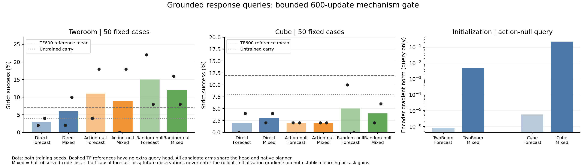

# Grounded response-query gate: complete, held

All 24 fresh runs reached exactly 600 updates; all 120 train/health/information/query/planning endpoints exited 0. All full-state audits pass. Every run matches all 550 original initial tensors exactly; all six auxiliary heads per task/seed are identical, with 12,480 additional parameters. Twelve two-step and twelve explicit gradient preflights passed before launch. Frozen source: `4fcb8d7e8aac32436d323988b458d62ac4afd862`.

All 24 H200s on dev2/dev13/dev15 were used. After completion, only the three verified idle dispatchers belonging to this plan were closed. Checkpoints, configurations and logs remain under `/efs/prescottsun/SPT-JEPA/runs/ideas10_relative600_20261031`; `HOLD_DISPATCH` prevents further dispatch. No automatic longer experiment is justified by this review.

## Same strict planning evaluation

Each entry shows both training seeds, each evaluated on the same 50 cases. The native CEM and goal cost are unchanged. Historical TF600 is a reference without the extra query head; direct/random/action-null arms are the equal-capacity controls. All candidate arms perform the same seven forecast calls. Mixed combines half the observed-code query loss and half the causal forecast query loss; future frames never enter the rollout. Relative normalization is per clip, with one fixed RGB-LSB-squared floor.

| Query operator / route | TwoRoom success % | Cube success % |
|---|---|---|
| Untrained carry predictor | 4 / 4 | 8 / 8 |
| TF600 reference | 6 / 8 | 14 / 10 |
| Direct / forecast | 2 / 4 | 0 / 4 |
| Direct / mixed | 2 / 10 | 2 / 4 |
| Action-null / forecast | 4 / 18 | 2 / 2 |
| Action-null / mixed | 0 / 18 | 2 / 2 |
| Random-null / forecast | 22 / 8 | 10 / 0 |
| Random-null / mixed | 16 / 8 | 2 / 6 |

There is no cross-task winner. Action-null versus random-null reverses sign between TwoRoom seeds: −18/+10 points for forecast, −16/+10 for mixed. Thus the occasional positive TwoRoom score does not establish the intended action-specific mechanism. All Cube candidates are below both historical reference scores, except one random-null seed ties the lower reference. These are immature learning gates, not evidence that longer learning is mathematically impossible. They also do not provide positive grounds to spend that larger budget.

## Opening a gradient path did something, but did not solve forecasting

At initialization, the action-null query's encoder gradient norm changes from approximately 8.0e−7 to .00474 in TwoRoom and 5.7e−6 to .22958 in Cube when observed-frame grounding is included. The tiny forecast-only values are consistent with the exact carry-initialization cancellation up to FP32 rounding. The full-model nonzero gradient audit alone would have missed this query-specific issue.

By update600, observed-code query errors improve with the mixed route. On Cube, action-null observed-code relative error divided by the zero-query reference changes from 1.043/1.021 to .940/.892. Replacing the observed codes by another episode increases the mixed-route error by .142/.267. Cube block-height clean-probe R² rises from .266/.290 to .377/.364. These are real effects on the learned observation encoding, rather than evidence that the gradient intervention did nothing.

The causal forecast barely gains: its action-null error remains .9970/.9969 of the zero-query reference, and changing the initial state to another episode changes relative query error by only about 1.1e−5/1.0e−5. On TwoRoom, mixed observed-code ratios are .979/.974 while forecast ratios remain 1.000/.998. The intended path information is not successfully forecast at this budget. Small raw/relative residual errors alone would conceal this failure.

Random-null forecasts on Cube obtain lower own-query error, .884/.882 of their zero reference, and larger wrong-action effects (.220/.202). Yet their task scores are only 10/0. The different projectors ask different questions, so these ratios are not a common quality metric. Together with actual planning, they show why action sensitivity, information retention and goal-directed control must be assessed separately.

The normalization floor dominates 2/64 held-out positive-rank TwoRoom action-null windows and no Cube windows. It is a declared numerical floor, not an estimate of sensor noise. No values, seeds or cases were dropped. Full per-seed results, 28 paired comparisons, manifest hashes, preflight gradients and tensor-identity audit are in [results.json](results.json). Raw audit files and logs remain on EFS.

## Frozen initialization control

Four additional evaluations use the exact initial checkpoints, same manifests and native CEM. All four exit0 and strictly match their stored weights. The predictor's final output weight and bias are exactly zero in all four models. With native residual carry, the predicted future state is consequently independent of candidate actions: GoalMSE cannot rank those actions by learned dynamics. The solver still emits actions through its sampling and tie handling. This is a control for the deployed pipeline before learning, **not** a zero-action policy or the separate native RandomPolicy.

The initial models score4/4% on TwoRoom and8/8% on Cube; their per-case successes are identical across initialization seeds within each task. Historical TF600 is only2/4 points above this on TwoRoom and6/2 points above on Cube. No confidence or general improvement claim is based on these small differences. In particular, the new Cube action-null2/2 scores are below initialization, despite finite states and improved observed-code probes. A nonzero short-gate success rate cannot itself certify learned control.

The frozen control plan, four complete results and exact-zero projection audit are in [initial-results.json](initial-results.json), with raw files under `runs/ideas10_initial_planning_20261031` on EFS. Its three idle dispatchers were closed after completion. All24GPUs were rechecked empty at2026-10-30 17:26UTC. No training was added.

## Decision

Hold all runs at 600. The structural gradient explanation is supported; its proposed remedy improves observed encoding but has not made the forecast query useful or improved Cube planning. The first eight and current 24 runs are two investigations of one candidate, not 32 ideas. They cannot be counted toward ten validated new algorithms or a claim of superiority over LeWM.
