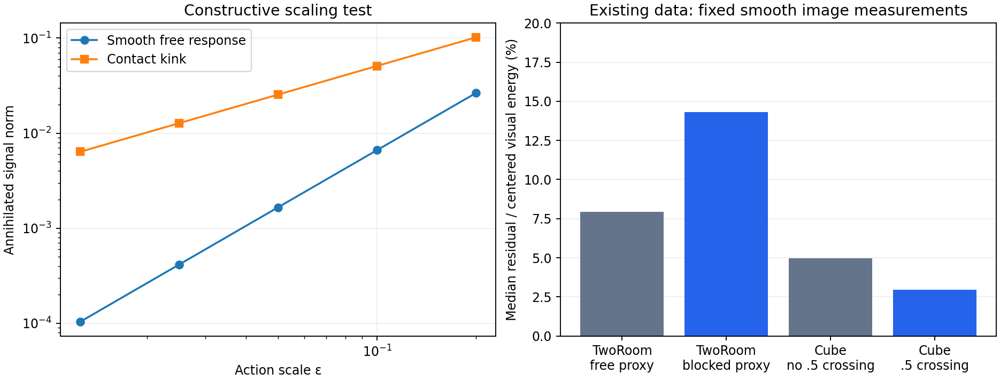

# Spatial proposal CPU checks

No model was trained and no GPU was used for these checks. They verify mathematical constructions and inspect existing data; they do not establish improved world modeling or planning.

## Constructive results

- Affine annihilation error: 3.04e-14; cumulative-coordinate change error: 2.78e-16.
- Smooth-response observed scaling order: 1.996217–1.999941; contact-kink order: exactly1 across four halvings.
- State-dependent affine example: global action-mean residual norm 11.220517, local action-annihilator norm 3.66e-15. The methods have different nullspaces.
- Contact projection: 10,000 known-halfspace pairs satisfy firm nonexpansion to3.56e−15 and idempotence to4.45e−16. This verifies a classical contact-model property; it is not a novelty result.
- First-passage example: AA and BB end in the same state, but hit probabilities are1 and0. Right-censoring gives the true hazard.2; keeping only observed events gives.539823. These are classical identities, not a learned-model result.

## Existing-data action-annihilator audit

Same predeclared128 training episodes per task, one eight-frame window each at the existing frameskip5. P=I−[1,U][1,U]† for this original CPU audit. ψ is fixed4×4 cosine coefficients per RGB channel. Physical fields are diagnostic only. The implementation subsequently selected by root uses the more conservative [1,time,U] span and8×8 area-pooled RGB; the following numbers must not be relabeled as measurements of that different target.

| Task | Diagnostic partition | Windows | Median visual residual energy fraction | Median physical residual norm |
|---|---|---:|---:|---:|
| tworoom | False | 36 | 0.07944 | 8.11334e-06 |
| tworoom | True | 92 | 0.14310 | 7.19967 |
| cube | False | 25 | 0.04965 | 0.000155587 |
| cube | True | 103 | 0.02954 | 0.0171828 |

TwoRoom partitions indicate whether any raw displacement differs from nominal5×action by more than1e−3 pixels. This is a dynamics-residual proxy, not a certified contact oracle. Its free group has median position residual amplitude fraction1.53e−7 and absolute norm8.11e−6 pixels, while the blocked/nonaffine group has fraction.11386 and norm7.20 pixels. This supports the intended cancellation mechanism in this dataset.

Cube partitions indicate whether the recorded continuous gripper-contact value crosses.5; the physical residual refers to block xyz and is in meters. The event group has a larger absolute block residual (17.18mm versus.156mm Frobenius norm over the clip), but its median visual residual energy fraction is LOWER (.02954 versus.04965). Thus the present visual measurements do not establish contact enrichment for Cube. The relative physical residual fraction is also not larger. No task-success inference follows.

The first attempted Cube proxy was any change in the continuous contact field. That was too broad; it was replaced explicitly by fixed.5 crossing, with0 and.9 sensitivity below. This correction is not a training-label or hyperparameter choice. All groups and thresholds are retained.

| Cube threshold | No-cross / cross windows | No-cross visual fraction | Cross visual fraction |
|---:|---|---:|---:|
| 0 | 25 / 103 | 0.04965 | 0.02954 |
| 0.5 | 25 / 103 | 0.04965 | 0.02954 |
| 0.9 | 24 / 104 | 0.04722 | 0.03035 |

## Rank of the selected implementation

For X=[1,time,cumulative standardized controls], the same128-window audit yields TwoRoom residual rank4 in all128 windows; Cube rank1 in127 and rank2 in1. No zero ranks occur. The invariant version retains only one temporal contrast for almost all Cube windows. See time-projector-ranks.json and IMPLEMENTATION.md.

