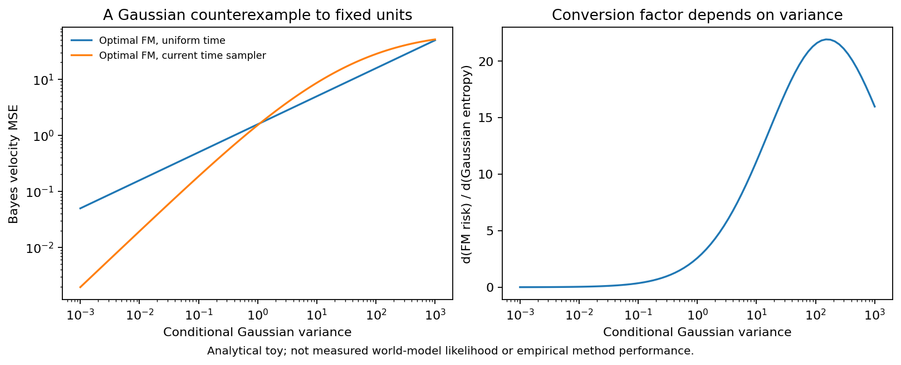

# 数学前提检查

这些是候选方法的数学性质和反例，world-model训练/推理实验数量为0，尚无新方法的PushT有效性结果。

- I01：Gaussian toy中，uniform-time最优FM风险与π√v/2的积分相对误差1.75e−14。采用当前logit-normal时间分布的Gaussian toy时，FM风险对熵的斜率转换因子随残差方差改变，不能用一个常数把所有FM收益当成nats。这不是对真实renderer似然的估计。
- I02：q/p均值、协方差及参考先验一起变换后，Gaussian KL误差1.56e−13。只变后验噪声而保留单位先验不能声称全目标坐标不变。
- I03：正确Markov条件KL之和6.607472与joint KL一致（误差1.60e−14）；错误沿用独立后验公式得到8.071693。因此相关噪声候选必须重写码长，旧独立后验理论也需重新检查。
- I04：在明确可分的线性style/dynamics toy中可去style并保持3维动力学rank；不代表实际图片满足这个条件。
- I06：构造反例中，受约束更新令一阶FM变化−1，原始FM+KL却变化+9。因此该候选属于改变优化约束，不能宣称仍保证原目标下降。
- I07：含log方差项时，最优预测方差等于条件均方残差；去掉该项会通过方差趋于无穷逃避损失。方差网络禁止读取目标。
- I08：标量反例展示latent增益.95、encode/decode增益1.2会得到1.14的pixel反馈增益；如果encode/decode完全互逆，两者没有这种结构差异。真实Native的反馈谱尚未测。
- I10：同步变换J、训练协方差和目标差后，可控能量变化5.29e−13；同一例的普通欧氏距离由18.38变到282.06。局部Jacobian是否可靠、P0是否改善仍需真实模型实验。

[全部数值](prechecks/mathematical-checks.json)、[冻结检查源](prechecks/source-manifest.json)。源提交9573e9b。

下一步优先准备I10的冻结模型规划对照，以及I01的密度/残差校准；I05/I07分别检查prior训练分布差距与小agent/随机细节的梯度竞争。I05的真实梯度通路、I09的新fork数据泄漏控制和全部候选的任务有效性尚未验证。执行范围与新增时间仍待用户选择，当前原截止时间为2026-10-27 22:24:58UTC。
