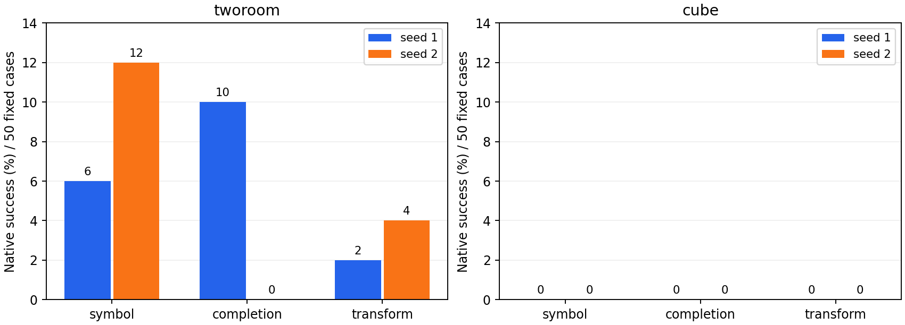
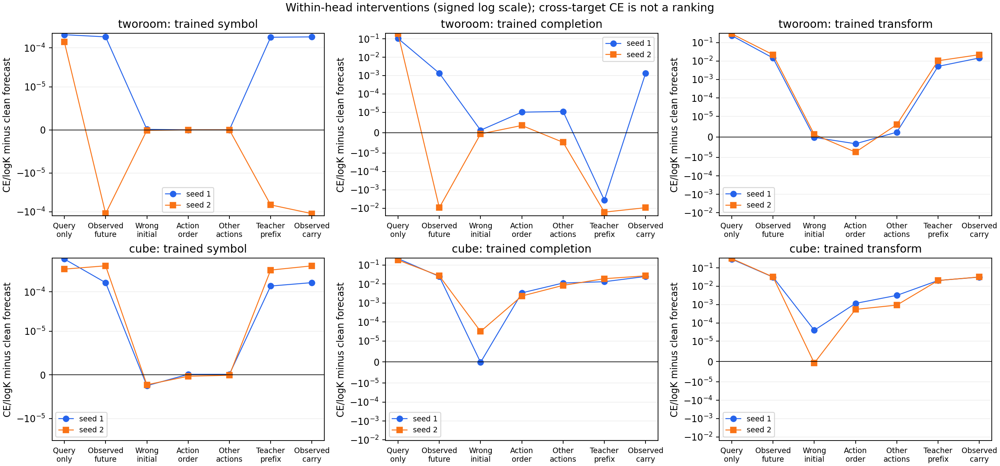

# S3 three-arm review

Source `dd2aeaa40e8a8050439ef036b402f289d006a257`; complete=True. Pending endpoints 0, failed 0.

Every row keeps its actual training seed. CE/log(K) has uniform reference one, but target entropy, class balance and effective active rows differ; do not rank methods by cross-arm CE.

| Task | Arm | Seed | Native P0 % | Forecast CE/logK | Query-only | Observed future | Wrong initial delta | Wrong action order delta | Other actions delta |
|---|---|---:|---:|---:|---:|---:|---:|---:|---:|
| tworoom | symbol | 1 | 6.0 | 1.000 | 1.000 | 1.000 | 1.09e-07 | 0 | 0 |
| tworoom | symbol | 2 | 12.0 | 1.000 | 1.000 | 1.000 | -1.09e-07 | 0 | 0 |
| tworoom | completion | 1 | 10.0 | 0.795 | 0.900 | 0.796 | 1.2e-06 | 1.01e-05 | 1.11e-05 |
| tworoom | completion | 2 | 0.0 | 0.793 | 0.980 | 0.784 | -6.02e-07 | 3.53e-06 | -4.73e-06 |
| tworoom | transform | 1 | 2.0 | 0.803 | 1.039 | 0.818 | -2.22e-07 | -3.33e-06 | 2.3e-06 |
| tworoom | transform | 2 | 4.0 | 0.808 | 1.104 | 0.829 | 1.19e-06 | -7.41e-06 | 6e-06 |
| cube | symbol | 1 | 0.0 | 1.000 | 1.001 | 1.000 | -2.5e-06 | 1.09e-07 | 1.09e-07 |
| cube | symbol | 2 | 0.0 | 0.999 | 1.000 | 1.000 | -2.28e-06 | -3.26e-07 | -1.09e-07 |
| cube | completion | 1 | 0.0 | 0.837 | 1.057 | 0.862 | -1.72e-07 | 0.00343 | 0.0113 |
| cube | completion | 2 | 0.0 | 0.837 | 1.020 | 0.864 | 3.16e-05 | 0.00234 | 0.00849 |
| cube | transform | 1 | 0.0 | 0.731 | 1.032 | 0.763 | 3.96e-05 | 0.00116 | 0.00317 |
| cube | transform | 2 | 0.0 | 0.732 | 1.055 | 0.764 | -7.41e-07 | 0.000545 | 0.000933 |

Query-only sets the whole state sequence to zero and retains real query prototypes and context masks. It may move the head off its training support. Observed future is privileged diagnostic access, not a forecast. Intervention deltas subtract the same trained head's clean forecast CE; positive means worse classification after intervention. These fixed-target swaps test conditioning dependence, not accuracy on unobserved counterfactual outcomes.

## Same-case planning comparisons

| Task | Seed | First → second | Delta pp | Gained | Lost |
|---|---:|---|---:|---:|---:|
| tworoom | 1 | symbol → completion | +4.0 | 4 | 2 |
| tworoom | 1 | symbol → transform | -4.0 | 0 | 2 |
| tworoom | 1 | completion → transform | -8.0 | 0 | 4 |
| tworoom | 2 | symbol → completion | -12.0 | 0 | 6 |
| tworoom | 2 | symbol → transform | -8.0 | 1 | 5 |
| tworoom | 2 | completion → transform | +4.0 | 2 | 0 |
| cube | 1 | symbol → completion | +0.0 | 0 | 0 |
| cube | 1 | symbol → transform | +0.0 | 0 | 0 |
| cube | 1 | completion → transform | +0.0 | 0 | 0 |
| cube | 2 | symbol → completion | +0.0 | 0 | 0 |
| cube | 2 | symbol → transform | +0.0 | 0 | 0 |
| cube | 2 | completion → transform | +0.0 | 0 | 0 |

## Avoiding cancellation across windows

Absolute per-window changes in the trained head's CE/log(K); each window still averages its queries and contexts.

| Task | Arm | Seed | Wrong-initial mean absolute change | Wrong-initial maximum | Other-actions mean absolute change | Query-only mean absolute change |
|---|---|---:|---:|---:|---:|---:|
| tworoom | symbol | 1 | 6.95e-07 | 3.36e-06 | 9.83e-08 | 0.00048 |
| tworoom | symbol | 2 | 5.26e-07 | 2.5e-06 | 6.95e-08 | 0.000656 |
| tworoom | completion | 1 | 4.43e-06 | 3.04e-05 | 0.000116 | 0.122 |
| tworoom | completion | 2 | 8.06e-06 | 5.06e-05 | 7.79e-05 | 0.205 |
| tworoom | transform | 1 | 3.39e-06 | 1.3e-05 | 4.17e-05 | 0.236 |
| tworoom | transform | 2 | 5.2e-06 | 1.72e-05 | 4.73e-05 | 0.296 |
| cube | symbol | 1 | 1.14e-05 | 7.42e-05 | 2.25e-06 | 0.000752 |
| cube | symbol | 2 | 9.27e-06 | 4.1e-05 | 1.95e-06 | 0.000705 |
| cube | completion | 1 | 5.91e-05 | 0.000262 | 0.0204 | 0.23 |
| cube | completion | 2 | 0.000109 | 0.000617 | 0.0158 | 0.19 |
| cube | transform | 1 | 0.000132 | 0.000521 | 0.00599 | 0.301 |
| cube | transform | 2 | 8.81e-05 | 0.00037 | 0.00244 | 0.323 |

## Full and half support

Map order: I, A, B, AB, BA. Completion order: no, yes.

| Task | Segment | Map counts | Completion counts |
|---|---|---|---|
| tworoom | full | [0, 0, 0, 283, 229] | [229, 283] |
| tworoom | first_half | [27, 116, 164, 131, 74] | [381, 131] |
| tworoom | second_half | [60, 141, 131, 46, 134] | [466, 46] |
| cube | full | [0, 0, 0, 374, 138] | [138, 374] |
| cube | first_half | [14, 84, 99, 191, 124] | [321, 191] |
| cube | second_half | [17, 113, 89, 88, 205] | [424, 88] |

The following context-only reference is fitted to the same validation label frequencies. It describes class imbalance, not a learned predictor or a held-out baseline. It receives the context type/frame position, but no query index, image, state or action.

| Task | Target | Empirical context-only accuracy | Empirical context-only CE/logK |
|---|---|---:|---:|
| tworoom | symbol | 0.438965 | 0.962855 |
| tworoom | completion | 0.735677 | 0.749448 |
| tworoom | transform | 0.382812 | 0.765194 |
| cube | symbol | 0.451172 | 0.957279 |
| cube | completion | 0.728516 | 0.818583 |
| cube | transform | 0.501302 | 0.709686 |

## Native latent prediction scale

Ratios are model-dependent. Tiny true encoded variation can make normalized error large; raw numerators and denominators are retained. Initial carry has normalized error one by definition.

| Task | Arm | Seed | True initial-to-future variation | Causal MSE | Teacher-prefix MSE | Causal / variation | Other-action effect MSE |
|---|---|---:|---:|---:|---:|---:|---:|
| tworoom | symbol | 1 | 6.62e-08 | 0.00141 | 7.33e-05 | 2.13e+04 | 3.54e-10 |
| tworoom | symbol | 2 | 7.41e-08 | 0.00166 | 8.73e-05 | 2.25e+04 | 2.37e-10 |
| tworoom | completion | 1 | 1.03e-07 | 0.262 | 0.0111 | 2.54e+06 | 3.82e-06 |
| tworoom | completion | 2 | 1.22e-07 | 0.174 | 0.00772 | 1.43e+06 | 4.51e-07 |
| tworoom | transform | 1 | 1.53e-07 | 0.928 | 0.0382 | 6.06e+06 | 5.41e-06 |
| tworoom | transform | 2 | 2.5e-07 | 0.803 | 0.0352 | 3.21e+06 | 8.59e-06 |
| cube | symbol | 1 | 1.83e-05 | 0.00222 | 0.000151 | 121 | 1.23e-07 |
| cube | symbol | 2 | 2.33e-05 | 0.00105 | 8.37e-05 | 44.9 | 1.82e-07 |
| cube | completion | 1 | 2.29e-05 | 0.218 | 0.0104 | 9.53e+03 | 0.0316 |
| cube | completion | 2 | 3.28e-05 | 0.203 | 0.00939 | 6.18e+03 | 0.0241 |
| cube | transform | 1 | 6.57e-05 | 0.714 | 0.0313 | 1.09e+04 | 0.0379 |
| cube | transform | 2 | 6.05e-05 | 0.702 | 0.0287 | 1.16e+04 | 0.00866 |

## Native two-step startup

| Task | Arm | Passed | Compared original tensors | Action gradient norm | Head gradient norm |
|---|---|---|---:|---:|---:|
| tworoom | symbol | True | 547 | 1.35e-16 | 0.176 |
| tworoom | completion | True | 547 | 6.79e-15 | 1.73 |
| tworoom | transform | True | 547 | 4.09e-15 | 0.877 |
| cube | symbol | True | 547 | 7.7e-17 | 0.208 |
| cube | completion | True | 547 | 1.59e-14 | 1.71 |
| cube | transform | True | 547 | 6.72e-15 | 0.739 |

600 updates remain inside the 1249-update warmup. Two seeds and 50 paired validation cases per task do not establish mature superiority or permanent failure. Better classification with observed future codes is not evidence that the causal predictor uses that information. Full raw reports, cases, manifest hashes and all horizons remain in results.json.

