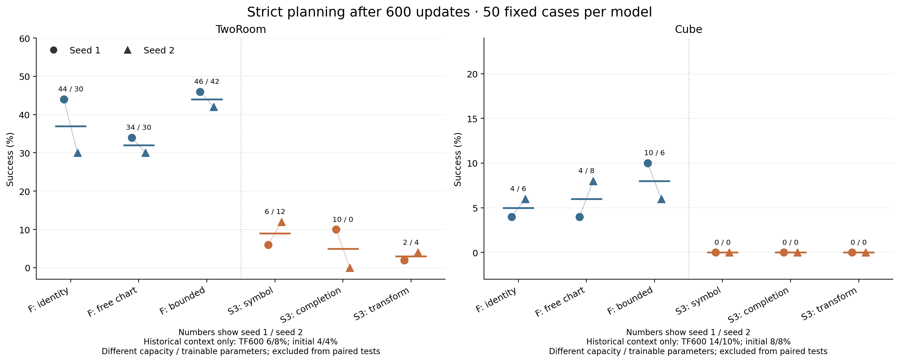
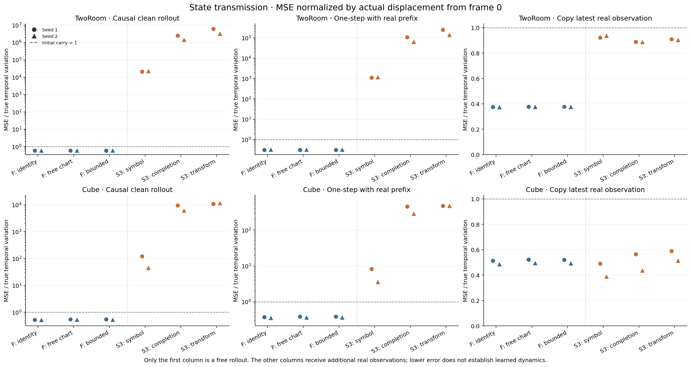
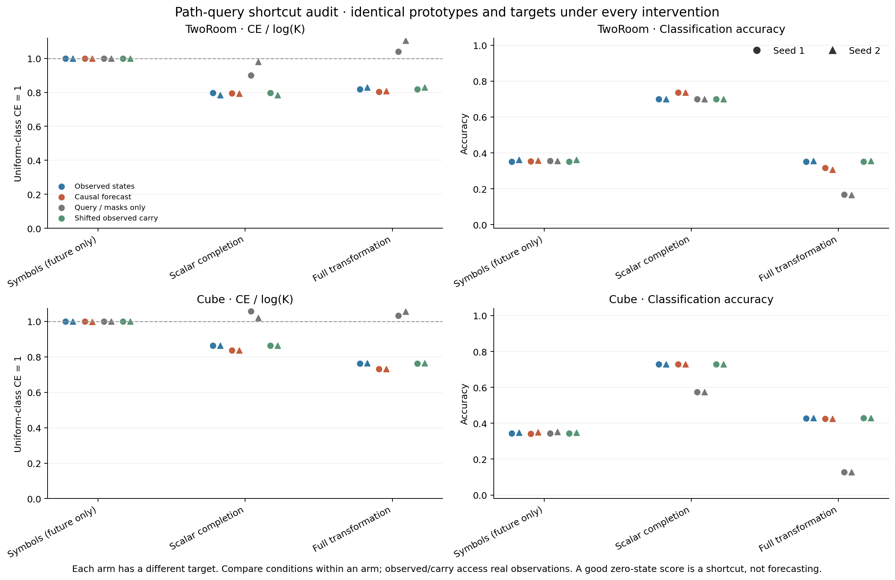
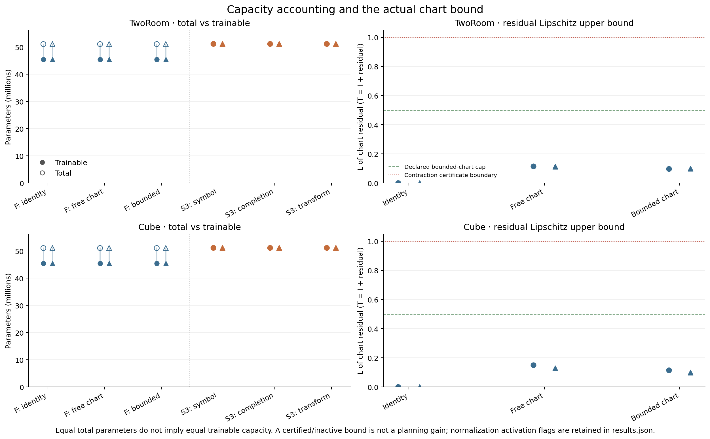
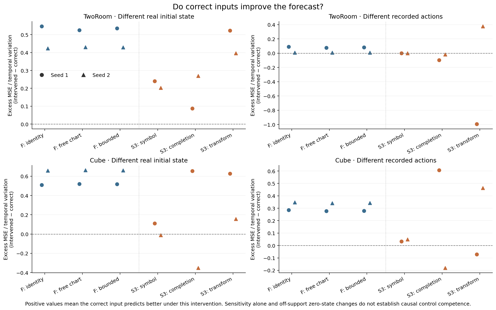

# Six-arm 600-update validation

Frozen source `dd2aeaa40e8a8050439ef036b402f289d006a257`; all 120 planned endpoints completed with exit 0. Twenty-four fresh runs, both seeds and both tasks retained.

The direct comparisons are within the carrier family and within the path-query family. Historical TF and untrained results below are context only. This remains a short gate inside the original warmup, not a long-run or general-stability result.

| Task | Family | Arm | Seed 1 strict success | Seed 2 strict success | Trainable / total parameters |
|---|---|---|---:|---:|---:|
| tworoom | carrier | identity | 44% | 30% | 45,443,294/51,105,454 |
| tworoom | carrier | unconstrained | 34% | 30% | 45,451,614/51,105,454 |
| tworoom | carrier | bounded | 46% | 42% | 45,451,614/51,105,454 |
| tworoom | pathquery | symbol | 6% | 12% | 51,167,667/51,167,667 |
| tworoom | pathquery | completion | 10% | 0% | 51,167,667/51,167,667 |
| tworoom | pathquery | transform | 2% | 4% | 51,167,667/51,167,667 |
| cube | carrier | identity | 4% | 6% | 45,447,674/51,109,834 |
| cube | carrier | unconstrained | 4% | 8% | 45,455,994/51,109,834 |
| cube | carrier | bounded | 10% | 6% | 45,455,994/51,109,834 |
| cube | pathquery | symbol | 0% | 0% | 51,172,047/51,172,047 |
| cube | pathquery | completion | 0% | 0% | 51,172,047/51,172,047 |
| cube | pathquery | transform | 0% | 0% | 51,172,047/51,172,047 |

Historical context: TF600 TwoRoom 6/8%, Cube 14/10%; untrained 4/4% and 8/8%. These are not capacity-matched controls.

| Task | Family | Candidate − reference | Seed 1 / seed 2 difference | Mean difference, paired case CI |
|---|---|---|---:|---:|
| tworoom | carrier | unconstrained − identity | -10/+0 pp | -5 [-11, +1] pp |
| tworoom | carrier | bounded − identity | +2/+12 pp | +7 [+1, +13] pp |
| tworoom | carrier | bounded − unconstrained | +12/+12 pp | +12 [+5, +19] pp |
| tworoom | pathquery | completion − symbol | +4/-12 pp | -4 [-11, +3] pp |
| tworoom | pathquery | transform − symbol | -4/-8 pp | -6 [-11, -1] pp |
| tworoom | pathquery | transform − completion | -8/+4 pp | -2 [-7, +3] pp |
| cube | carrier | unconstrained − identity | +0/+2 pp | +1 [-2, +5] pp |
| cube | carrier | bounded − identity | +6/+0 pp | +3 [+0, +7] pp |
| cube | carrier | bounded − unconstrained | +6/-2 pp | +2 [-2, +6] pp |
| cube | pathquery | completion − symbol | +0/+0 pp | +0 [+0, +0] pp |
| cube | pathquery | transform − symbol | +0/+0 pp | +0 [+0, +0] pp |
| cube | pathquery | transform − completion | +0/+0 pp | +0 [+0, +0] pp |

Intervals resample the same 50 cases jointly across the two fixed training seeds. They do not estimate training-seed uncertainty, adjust for the exploratory comparison family, or establish general superiority.

`results.json` retains every case outcome, health/intervention record, probe result, normalized forecast error, trained-query per-case score, chart certificate, capacity partition, source path and artifact hash. Weights and NPZ trajectory arrays remain on EFS.

Interpretation requirements: compare clean causal rollout against initial carry; teacher-forced and shifted-observed carry receive additional real observations. Query-only zero states test prototype/mask shortcuts. An active chart normalization or an informative observed probe is not proof of better forecast transmission or planning.

