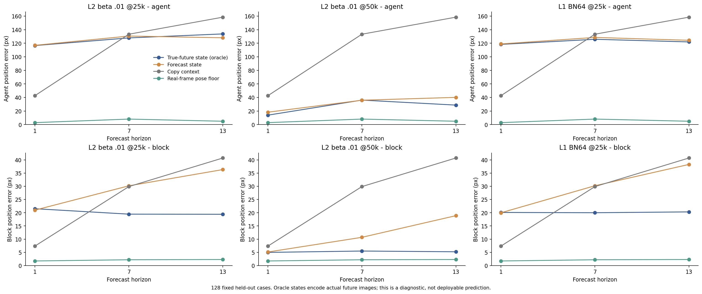
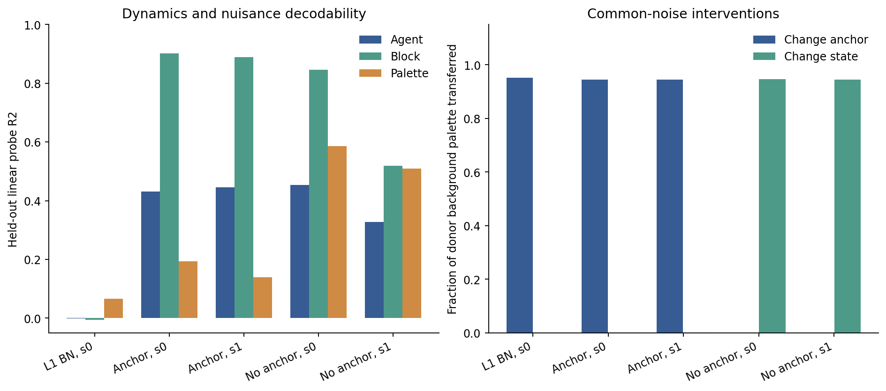
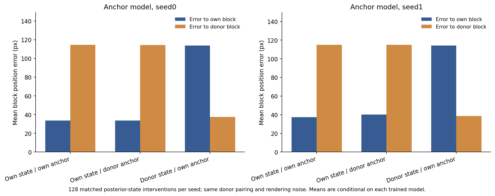
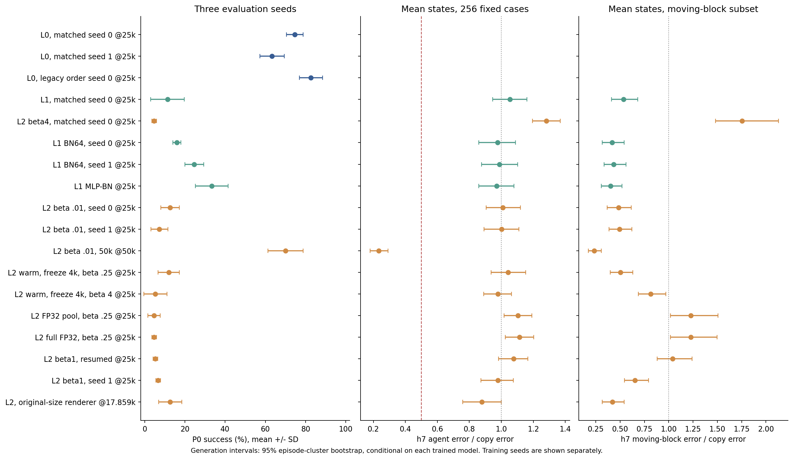

# SPT-JEPA：12 小时关键实验结果

本轮最重要的结果是：**21,580,398 参数、64 维 state 的 L2，从零训练到 50k 后，在一个训练种子上同时获得了有用表征、较好的数值生成、动作反事实和 P0 规划结果。** 设置为 β=.01、σ=.1、一次性头初始化 std=.1；没有 L0 暖启动、BN 或 SIGReg。P0 三个评估种子为 **74%、76%、60%，均值 70%**。这支持继续验证这个轻量配置。

28 组所选主终点评估已全部完成，并通过检查点、源代码、公共测试样例和数值一致性核验。它们是本轮探索的终点集合；原方案的三训练种子统计、32 例人工 gallery gate 和完整 Appendix A 尚未完成。多数配置只有一个训练种子。所有位置误差使用 **512×512 模拟器坐标**，生成图像为 64×64。

**1. 小模型可以工作；训练预算会改变结论。**

| 配置 / 检查点 | 噪声 agent / block R² | h7 agent / copy | h7 移动物块 / copy | P0 均值±SD (%) |
| --- | ---: | ---: | ---: | ---: |
| 独立 25k 预算，seed0 @25k | .472 / .935 | 1.010 | .486 | 12.7±4.6 |
| 50k 预算同一轨迹 @24k | .653 / .961 | .860 | .322 | 24.0±7.2 |
| 50k 预算同一轨迹 @50k | .868 / .971 | **.234** | **.234** | **70.0±8.7** |
| L0，匹配采样源，seed0 @25k | .955 / .940 | — | — | 74.7±4.2 |
| L0，匹配采样源，seed1 @25k | .946 / .941 | — | — | 63.3±6.1 |

50k 的均值状态结果使用 256 个固定测试窗口，其中 128 个属于移动物块子集。h7 agent 误差比的条件 95% 区间为 [.179,.291]，移动物块为 [.174,.307]；对应 h7 绝对误差为 agent 31.03 px、全体 block 10.95 px。每例 4 次噪声状态采样并全部平均，两个误差比仍为 .265/.261。h13 agent 比值为 .213。

64 个相同模拟器 reset、各 4 条动作序列的反事实中，50k 的整体动作识别率 **88.28%**（agent 85.94%、block 68.75%），随机水平为 25%。真实帧 pose 参考为 87.5%；它反映此评估流程的参考表现，不能视为数学上限。反事实识别与 P0 是两个独立测量。

同一条连续 50k 轨迹的 24k→50k 对照尤其有价值：固定测试样例下，agent 误差比 .860→.234，P0 24%→70%。独立短跑的总余弦预算是 25k，学习率轨迹不同；其与 50k 的差异不能全部归因于多训练了 25k 步。50k 约需 4.6 GPU 小时，L0 对照约 .6 GPU 小时，当前结果没有证明计算效率相同或统计等价。

图中最后两个检查点来自同一训练轨迹；反事实仅比较两个实际完成反事实评估的终点。区间按测试 episode 重采样，条件于这些已训练权重。规划 SD 来自 3 个评估种子，各 50 局，并非训练种子间的不确定性。

**2. agent 的编码/解码能力可以随预算改善；剩余 prior 误差需要分开看。**

在另一组匹配的 128 个窗口里，独立 25k 短跑即使用真实未来图片编码的后验 state，h7 agent 重建误差仍为 127.9 px。50k 时下降到 36.2 px，h1/13 为 14.0/28.8 px。因此早期的 agent 重建问题并非所有训练预算下都持续存在。

50k 的物块后验重建 h1/7/13 误差为 4.99/5.50/5.22 px，预测 state 为 5.13/10.69/18.88 px：重建路径改善后，prior 的长期累积误差仍然可见。这个诊断使用真实未来图片，不能作为可部署预测，也无法单独拆分 encoder 和 decoder 各自的责任。

[50k 固定顺序前 16 个样例](figures/rollout-50k-first16.png)没有按误差筛选，附有 [episode/start 元数据](rollout-50k-first16-cases.json)。agent 与物块通常可辨认，仍有噪点、错位和形状误差。该图提供定性证据，不替代全部 256 例的指标，也不是原方案 32 例人工通过率评定。

**3. Anchor 的背景配色分工在两个训练种子复现，state 同时控制物块位置。**

颜色控制中（β=.25、初始化 std=1、25k），更换 anchor 后，输出沿 donor 背景配色方向的投影为 .9447/.9444；更换 state 仅为 .00093/.00050。无 anchor 时，配色随 state 转移 .9463/.9451。这些是归一化颜色投影，不是样例成功率。

128 例后验状态几何干预补齐了另一半证据。seed0 更换 anchor 前后，对原物块的误差为 33.79→33.59 px；更换 state 后，对 donor 物块误差 37.46 px、对原物块 113.70 px。seed1 方向一致：原位误差 37.34→40.14 px；交换 state 后对 donor 38.70 px、对原位 114.12 px。

带 anchor 的噪声 block R²=.902/.889，无 anchor 为 .845/.519；配色 R² 从无 anchor 的 .586/.510 降到 .194/.139。移动物块生成误差比的配对差（anchor 减 no-anchor）为 −.127，95% 区间 [−.189,−.070]；第二种子为 −.393，[−.536,−.267]。agent 的探针变化方向不一致，生成差区间包含 0。证据支持背景配色和物块几何的输入分工，完整 agent 解耦仍未建立。

两种干预分别只更换一条输入通道，使用同一批样例、相同 renderer 噪声和同一批内反向 donor 配对。新增几何标注前后的旧配色/原位分数差为 0。颜色数据是 episode RGB affine 控制变量，覆盖范围小于原方案完整的模拟器外观变化。

**4. Native 已学会单步预测，自由 rollout 的主要问题与生成历史反馈有关。**

S0/S1 的 24k 快照在首步 agent 误差为 12.48/9.24 px，复制基线为 44.91 px。S1 在 h7 使用真实历史帧时，agent/block 为 16.69/6.57 px；自由 rollout 则为 145.39/58.12 px。两条件使用相同模型、动作、anchor 和采样噪声，首步误差逐例最大差为 0。只把过去帧替换为真实图片便大幅改善后续结果，支持进一步研究反馈分布和稳定性。

真实历史属于额外信息。把生成历史裁回训练像素范围的单独推理消融没有改善：S1 h7 agent/block 反而达到 273.18/90.73 px。Native 与 LeWM 使用不同优化器分组/调度，跨分支差异不能只归因于架构。

S2 β=4 的 12k checkpoint 噪声 state 仍空，保留完整 DCP 后停止。本轮没有把最终成功的 β=.01/50k 设置转移到 S2，因而 Native 版本是否能在该工作点成功仍是开放问题。

**5. 随机细节与精度实验限制了目前能讲的机制故事。**

同预算 15k、seed0、β=.01 的随机点控制中，flow 保留 dot RGB（R² 约 .80/.83/.83），MSE 及 L1 BN 接近 0；三者的 dot 位置都几乎不能线性解码。flow 的 block 探针 .834 高于 MSE 的 .677，但移动物块生成误差比为 .779，MSE 为 .472。当前低 β 工作点没有呈现“flow 更会删除随机细节”的预期模式，β≥1 下的理论条件仍未获得对应的有效非坍塌对照。

[随机点图](figures/dot-information.png)逐项展示位置和 RGB。[同权重精度图](figures/precision-diagnostics.png)显示，部分高增益 25k 配置的 BF16 特征 std 约 .15–.20，FP32 却只有约 1e−4，加入 σ=.1 后的 FP32 任务探针接近零。完整 FP32 训练的 β=.25 配置有部分状态（噪声 agent/block R²=.206/.207），但移动物块生成误差比 1.227、P0 均值 4.7%。因此方差、信息上界、线性探针、生成和规划必须分别检验。

**6. 默认 β、大 renderer 与暖启动提供了哪些边界。**

修正采样源的默认 β=4 持续 25k 后，噪声探针仍接近零；单次初始化放大、direct prior、较长窗口和较小噪声的筛选也没有得到最终可用的完整结果。β=1 的连续 25k 控制在后期恢复到噪声 agent/block R²=.445/.833、移动物块比值 .653，P0 均值仍为 6.7%。8k 的早停只描述当时的失败，不能推广为永久坍塌。原始初始化的 β=.01 在 25k 也保住了 block R²≈.930，但 agent 和 P0 仍弱。

L0 暖启动后冻结 encoder/pool 前 4k 步的 β=4 控制保住噪声 R²=.416/.748、移动物块比值 .814，但 P0 均值仅 5.3%。它额外使用了本轮 L0 预训练。修正源 L1 无 BN 的 P0 均值为 11.3%；BN64 为 16.0/24.7%，MLP-BN 单种子为 33.3%。BN64 seed0 与旧 L0/L1 的数据顺序来源在完整表中单独标记，不能当作严格相同训练源的成对对照。

原尺寸 renderer 为 384×12、全模型 51,097,134 参数，在约 4.5 小时续训预算下达到 **17,859 步**：噪声 R²=.453/.762，均值状态 h7 agent/移动物块比值 .879/.422，P0 为 16/6/16%，均值 12.7%。4 次状态采样使用 64 例，比值 .849/.346。其 gallery 仍有明显 agent 错位。这个控制在本轮时间预算内未打通规划；容量的独立效应需要等步数/等调度对照。

**覆盖范围与后续决策。**

| 原计划问题 | 本轮证据 | 尚未解决 |
| --- | --- | --- |
| priced state 是否能学会 | β 网格、晚期恢复、50k 正面结果 | 成功设置的训练种子复现 |
| anchor 是否承担外观 | 两种子颜色探针、配色/几何交换 | 完整外观变化、完整 agent 解耦 |
| flow 是否删除随机细节 | 低 β flow/MSE/L1 dot 对照 | β≥1 的有效非坍塌比较 |
| collapse 和设计选择 | 初始化、精度、prior、噪声、窗口、暖启动控制 | 设计交互；最终 50k 工作点下 g0 等复测 |
| rollout 是否支持动作和控制 | 256 例均值/采样、64×4 反事实、P0 三评估种子 | 原方案三训练种子及 32 例人工 gallery gate |
| 是否转移到 Native | S0/S1 单步与反馈诊断，S2 β4/12k | 成功低 β/长预算设置的 S2 复现 |

下一轮最有信息价值的验证是复现小模型 β=.01/50k 的训练种子 1/2、完成固定 gallery gate，然后检查该工作点能否转移到 Native。当前数据更支持先验证成功配置的稳定性；本轮计算已经结束，没有为这些后续问题启动新训练。

数据使用原始 PushT HDF5 每第五帧的一种相位，保留 474,498 帧、17,751 个训练 episode、934 个测试 episode，划分交集为 0。没有复现原论文全部数据曝光量。统一 pose-v2 的独立真实图片误差（agent/block）为 standard 2.37/1.48、color 3.03/1.80、dot 3.25/1.78 px；生成窗口中的真实帧误差也逐项保存。旧 pose-v1 的 dot 分数明确排除。**LPIPS、SSIM、FVD 未测**；数值位姿和定性样例不能替代这些质量指标。

[完整结果与图索引](README.md)、[统一主表](RESULTS.md)、[全部聚合数值](all-aggregate-measurements.json)、[验证记录](verification.json)均随代码发布。历史失败/旧协议保留并附标记。数据、权重、逐 case 数组、日志和视频继续保存在 EFS。
