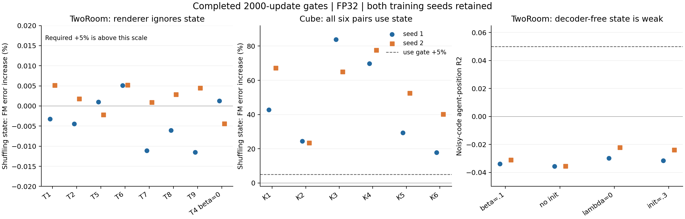

# Lingjing 两个提案：覆盖进度与已取得的 insights

最终状态已由[2026-11-03收尾报告](CLOSEOUT_20261103.md)和[最终逐条覆盖](results/closeout20261103/coverage-final.json)更新；本文下方保留原时间范围的证据。

2026-11-02。用户最新要求是停止旧失败路线，按上传提案补齐问题，优先取得结论；明确失效的分支不必跑满。这里区分**执行通过、科学门槛通过、名义预算完成、规划性能提高**，四者不能互相替代。当前没有新的三任务统一优势结论。

> **最新复核覆盖以下历史进度**：[REVIEW_20261102_1229.md](REVIEW_20261102_1229.md)。Cube12条12000步/48个控制终点已完成，无K组达到延长门槛，不续23342；4个冻结native/TF姿态对照说明约22°弱读出是共享现象，不能单独解释K较差。L0三seed10epoch与全部72评测完成，raw均值90.89/87.33%。PushT4条真实首epoch失效已早停；审计误报与两条保存故障独立恢复，绝不记作算法失败。既有有限PushT队列继续，条件Phase2未选择。以下为启动及2000步历史记录。

## 已经能据此作决定的结果

**TwoRoom：停止这一轮 pooled-state 分支，不续同配置 6000 步。** Round2 T1–T9 两个种子和 decoder-free T 的四组两个种子，全部没有通过各自的 2000 步门槛。26 个主要配方的问题已经回答；另加的 β=0、decoder-free 初始化尺度 0.3 四个诊断也未救回状态。不是因为训练报错：36 条新增短程链全部 exit0，完整模型/AdamW/scheduler 的实际 CPU 恢复、有限权重/日志、必须活跃的梯度组、固定状态诊断均已检查。旧 T3/T4 和 canonical DF 使用匹配的既存检查点，单列来源。

**Cube：12 条分支全部通过，继续原方案的 12000 步评测。** 这时续训有意义：两个种子都已学会在高图像噪声下使用状态，且噪声状态能读出一部分真实物体位置。仍不能据此宣布控制成功或选出最佳配置。

图中左面放大了 TwoRoom 的近零效果；5% 使用门槛在其纵轴范围外。中间 Cube 使用相同“交换状态后的 FM 误差相对增加”定义。右面为 decoder-free 的带噪位置探针。所有数值、源文件 SHA 和画图脚本随图保存；没有挑出有利种子。

## 1. TwoRoom 失败不能只归因于压缩价格

Round2 T4 在去掉全部 rate 惩罚（β=0）后，两个种子的 FP32 `feature_std/sigma0` 为 **0.291 / 0.294**，而交换状态仅使 t=.95 的预测误差变化 **+0.00126% / −0.00437%**，远低于 5% 使用门槛。必须活跃的 encoder、pool、predictor、action encoder、renderer 梯度均存在；“计算图有梯度”仍不等于“条件被功能性使用”。

其他 Round2 新 T 变体的交换效果全在 **−0.0116% 至 +0.0053%**。降低 β、改变 σ、改 anchor、改 forecast 的采样/时间相关性，都没有在这一门槛救回状态使用。decoder-free 去掉 forecast 项后，带噪 agent R² 仍为 **−0.0298 / −0.0221**；初始化尺度提高到 0.3 后为 **−0.0316 / −0.0238**。

因此，“rate 太贵”不是单独充分的解释，作者预测的“校准初始尺度就能脱离 TwoRoom 陷阱”在这些配置和预算下也未得到支持。共同的 pooled 表征路径值得怀疑；但不能把这组否定结果写成 pooled readout 已被严格证明是唯一因果瓶颈，也没有证明所有更长训练都不可能恢复。按提案本身的 Part T 停止规则，已有足够理由结束这轮同配置续训。

依据：[36 条完整短程证据](results/hard2000-summary.json)、[TwoRoom 新门槛汇总](results/tworoom-gates-v1.json)、[原有匹配检查点的冻结诊断](results/gates-summary-v1.json)。

## 2. “信息量大”与“任务状态有用”是两回事

在未训练但校准好的 TwoRoom 初始状态中，全局 SNR 约 **0.97 / 0.99**，信息替代量约 **8.49 / 8.12 nats**，有 **12 / 13** 个信息方向；但带噪 agent R² 仅 **0.026 / 0.030**。训练后 canonical decoder-free 的带噪 agent R² 约 −0.03。校准创造可用的整体数值尺度，并不自动把尺度分配给 agent 的位置。

旧冻结检查还显示，BF16 可把微小状态的有效 spread/信息量夸大。例如校准 Round2 TwoRoom 2000 步的 SNR，BF16 可达约 1.5–1.8，FP32 实际只有约 0.15–0.21。因此本轮**以 FP32 科学判定为准，同时保留 BF16**；旧 `fp32_pool` 训练修复的负结果单列，不用数值修复去冒充性能修复。

更有用的诊断链条是：总体信号是否存在 → 噪声后是否保留物理变量 → 解码器是否使用 → 动力学是否保留 → 候选动作的目标排序是否正确。只优化或观察前一项，不足以推断后一项。

## 3. Anchor 的影响依赖任务，并非统一的泄漏解释

训练集 staleness 审计中，TwoRoom near anchor 已有 **92.9%** 的渲染帧在 agent 上陈旧；past-gap2 为 **98.4%**。因此“把 anchor 放远即可解决”缺乏充分解释力，实际 T1–T9 的门槛结果也没有支持它。

Cube 的区别更明显：block 位移超过 3cm 的帧比例从 near 的 **61.6%** 增至 past-gap4 的 **81.3%**；对称 yaw 差超过 15° 的比例从 **9.5%** 增至 **37.4%**。near 对慢变量确实提供了更多免费信息。2000 步时 past/zero-anchor 的状态使用和 y 位置可读性普遍强于 near；这支持继续完成作者的配对因果对照，尚不是 anchor 规则改善控制的证明。

依据：[anchor 审计与实际行索引合同](results/anchor-audit-v1.json)。gap 只按训练集 fallback≤20% 决定：TwoRoom2、Cube4，没有用验证集选择。

## 4. Cube 已学会使用状态，但保留的物理信息不均匀

K1=past，K2=near，K3=zero anchor，K4=past/λ0，K5=past/σ.05，K6=past/σ.2；其他设置按作者规格。每行两个训练种子都保留。

| Cube arm | State SNR, seeds 1 / 2 | Swap error increase, seeds 1 / 2 | Noisy block xyz R², seed 1 | Noisy block xyz R², seed 2 |
|---|---:|---:|---|---|
| K1 | 2.00 / 2.53 | 42.8% / 67.3% | 0.26 / 0.87 / 0.21 | 0.41 / 0.91 / 0.22 |
| K2 | 1.14 / 1.11 | 24.4% / 23.5% | 0.28 / 0.44 / 0.21 | 0.31 / 0.58 / 0.21 |
| K3 | 2.70 / 2.44 | 83.9% / 65.1% | 0.39 / 0.92 / 0.22 | 0.42 / 0.90 / 0.22 |
| K4 | 2.07 / 2.45 | 69.8% / 77.7% | 0.22 / 0.90 / 0.22 | 0.22 / 0.90 / 0.23 |
| K5 | 1.77 / 2.77 | 29.4% / 52.5% | 0.34 / 0.86 / 0.22 | 0.41 / 0.91 / 0.21 |
| K6 | 1.13 / 1.45 | 17.8% / 40.3% | 0.23 / 0.66 / 0.21 | 0.32 / 0.80 / 0.20 |
位置 R² 是固定 ridge 的验证误差相对训练均值基线，不是控制成功率。当前位置探针尚不包含姿态；12000 步包补同一固定128训练/64验证 clip 的位置、立方体对称姿态、clean rollout、teacher-forced、carry 和 noisy observed。诊断物理标签只拟合读出器，绝不输入学习器或规划器。

这一组结果把“根本没学状态”和“学了状态但还不会控制”分开。特别是 y 的可读性远高于 x/z：用一个总体 spread、总 MSE 或总信息量概括任务信息，会掩盖这种方向差异。后续应看 contact/goal 关键变量与规划表现能否同时改善，不按 state-swap 大小选赢家。

新增姿态接口验证同时产生了一份完整冻结读出：**K1/seed1/2000步**在同一128训练/64验证clip上，RBF读出 observed state 的位置误差 **9.09cm**、对称姿态误差 **22.38°**，同时满足3cm/15°的比例仅 **2.46%**；noisy observed 为 **10.06cm / 22.84° / 1.12%**。所以通过42.8%的state-use门槛，仍可伴随不够精细的物理读出。这是单个早期模型的描述性证据，不能证明姿态信息完全不存在、不能代表全部K分支或12000步性能，也不是P0成功率。读出器在clean训练状态上拟合，与前面专门对noisy状态拟合的位置探针有不同测量条件。见 [原始姿态/rollout读出](results/cube-pose-interface.json)。

依据：[全部12条配对续训决定](results/cube-maturity-review-v1.json)，原 2000 步 full states 不修改。

## 5. 成熟 Cube 的低 factual 误差，并不解释其弱规划

另补了原有 Cube **11671** 步 original/lower-beta/TF × 两个种子 × BF16/FP32 的12个冻结诊断。FP32 SNR 约 **7.5–8.6**，one-step noisy calibration slope 约 **0.99–1.00**；h7 的 latent error/copy 约 **0.005–0.017**，global carry ratio 接近1。

因此，**整体状态塌缩或整体 rollout 严重收缩**不足以解释这批成熟 Cube 模型之前的弱规划。但不同编码器可压掉难预测变量，所以不能把各自 latent 空间中的小 MSE 当成物理精度等价，也不能直接据此宣布“世界模型已经足够准确，只差 planner”。仍可能是目标几何、关键变量缺失、候选动作分布外误差或接触覆盖；这几个机制尚未被分离。

PushT 的40个既存2/3-epoch检查点也补齐80个冻结诊断，包含所有请求的可用种子和差的种子。缺失的历史3-epoch导出未被新训练悄悄替换。

依据：[Cube D0](results/Cube-D0-summary.json)、[PushT D0](results/D0-summary.json)。这些诊断没有任何新 SGD、simulator success 标签或最优动作标签。

## 6. 为什么不在 PushT 2000 步就照搬早停

成功的旧 PushT lower-beta 控制，在2000步的 SNR 仍可只有 **0.009–0.010**；到4000步才约0.8–1.9，到6000步约3–4，后来规划才强。过早的 spread 判定会杀掉已知成功的学习轨迹。

因此新 PushT 队列第一次判定放在一个完整 loader epoch（L2/DF12491步），且必须由 FP32 的**低 SNR、噪声后物理信息弱、训练所用条件通道失效/信息方向不足**共同支持才提前停止。保留完整检查点和证据，标为“第一 epoch 失效”，不标为“名义预算跑完”或“已证明永远学不起来”。NCE 是无 renderer 的批耦合对照，其门槛仅使用 SNR 和 noisy probe；L0 不套用该噪声门槛。

依据：[旧成功轨迹的逐100步日志](results/early-logs-v1.json)。

## 7. 两个用于解释结果的机制控制

**动作预测性是各向异性的。** 额外 CPU-only 固定 ridge 控制，用20k训练/5k验证帧、current action/history3、shuffle、previous-position+action 对照。PushT 的 action-history3 对 agent 绝对位置 R² 约0.17–0.18，TwoRoom 接近0；Cube 的 block xyz 约 **0.044/0.083/0.839**。因此不能笼统地说“有动作就不必有状态”；Cube 高度与横向位移需要的状态信息也不同。oracle previous-state 只用于诊断，绝不是训练输入。这是观察性可预测性，不是干预因果证明。见 [action-information](results/action-information-v1.json)。

**噪声的作用不能混为一谈。** 作者 decoder-free 的 one-step sample forecast，因 Gaussian 方差相加，在期望下把 forecast surprise 的权重变为 mean 版本的一半，另加常数；有效预测价格为 `w=β+κλ`，κ 为 sample .5 / mean1。改变噪声既可能改变信息通道，也可能改变优化权重；必须利用 B 组及 H 组的有效参数配对来区分。这是作者提案已有推导，不是本轮新方法。latent σ、posterior 相关噪声、forecast noise 和 DiT 图像扩散时间是四个不同变量。本轮没有把旧 frozen 高t能量试验重新解释成高噪声 DiT 训练证据。

## 覆盖与剩余工作

完整配方和来源见 [COVERAGE.md](COVERAGE.md)。**135个主要配方是覆盖清单，不是135个已完成的正结果。** TwoRoom 26 个按门槛结束；12 个 Cube 只完成2000步门槛；3个匹配 L0 基线及94个其余 PushT 配方按有限阶段队列执行。作者明确依赖筛选结果的 P2c、Stage2、DF Phase2 单列，尚未宣称执行。

本轮对失败 TwoRoom 配方省去后续6000步训练及重复2k大规模规划，按用户最新“insight已得到即停”优先级处理；不能拿缺失的规划表声称控制达到某个精确值。实现错误先修复再复测，不计作负算法证据。所有旧失败、旧 HOLD/STOP、未选执行包和两个种子均保留。

ForecastScored/window decoder-free 满足本项目的 sample-level 候选范围；pooled logdet decoder-free、NCE、L0/SIGReg 是公开机制或批耦合对照，**不会包装成新的 sample-level 算法**。尚未证明创新性、baseline 大幅优势、十个合格原创 idea 或三任务统一成功。

## 当前执行状态与复核入口

截至2026-11-02 10:02UTC，三台机器的24个真实训练均已通过启动健康检查：12个Cube续训在2200步，9个首批DF PushT在2000–2300步，3个原模板L0在62000/43900/43800步；必要梯度为正且有限。其余配方按固定有限队列等待。此处没有读取未完成长实验的局部赢家，也没有提前声称12000/37473/152650的结果。验证详情见 [VALIDATION.md](VALIDATION.md)，恢复与停止入口见 [RECOVERY.json](RECOVERY.json)。
