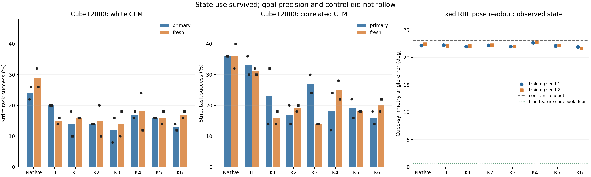

# 2026-11-02 新结果与必要处理

本次最先发现的是执行审计误报，随后收齐了 **Cube12条12000步训练/48个完整控制评测**、3条L0基线/72个3与10epoch评测，并补了姿态探针正负控制及4个冻结native/TF对照。TwoRoom上一轮按门槛停止的26条主要实验保持结束，没有重启。

## Cube：有状态使用，仍没有控制优势

所有K组两个种子、两个controller、primary/fresh均保留。表内是双种子成功率均值（%）；native/TF为事先保存的12000步同manifest、同300×30/H5/history3/budget50控制结果，不选择历史最好的一次。

| 配置 | White primary / fresh | Correlated primary / fresh | RBF位置误差cm | RBF姿态误差° |
|---|---:|---:|---:|---:|
| Native既存参照 | 24 / 29 | 36 / 36 | 5.26 | 22.33 |
| TF既存参照 | 20 / 15 | 33 / 31 | 5.33 | 22.20 |
| K1 | 14 / 16 | 23 / 16 | 6.15 | 22.06 |
| K2 | 14 / 15 | 17 / 19 | 5.74 | 22.25 |
| K3 | 12 / 14 | 27 / 14 | 6.03 | 22.02 |
| K4 | 17 / 18 | 18 / 25 | 6.46 | 22.77 |
| K5 | 16 / 16 | 19 / 18 | 6.01 | 22.18 |
| K6 | 13 / 17 | 16 / 20 | 6.31 | 21.83 |

K1=past anchor；K2=near；K3=zero；K4=past/λ0；K5=past/σ.05；K6=past/σ.2。

**新的决定：停止这批K分支，不续23342。** 所有K的点估计都没有达到native的±6pp延长门槛：white最接近的primary仍差7pp、fresh差11pp；correlated分别至少差9pp、11pp。移远/移除anchor没有带来跨case-set一致的控制收益，减小σ也未救回。这些是门槛处置与描述性结果，不是声称每一个成对差异都达到统计显著。预设K1−K2、K3−K2、K1−K4、K5−K1、K6−K1的全部配对区间见analysis-v2.json；没有挑赢家。

这批训练证明了“模型会读state”，没有证明“state保存了控制所需的精度”。K1/seed1在同一冻结cohort上从2000到12000步，位置读出由9.09cm改善到6.19cm，姿态却由22.38°到22.01°。全部12个RBF读出的姿态误差仍为21.71–22.87°。

为排除解码codebook本身太粗，补了纯CPU正负控制：同一1024个训练姿态作为codebook，输入真实姿态invariant特征时误差仅 **0.55°，100%落入15°**；输入训练均值时为 **23.13°，32.8%落入15°**。所以22°并非该codebook的误差下限。仍需区分“表征不可读”和“固定读出器的归纳偏置”；它不能单独证明latent完全没有姿态信息，也不是P0的数学上限。

**补充对照改变了归因。** 用基线完成后释放的GPU7，对同一1024训练/448验证帧补了4个冻结读出，所有模型前后state hash相同。Native两seed姿态误差为 **22.21/22.45°**，TF为 **22.27/22.14°**；也接近恒定读出的23.13°。因此“新方案独有地丢掉姿态，所以更差”不成立。这里至多发现固定探针对几类模型都有的薄弱项；不能把共同现象当作方法差距的原因。codebook正控制只排除量化下限，没有排除readout本身的归纳偏置。

同一固定cohort的RBF位置读出（cm，两个seed均值）：

| 模型 | 真实观测编码 | 冷初帧clean rollout | 复制初帧 |
|---|---:|---:|---:|
| Native12k | 5.26 | 5.56 | 11.46 |
| TF12k | 5.33 | 4.87 | 10.62 |
| K1-12k | 6.15 | 5.64 | 10.78 |

K1的factual rollout并非完全失效，位置读出误差接近native，控制却弱得多；TF的该读出更好，P0也未相应超过native。这进一步表明，不能用一个平均factual误差代替规划诊断。它仍是冷初帧诊断，不是native history3或CEM所选动作分布，不能声称已识别唯一中介机制。**下一项有判别力的分析应直接看同一goal下候选动作的排序、及真实终点编码与预测终点编码分别造成的误差。** 先检查已有候选池/cache的适用性；不重启已失败的query/S3/pathquery路线。

原生模型约18M参数、TF/K约51M，且生成器与原生训练算力不同；相同更新数不等于等算力。历史参照不是本次同时间重跑，simulator-repeat噪声没有包含在配对区间内。以上都是自定义heldout协议，不是canonical CLEAR成绩。

## PushT：先确认强baseline，不把BN重估当成默认修复

三个作者原L0模板在3个各自loader epoch（45795步）的完整结果：

| 训练seed | Raw primary / fresh | Train-only BN重估 primary / fresh |
|---|---:|---:|
| 0 | 88.67 / 83.33 | 82.67 / 80.00 |
| 1 | 79.33 / 76.67 | 79.33 / 78.00 |
| 2 | 86.67 / 76.00 | 80.00 / 70.67 |
| 均值 | **84.89 / 78.67** | **80.67 / 76.22** |

重估只改变已验证的四个BN running buffers，学习权重不变；固定128个不同训练episode，不使用测试统计。这一具体干预没有带来收益证据。BN−raw：primary −4.22pp，按episode聚类95%区间 **[−8.62,+0.22]**；fresh −2.44pp，**[−5.63,+0.66]**。两个区间均跨0，所以不宣称统计显著普遍退化，更不能事后挑出每个seed较好的版本当baseline。原始和重估结果均保留。

机制上的启示是：推理统计、表征、预测器和规划度量是共同适配的。若表示从E变为T∘E，保持同一动力学需要相应的T∘F∘T⁻¹，GoalMSE也会受T改变。仅替换BN统计不保证这种一致性。这个代数事实解释了为什么“估计更精确的总体矩”不保证决策更好；本次实验并未单独识别是哪一个环节介导下降。

10个名义周期（152650步）现已全部完成：3条训练、72个3/10epoch×raw/BN×固定seed评测全部exit0，结束汇总passed，无延长。

| 训练seed | 10epoch raw primary / fresh | 10epoch BN primary / fresh |
|---|---:|---:|
| 0 | 92.67 / 89.33 | 90.67 / 85.33 |
| 1 | 88.67 / 86.67 | 86.67 / 85.33 |
| 2 | 91.33 / 86.00 | 90.00 / 78.67 |
| 均值 | **90.89 / 87.33** | **89.11 / 83.11** |

Raw10−raw3：primary **+6.00pp [2.44,9.52]**，fresh **+8.67pp [4.70,12.79]**，三个训练seed均改善。10epoch BN−raw：primary **−1.78pp [−4.58,+0.92]**，fresh **−4.22pp [−7.16,−1.33]**。这些区间按episode聚类并条件于三个固定模型，不覆盖训练seed总体或simulator-repeat方差。在这批证据中，增加训练曝光是稳定的收益来源，事后重估BN不是。完成10epoch不等于数学上的收敛，也不将本地协议冒充公开96%基准复现。见 [完整成熟基线](results/review20261102T122931Z/baseline-final.json)与 [配对分析](results/review20261102T122931Z/baseline-final-analysis.json)。

L0这里保留作者window4，AS/DF为window8；epoch不是相同image-forward数量。3epoch与10epoch、训练种子和所有评测种子分开报告，不能用2000步baseline替代成熟参照。

## Decoder-free：任务信息与信息替代量正在分离

修复审计后，首批完整FP32首epoch诊断已产生。当前还不是3epoch结果，不能挑出Phase2赢家：

- β=.3/λ1：SNR **.368/.347**，有 **5/4** 个信息方向，但带噪agent R²只有 **.040/.037**。
- 同β、λ0：SNR **4.84/2.61**，pooled信息量 **38.59/29.79 nats**，带噪agent R²却为 **.037/.399**。信息更多和agent更可读不是同一件事，两个种子的语义分配也不同。
- color/window F5在完整首epoch后是真正的严重退化：SNR **.00116**、带噪agent R² **−.00123**、信息方向 **0**。已经按联合门槛早停，省去后两个周期。这个例子不能推广成所有window目标或标准域均不可能成功；D组同域对照仍是必要实验。
- B组标准域open-loop mean/λ1两个种子也均满足首epoch联合失效：SNR **.07549/.06620**，带噪agent R² **.000265/.000641**，信息方向均为 **1**。E5 dot/rollout-mean同样失效（SNR **.06723**、noisy-agent R² **.000467**、方向 **1**）。与colour/window F5合计4条均已早停。B的这两个种子说明早停并非仅发生在额外nuisance域，但仍不能把不同horizon/noise/有效权重的差别归于单一因素；其余配对尚未全部成熟。

同一logdet写法也不意味着同一个奖励。设每个window的anchor-relative协方差为C_i，则代码中的pooled与window估计分别是

`I_pool = 0.5 logdet(I + E[C_i]/σ²)`，

`I_window = 0.5 E[logdet(I + C_i/σ²)]`。

由logdet凹性，`I_pool >= I_window`。跨window混合本身可贡献Jensen gap，而不保证可用的任务变量变多。靠不同episode选择不同编码方向，也能把pooled谱撑大。因此改成sample-level window估计同时改变了统计奖励，不能只当成无害的batch实现替换；去掉混合奖励后出现塌缩，也不能证明之前的大信息量是有用状态。这是对作者已指出估计器问题的分析，不是原创方法/定理。

作者gaming判定还要求epoch1到epoch3的趋势和双旗，当前不能仅凭一个大的pooled/window比值宣布满足它。下一步需要现有B组的同有效w配对、D组同域window/pooled对照、noisy物理probe与真实规划一起判断；不靠clean标准化probe或信息量筛赢家。

## 已处理的执行问题

我上一轮新增的严格梯度审计有一个实际错误：trainer每100步记录梯度，而12491、15265等阶段结束行只含最后loss，没有grad字段；审计用`.get(...,0)`把缺失值误作0。初次检查发现22条因此被挡在评测前，它们都已正常完成首阶段SGD。这是审计误报，不能算算法崩溃。

修复后只检查真正采样的梯度记录，必须距阶段结束少于100步；实际记录为0、缺失应有的100步记录、陈旧记录、冻结路径出现梯度仍会失败。5个回归测试通过，并实际恢复DF、L0完整模型/AdamW/scheduler。原错误日志和终端文件不改。

新有限根目录 `runs/lingjing_fullspec_recovery_v4_20261102`，训练NN仍为0196dc17，恢复helper为d1f5ed1。12条Cube完整结果原样继承；31条已开跑PushT从精确首阶段检查点补审计/评测，不重复已完成SGD，健康状态按原预算续训。原先63条未开始配方先暂停，待两个配对DF单元的完整FP32评测及真实恢复通过后，已按原预算放行。没有新增学习方法、超参数或训练预算。旧三个调度器和旧结束汇总进程已按精确PID退役，正在训练的子进程保留。

另发现两条**保存I/O故障**：A/β.3/λ1/seed1已经做到24982，A/β.1/λ0/seed1已经做到37473，随后外层固定`last.ckpt.tmp`重命名报错。二者都不是数值崩溃。第一条24982实际CPU完整恢复已通过，GPU7补齐2epoch评测后已按原37473预算继续；14:24UTC实际到27900步且损失/必要梯度有限；第二条从最终37473完整状态补全评测，绝不重复已完成SGD。旧失败终端不改，由显式CORRECTIONS绑定补充结果。

已安装的原子保存后端使用唯一临时文件与fsync/replace。实际同步/异步CheckpointIO的CPU回归复现了“异步返回后立即外层rename”的不安全接口，并验证直接保存最终路径、等待异步完成可以连续两次完整恢复。原失败进程未记录实际IO类，因此不能断言两次原故障必定由AsyncIO导致。修复只更换操作层保存入口，不改变NN/loss/LR/data/sampler/阶段预算。后续派发采用不可变v8 helper，接管既存worker而不重复启动，原72小时截止不延长；已有worker保持原源。

14:12:34UTC快照：主106条中12条Cube名义完成、1条colour L0名义完成、4条首epoch早停、24条已启动未结束、63条尚未开始、2条执行错误（随后单独补恢复）。这是共享文件系统快照，不等于24个GPU正在SGD；部分worker在CPU审计/规划。详见完整inventory141234.json。恢复入口以RECOVERY.json及带hash的运行记录为准；没有恢复旧goal或LLM周期监控。

## 当前需要做的事

1. Cube这批K组已经回答问题，停止同配置长训。四个native/TF冻结对照已补完，并否定了“姿态读出弱是K独有原因”的归因；后续优先验证规划分布上的动作/goal排序，先复用已有cache。
2. 成熟L0基线已完成。继续现有PushT的P2因素对照、B的有效权重对照、D的同域sample-level对照。已确认的4条真正退化分支早停，其余按原定预算；当前没有依据启动DF Phase2或新的Cube长训练。
3. 后续学习机制需要解决决策相关信息的保留和预测器/度量的一致性；继续降低总MSE、抬高全局spread、替换BN统计或调整anchor，现有证据都不足以当成跨任务方案。

全部48个Cube终点、预设对照、逐种子数值：[analysis-v2.json](results/review20261102T122931Z/analysis-v2.json)。基线聚类统计：[analysis-v1.json](results/review20261102T122931Z/analysis-v1.json)。探针正负控制：[pose-floor-v1.json](results/review20261102T122931Z/pose-floor-v1.json)。恢复入口已随本次实际核验更新；旧HOLD/STOP与负结果保留。

补充原生/TF冻结探针：[pose-controls-summary-v6.json](results/review20261102T122931Z/pose-controls-summary-v6.json)。初版pose-control用通用加载器误将NativeLeWM按AS-L2构建，严格state检查在图像forward前拒绝；独立v6改为实际NativeLeWM类并保留原权重，不注入任意posterior噪声。失败v5日志与未完成输出保留，不当作算法结果。

恢复的实际核验：[最后一次运行快照](results/review20261102T122931Z/recovery-live-once.json)、[I/O与接管绑定](results/review20261102T122931Z/runtime-corrections-v8.json)、[同步/异步保存回归](results/review20261102T122931Z/checkpoint-io-proof-v7.json)。三机接管、原72h截止与新worker入口均已检查；第一条修复实际继续至27900，第二条仅补已完成37473的最终评测。
