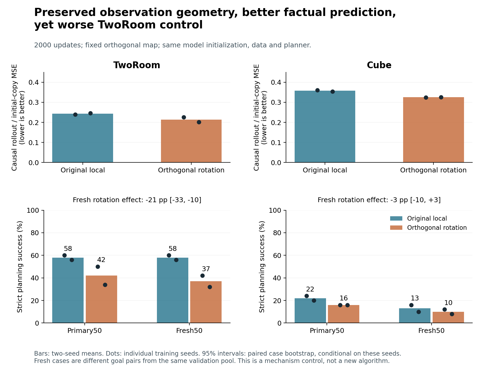
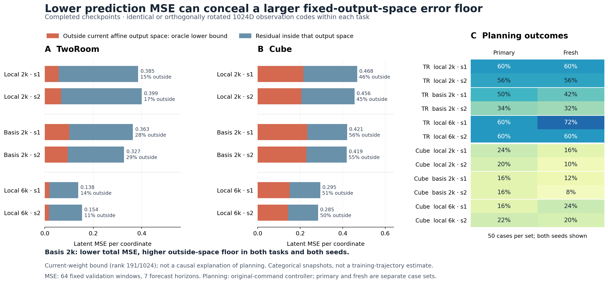

# Completed bounded stages: prediction improvements are not control improvements

No tested sample-level method has yet shown substantial superiority over the appropriate baselines on both tasks. At6000 updates, the local1024 carrier improves some Cube comparisons but remains weak in absolute performance and trails the stronger64-D carriers/native LeWM on TwoRoom. Neither greater state/action sensitivity nor lower factual prediction error is sufficient evidence for better planning.

|6000-update model|TwoRoom primary / fresh, seeds1/2|Cube primary / fresh, seeds1/2|
|---|---|---|
|TF64|2/4 ;4/2|24/14 ;14/18|
|Fixed64 identity|80/86 ;74/80|10/12 ;12/10|
|Fixed64 learned free chart|90/94 ;82/86|Not continued to6000|
|Fixed64 learned bounded chart|92/88 ;80/94|Not continued to6000|
|Local1024|60/60 ;72/60|16/22 ;24/20|
|Dense1024|12/14 ;20/18|12/18 ;10/14|
|Native LeWM, raw|80/72 ;76/70|24/22 ;12/14|
|Native LeWM, fixed train-only BN calibration|82/78 ;84/88|16/18 ;20/16|

Entries are success percentages, with both training seeds retained. Data/update exposure, ordered cases, planner budgets, action normalization and strict success semantics are matched within each comparison. Native LeWM is approximately18M parameters, F/TF51M and local/dense56M; this is not equal capacity or compute. Baselines retain their native objectives; only our candidates are required to use sample-level losses. Fresh means new goal pairs from the existing validation pool, not an independent test dataset. We do not choose raw versus calibrated LeWM separately by task or case set.

Cube local−TF6000 is0pp[-7,7] on primary and+6pp[-1,14] on fresh; local−calibrated-native is+2pp[-5.025,10] and+4pp[-7,15]. These paired95% intervals condition on two fixed training seeds and do not establish a stable advantage. Meanwhile local causal rollout/copy MSE falls from.361/.354 at2000 to.227/.221 at6000, and DiT wrong-state sensitivity grows from1.57/1.68 to8.47/8.39. This is learned input use with limited task progress, not persistent collapse. Extending Cube TF from6000 to12000 likewise improves denoising diagnostics but changes success by0pp[-8,8] primary and−1pp[-9,7] fresh. Those training branches are held.

The orthogonal control supplies a cleaner mechanism counterexample. Its fixed Q preserves observation information and Euclidean goal distances to rounding. At2000 it has lower factual rollout and one-step errors in all four task/seed pairs, yet TwoRoom planning falls16pp[-24,−8] primary and21pp[-33,−10] fresh. Therefore neither retained information nor factual average MSE alone explains planning success. This does not identify the responsible network component: Q changes predictor and renderer parameterization, and independently trained predictors are not forced to be conjugate. Errors under planner-proposed actions and how those errors change candidate ranking are still unmeasured.

The next bounded work tests three separate questions, not three claimed innovations: a shared invertible16-channel chart asks whether locally learned coordinates help without discarding detail; a frozen decoder-response metric tests the mismatch between generation geometry and planning distance; a common-action-bank environment audit tests factual-versus-counterfactual ranking accuracy. Each starts with CPU contracts and a committed-source technical/short gate. No new long grid or automatic continuation follows from this review. Decoder geometry is a controller diagnostic and the common-bank rollouts supply diagnostic labels only, never additional training data.

Full supporting reports: [local6000](results/gate6000/RESULTS.md), [orthogonal2000](results/basis2000/RESULTS.md), [native6000](../native_baseline_20261031/results/gate6000/RESULTS.md), [TF12000](../carrier_progress_20261031/results/tf12000/RESULTS.md). All relevant stages completed successfully, original checkpoints and historical holds are preserved, and idle owned dispatchers are closed. The high-performance goal and the request for ten genuinely distinct evidence-backed successful ideas remain open.

## Subsequent mechanism checks, 2026-10-31 00:44 UTC

The first common-bank diagnostic exposes a potentially consequential action-support mismatch. In one fixed TwoRoom case, 24.31% of the candidate action coordinates are clipped by the environment, whereas every finite coordinate in the actual training data is within the actuator bounds. Native CEM passes its unbounded commands to the model before this environmental clipping. This does not by itself establish a software bug: a learned model could learn saturation. It does identify extrapolation outside the observed training-action support.

Applying the same known actuator projection before prediction, while retaining the original64 candidates and their already measured physical endpoints, improves identity-local2000 Spearman from−.142 to.392 and span-normalized regret from.968 to.028. The orthogonal-local2000 model improves from.051 to.674 and1.000 to.012. Both original first-eight costs reproduce exactly; weights and true endpoint costs remain unchanged. This is one diagnostic case, with no new physical rollouts, and cannot establish closed-loop improvement or explain the aggregate orthogonal-control gap. Projection is a common controller treatment to test on every baseline, not a new learning algorithm or justification for replacing the published original protocol. See [the saved review](../basis_counterfactual_20261031/results/projection-pilot-seed1-case0.json).

All eight frozen decoder-response calibrations also pass integrity review. Each uses128 training clips and eight response vectors per clip, with unchanged weights and model buffers. TF's response participation rank is2.26–3.17 versus8.91–20.70 for fixed64; all matrices have numerical rank64. These coordinate-dependent concentrations are not evidence of information loss or superior representations. The next fixed-metric control compares identity, decoder geometry and a spectrum-preserving rotation under the original command protocol, separately from actuator projection. See [calibration results](../decoder_geometry_20261031/results/calibration/RESULTS.md).

The Cube execution audit prevents overgeneralizing the TwoRoom result. Cube exposes a bounded action space but its native controller affine-transforms out-of-range commands before state-dependent workspace and gripper limits; clipping those commands can change the executed target even away from a workspace boundary. A Cube score-only clip would therefore be inconsistent with retaining the original executed command. The proposed common bounded-controller comparison projects both the model input and returned execution command, using the same action-space bounds for every model and task. It preserves actuator equivalence on TwoRoom and deliberately changes the controller on Cube. All original-command evaluations remain separate.

The shared local chart completes all20 short-gate endpoints at600 updates. All original553 initial tensors and210 frozen tensors pass, and its2128 new parameters receive gradients. TwoRoom changes by+2pp[-3,+7], Cube by+5pp[0,+10], conditional on the two training seeds. Inverting cached chart predictions back into the common original coordinates leaves factual prediction errors almost unchanged. This is not evidence of improved dynamics or mature superiority;600 remains inside the1249-update warmup. The four runs remain held pending a further reviewed allocation. See [chart600 review](results/chart600/RESULTS.md).

## Completed decoder-distance comparison

All48 fixed-distance evaluations complete successfully. TwoRoom TF improves from3% to10% on both primary and fresh sets, but the same-spectrum random rotation reaches9% and11%. Thus this result does not isolate a benefit of decoder-specific axes. Fixed64's primary/fresh averages change83/77% to77/78%; Cube effects change sign across seeds or case sets. Do not promote this distance or add a tuning grid. The scientifically relevant result is that a generation-sensitive metric need not be a better control metric. Full per-seed outcomes and paired intervals are in [the48-endpoint report](../decoder_geometry_20261031/results/evaluation6000/RESULTS.md).

Only13/16 original-distance evaluations reproduce all historical case outcomes. Three Cube replays differ on five individual cases, despite matching source/checkpoint/cases/protocol and exactly unchanged native cost algebra. The report uses actual contemporaneous baselines, not substituted old outcomes. Separate native-calibrated and local1024 pass-through tests each also change one Cube case from failure to success. Those failed strict-replay gates and their blocked dependencies are preserved. Bare native-evaluator repeats and a small reset-state audit investigate whether this originates in the original environment or the wrappers; neither cause nor a repair is established yet.

Five bare, unwrapped native repeats now finish successfully. Two differ from their historical vectors: fixed64 Cube seed1 primary10→12%, and native-calibrated Cube seed1 primary16→18%. Three others match their historical vectors. Thus a wrapper is not necessary for every changed outcome, but these repeats do not establish that wrappers have no effect or prove the reset mechanism. See [all three vectors per comparison](../decoder_geometry_20261031/results/bare-replay6000/RESULTS.md). Original failed strict-replay gates remain failed; their ten pending jobs move to an explicitly reviewed recovery root with unchanged code, rather than rewriting exits. Current paired-case intervals omit environment repeat variance and are exploratory.

## Completed common bounded-controller comparison

All32 bounded evaluations complete, using the same action-space projection before model prediction and physical execution for every model. Two-seed mean primary/fresh success is: TwoRoom native-cal76/84%, TF10/7%, fixed64 80/82%, local65/66%; Cube native-cal17/19%, TF14/20%, fixed64 8/7%, local21/22%. This does not solve TF’s TwoRoom failure or fixed64’s Cube failure. Local’s small Cube advantage over the calibrated native variant is not significant, and raw native was not evaluated under this intervention. First proposed banks match across models/seeds and returned commands obey the bounds. Historical baselines and every repeat remain separate; no best reference is selected. The single-case ranking rescue did not generalize into a broad closed-loop rescue. See [complete controller results](../action_projection_20261031/results/evaluation6000/RESULTS.md).

The reset followup also prevents an unsupported repair: after an identical bounded action, all recorded physical fields,286 visual arrays, textures, XML and segmentation are exact across nine paired comparisons. RGB differs sparsely (MAE.0143–.0216 on a0–255 scale), predominantly on the robot. The suspected skybox texture change is absent, and neither the render mechanism nor its contribution to task flips is proven. Stop this diagnostic branch; keep the original evaluator and account for repeat variation when judging a promising method. [Report and fixed-case figure](../action_projection_20261031/results/reset-visual/RESULTS.md).

## Chart maturity check and direct-RGB information audit

All32 chart2000 endpoints and eight recoverable archives pass. TwoRoom primary60/58% versus identity60/56%, with identical fresh rates60/56%; Cube primary16/16% versus24/20%, fresh18/18% versus16/10%. Every paired interval includes zero. State/action use is now learned, so the weak600-update condition use no longer explains the failure. Chart code RMS falls12–20% and native rate21–27%, whereas common-original-coordinate rollout error changes only about0–2%. The learned residual bound approaches.5. This supports investigating coordinate contraction as a source of objective improvement; it does not attribute every rate change to scaling. A noiseless invertible chart need not preserve information after adding fixed isotropic noise in the new coordinates. All four stop at2000. [Full chart report](results/chart2000/RESULTS.md).

A single CPU-only Cube audit also does not justify a direct-RGB training grid. It uses the exact old128train/64val cohort, old shared192×16 projection, one global training calibration and unchanged readout settings. Raw RGB gives RBF xyz7.92cm versus random-ViT6.65/6.74cm, with pose still near22 degrees. Native224-to64 preprocessing is exact for all1536 frames, old readouts reproduce, and channel energy remains finite under sigma.1. TwoRoom lacks the corresponding cached cohort and was not substituted. This is weaker observed readout, not a proof that a local dynamical parameterization cannot learn better. Hold it without training. [Information audit](results/direct-rgb/RESULTS.md).

Only two original native Cube references now continue from6000 to12000, matching the already completed TF12000 update/window exposure. Original raw full states and training code remain unchanged;8000/10000/12000 archives gate continuation. Raw and the fixed128-training-clip BN variant remain separate, with original primary/fresh cases and no posthoc variant selection. Native18.04M versus TF/F51.1M remains a capacity/compute difference. No new method training follows from the coordinate-consistency proposal until its algebra and numerical contracts are reviewed.

## Observation information and expressible changes are separate requirements

A CPU audit of 20 existing checkpoints and 18 saved trajectory caches identifies a concrete restriction of the local1024 predictor. Its last operation is LayerNorm(192) followed by a linear output, with an identity carry. For fixed weights, every increment belongs to one affine space, `c + range(V)`, of rank at most 191. A k-step endpoint therefore belongs to `u0 + k*c + range(V)`, even though the observed carrier has 1024 coordinates. At the two Cube6000 checkpoints, the component outside that space accounts for 51.03% / 50.14% of measured clean forecast error. The corresponding TwoRoom fractions are only 14.17% / 11.45%. These are lower bounds for the current output weights, not impossibility results for all trained rank191 models. They do not identify task-relevant directions or establish a cause of planning failure. [Full derivation and measurements](../predictor_span_20261031/results/RESULTS.md).

The distinction matters for goal evaluation. At a fixed initial state and horizon, the squared goal error outside the output space is constant across candidate actions. Preserving a coordinate in the observation does not ensure that the predictor can express its action-dependent changes, or that the planner can use it to rank actions. Conversely, removing this restriction cannot ensure accurate dynamics: the full-rank64 models already demonstrate that expressibility alone is insufficient.

A train-only control rejects one tempting shortcut. Fitting a rank191 affine PCA space to the existing128 Cube training clips halves its training residual, but raises the held-out residual by18.81% /16.46% relative to the learned output space. There is no evidence here that replacing the learned directions with this empirical PCA improves generalization. The learned predictor saw more training data; this is a diagnostic, not an equal-exposure algorithm comparison. [PCA results](../predictor_span_20261031/results/pca/RESULTS.md).

Both seeds and every selected checkpoint are shown. The orthogonal2000 control lowers total forecast MSE while increasing the current output-space error floor. The planning panel supplies the associated outcomes; it does not establish that this floor causes those outcomes. [Figure provenance and limits](../predictor_span_20261031/results/mechanism-figure/CAPTION.md).

The next technical prototype consequently tests a state-dependent output map against a static map with the same extra parameters. A state-dependent map can change output directions along a rollout while retaining the original sample-level loss. It does not increase instantaneous rank at a fixed state, and dynamic filters/hypernetworks are established ideas. CPU algebra and initialization contracts were followed by eight real three-update runs and eight full-state audits, all successful. The original553 initial tensors match, all210 frozen tensors remain unchanged, and the same four added head tensors contribute5376 parameters. Positive head gradients establish a live path only: the input weights have not yet changed under the tiny warmup updates. On review, a separate eight-run600-step gate started on dev15 at03:14:30 UTC with unchanged source `d6d0a9f85127a8af3e65bd31b29c161c3584867c`. It stops after the full health, transition and primary50 evaluation chain. These are not task gains or evidence of academic novelty. [Technical preflight](../dynamic_readout_20261031/results/preflight/RESULTS.md).

## Coordinate correction: valid algebra, failed numerical gate

The chart experiment separates another requirement: invertibility before noise does not imply equal information after coordinate-dependent noise. Pushing both prior and posterior through the same invertible chart cancels their Jacobians in the KL; keeping noise, rate and planning in raw coordinates removes the incentive to lower rate solely by contracting coordinates. A scalar example lowers the old rate from52.51841 to14.64341 without improving raw prediction, whereas the corrected rate remains52.51841. This is classical change of variables, not a new information source or a novelty claim. [Theory and CPU counterexamples](../ideas10_20261030/theory/coordinate_consistency/NOTE.md).

The implemented raw-coordinate variant passed CPU and real two-update contracts, but all four fresh600 attempts stopped at112 /124 /163 /116 updates on the same inverse-adjoint residual check. No600 health or planning result exists. The failures and original source remain held. One exact diagnostic reproduces seed1's step112 failure: replaying its full captured operands with the original TF32 policy fails, while IEEE FP32 and FP64 pass at the original64 iterations and relative tolerance1e-6. Against a dense FP64 adjoint solve, maximum solution error divided by each slot’s right-hand-side norm is4.709e-7 for the failing TF32 solve and4.751e-8 for IEEE FP32. This identifies a precision-sensitive residual test, not mathematical divergence or a poor method score. A separately reviewed numerical repair must pass another short gate. [Original four failures](raw_chart/failure600/RESULTS.md), [exact precision replay](raw_chart/adjoint_diagnosis/RESULTS.md).

## Subsequent execution faults and numerical recovery

All eight dynamic-readout runs saved their600-step states, but their dispatcher exited on a temporary worker-status file rename before collecting OS exits. Those eight exit codes remain unknown. A separate recovery completed eight full-state audits successfully, including the original553 initial tensors,210 frozen tensors and all four actual head gradients. Its eight health jobs then failed because the native checker treats a complete parameter name as a module prefix; the corresponding trace fields are also empty-group zeros. These are preserved diagnostic failures, not failed model gradients or planning outcomes. No planning result exists at this review. A separate compatibility helper will verify the exact-checkpoint per-parameter evidence while retaining the original module checks and all native health cases. The old failures are never relabeled.

The raw-coordinate precision repair now passes the captured full-batch GPU solver test without changing global TF32 settings or tolerances. A fresh TwoRoom seed1 run also reaches200 and passes both native endpoints, including full optimizer/scheduler/RNG state,557 initial tensors and210 frozen tensors. Its chart gradient is positive and finite, peak allocation107.571GiB, and the effective residual Lipschitz upper bound is.00621. This verifies the repaired numerical path beyond the old112-step failure; it is not evidence of useful planning. The reviewed next allocation is four600-step chains with consistent repaired precision, reusing that audited200 state for seed1 and starting the other three fresh. Every old failure and hold remains intact.

## Completed12k reference and600-step readout comparison

The native Cube reference completes all26 endpoints and all full-state/source/protocol audits. Raw12k success is26/26% primary and28/26% fresh, versus TF12k18/20% and14/16%; average differences are+7pp[-3,17] and+12pp[3,22]. The fixed train-only BN variant is30/28% and30/26%, retained separately without selecting a better variant per task or case set. Native uses approximately18M parameters versus TF51M; equal update/window exposure does not equal capacity or compute. This establishes a stronger mature reference, not a universal superiority claim. [Full interpretation](../native_baseline_20261031/results/gate12000/INTERPRETATION.md).

The dynamic-readout600 recovery also completes its24 final endpoints with all original failures and unknown OS exits retained. TwoRoom identity/STATIC/STATE success is16/24%,24/30%,38/20%; Cube is0/4%,6/10%,6/2%. STATE−STATIC averages+2pp[-9,13] and−4pp[-9,0]. STATE improves same-coordinate factual error in all four pairs and its state-dependent output matrices are active; neither result establishes improved planning. STATIC’s small Cube advantage over identity is+6pp[2,11], conditional on two seeds and50 cases, without multiple-comparison correction. The reviewed followup retains both arms and both seeds to2000, crossing the1249-update warmup, with original primary/fresh controls. No longer budget or STATE-winner claim is justified. [Complete comparison and mechanism measurements](../dynamic_readout_20261031/results/gate600/RESULTS.md).

The repaired raw-coordinate method has no600 result: all four runs fail at574/553/452/456 on the final public-dtype certificate. All latest400 full states remain recoverable. Exact replay of the574 failure identifies premature stopping: the internal solve reaches.9966365 of the allowed error, but FP32 rounding raises it to1.0157375; the original next check at iteration8 passes below.097. The authorized correction tests the actual returned value before stopping, without changing precision, tolerance or the64-iteration limit. Another bounded single-run recovery is required; the previous200-step numerical success was insufficient.

The two prototypes also differ geometrically. An invertible chart bends the predictor’s fixed affine output space into a curved reachable set; a state-dependent output matrix can change how available directions compose along a trajectory. A finite four-step counterexample distinguishes these properties while preserving low instantaneous rank. This is an analytical limit, not a novelty claim or evidence that the implemented head gains control-relevant reachability. [Derivation and CPU witness](../predictor_span_20261031/geometry/NOTE.md).
