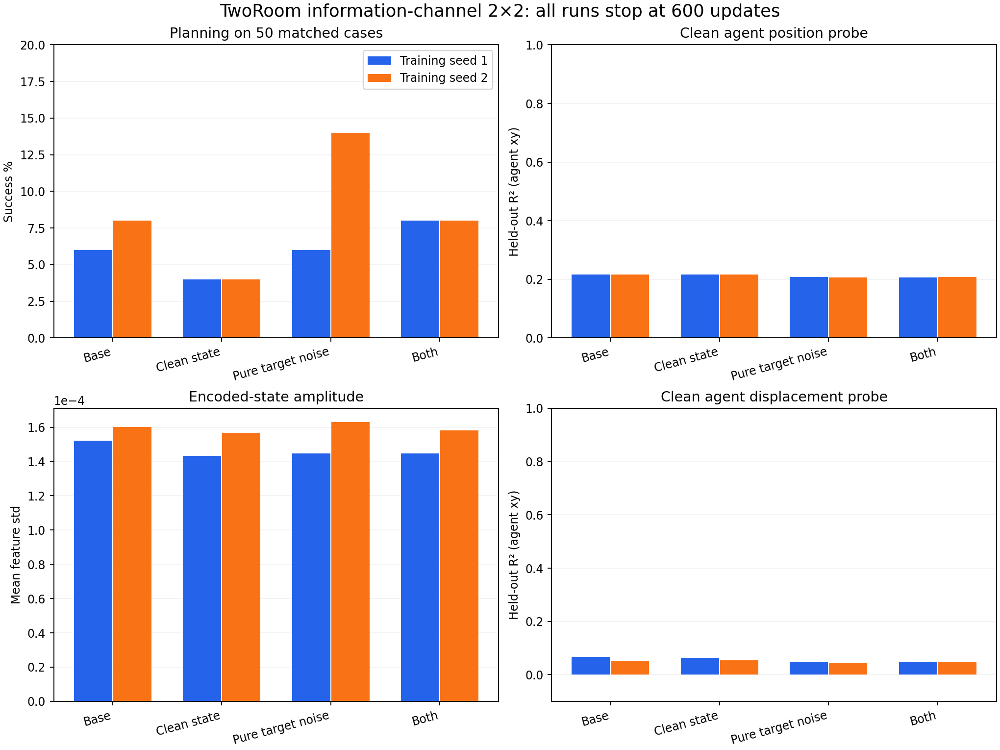

# TwoRoom information-channel 2×2 diagnostic

All 26 new endpoints completed with exit 0: six training, six health, six frozen-information audits and eight planning evaluations (including two reused baseline weights). All six candidates match all 550 initial tensors of their corresponding fresh baseline. The model config differs only in the two declared channel controls; selected training/data settings also match. All eight planning runs use the same 50 validation cases.

The 2×2 factors are: posterior sampling noise retained/removed, and standard target corruption/pure target noise t=1. Beta=.25 and sigma0=.1 inside the rate expression are unchanged. The controls are diagnostic surrogates, not an exact ELBO claim. Base training and information audits are reused from the rate-on fresh-600 cohort; its planning was evaluated in this campaign.

## Results

| Arm | Seed | P0 % | Versus base pp | Gained/lost | Clean agent xy R² | State std | Clean constant-state MSE change % |
|---|---:|---:|---:|---:|---|---:|---:|
| base | 1 | 6 | +0 | 0/0 | 0.1607, 0.2723 | 0.000152172 | 0.000382 |
| base | 2 | 8 | +0 | 0/0 | 0.1243, 0.3075 | 0.000160116 | 0.000483 |
| clean-state | 1 | 4 | -2 | 2/3 | 0.1613, 0.2729 | 0.000143222 | 0.000808 |
| clean-state | 2 | 4 | -4 | 2/4 | 0.1250, 0.3069 | 0.000156692 | 0.000924 |
| pure-target-noise | 1 | 6 | +0 | 2/2 | 0.1433, 0.2726 | 0.000144768 | -0.000164 |
| pure-target-noise | 2 | 14 | +6 | 7/4 | 0.1131, 0.2983 | 0.000162915 | 0.000082 |
| both | 1 | 8 | +2 | 4/3 | 0.1434, 0.2703 | 0.000144799 | 0.000475 |
| both | 2 | 8 | +0 | 4/4 | 0.1139, 0.3032 | 0.00015818 | -0.000037 |

**Neither channel intervention produces a clear representation recovery at this gate.** Clean position probes and state amplitude remain close to the baseline across both seeds. Planning is base 6/8%, clean-state 4/4%, pure-target-noise 6/14%, and both 8/8%. The pure-target-noise gain appears only in seed 2; no reliable cross-seed advantage or consistent positive interaction is established.

**This is not merely an artifact of adding noise during the audit.** Under the explicitly clean-state sigma=0, t=1 diagnostic, replacing the tiny varying posterior means by their batch mean changes renderer MSE by less than .001% in every candidate. This intervention is a fixed-model readout check, not a proposed batch-dependent training loss. The decoder currently makes little use of these clean state differences.

**The result does not imply permanent impossibility.** All runs stop at 600, inside the inherited 1249-update learning-rate warmup. These controls reject an immediate rescue at this measured stage; they cannot establish that more learning would never help. The spatial probe result independently shows position is accessible before the learned pooling path, motivating a more specific representation intervention rather than treating these two channel changes as a validated fix.

## Correct interpretation of noise and loss

For clean-state and both, the sigma=.1 noisy probes and noisy forecast interventions deliberately test robustness to the original channel; they are counterfactual to those arms' noise-free training. They must not be called measurements of native noisy-state use. The clean probes and clean sigma=0 intervention above avoid that ambiguity.

Pure-target-noise changes the training corruption distribution. Its scalar training FM loss is therefore not directly comparable with the baseline's sampled-t loss as evidence of quality. Fixed-t diagnostic errors also remain denoising measurements, not generated-image quality or task success. No policy receives diagnostic physical labels.

## Per-coordinate probes

Coordinate order: agent x/y, target x/y. The fixed sigma=.1 column is a counterfactual noise-tolerance test for noise-off arms.

| Arm | Seed | Clean R² vector | Original-noise R² vector |
|---|---:|---|---|
| base | 1 | 0.1607, 0.2723, 0.1201, -0.0231 | -0.0622, -0.0526, -0.0599, -0.0368 |
| base | 2 | 0.1243, 0.3075, 0.1263, -0.0307 | -0.0621, -0.0525, -0.0596, -0.0369 |
| clean-state | 1 | 0.1613, 0.2729, 0.1201, -0.0230 | -0.0622, -0.0526, -0.0599, -0.0368 |
| clean-state | 2 | 0.1250, 0.3069, 0.1256, -0.0305 | -0.0621, -0.0525, -0.0596, -0.0369 |
| pure-target-noise | 1 | 0.1433, 0.2726, 0.1291, -0.0207 | -0.0622, -0.0526, -0.0599, -0.0368 |
| pure-target-noise | 2 | 0.1131, 0.2983, 0.1280, -0.0324 | -0.0621, -0.0525, -0.0595, -0.0369 |
| both | 1 | 0.1434, 0.2703, 0.1287, -0.0211 | -0.0622, -0.0526, -0.0599, -0.0368 |
| both | 2 | 0.1139, 0.3032, 0.1283, -0.0305 | -0.0621, -0.0525, -0.0595, -0.0369 |

## Decision

Hold these six candidates at the measured gate. Preserve all seeds, full state and source snapshots. There is no evidence here for promoting a channel-only change to a long run. Continue the already specified, separately gated test of spatial locality versus matched shuffled pooling. This report does not alter or launch that campaign.

