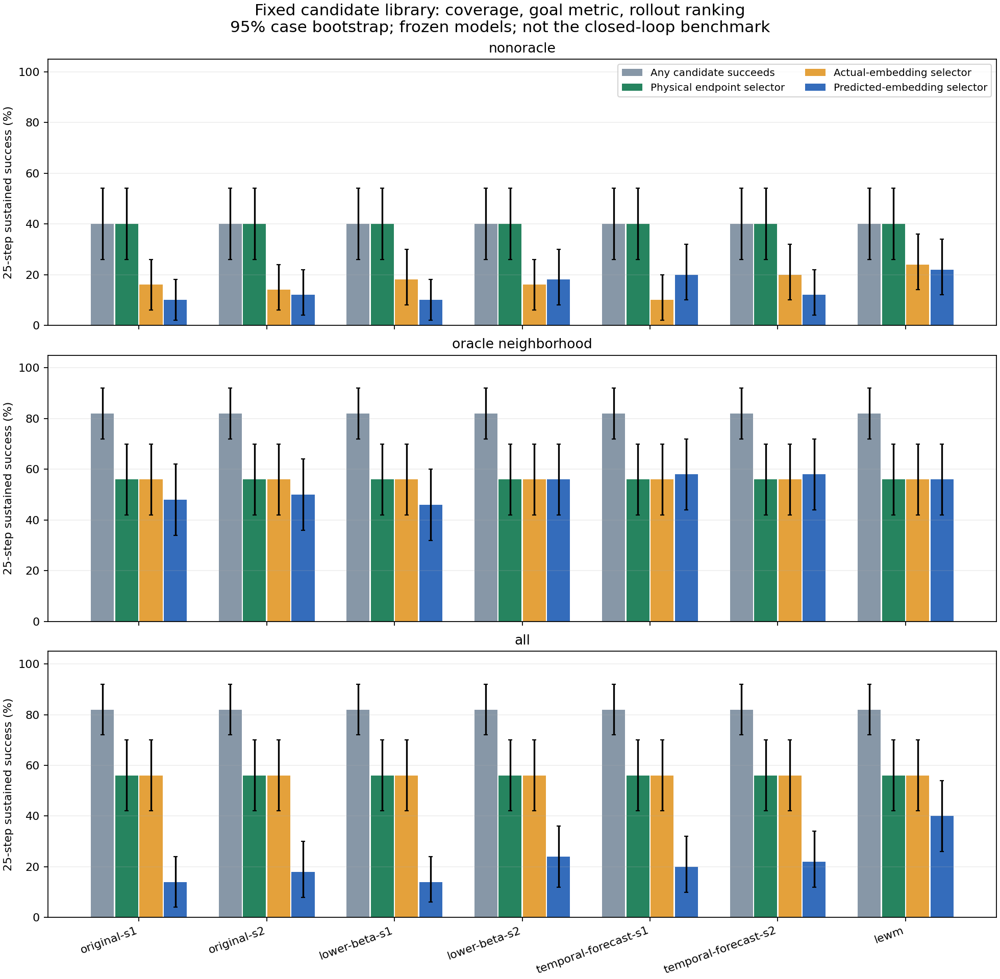
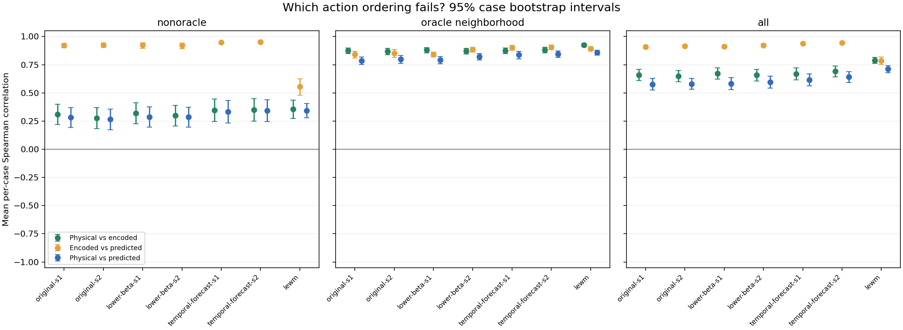

# Cube fixed-candidate mechanism audit

Conditional on fixed trained weights and fixed candidate library. Paired case resampling; no inference over training seeds. Recorded-action oracle families are not deployable policies. 25-step first-plan diagnostic, not 50-step MPC benchmark.

Matched cases: 50. Intervals: 95% percentile case bootstrap (5000 draws).

Success is the strict position + 24-symmetry orientation + hold criterion. The physical selector minimizes endpoint normalized pose error, so its success need not equal the library's any-success coverage.

## nonoracle

| Model | Any success % | Physical selector % | Encoded selector % | Model selector % |
|---|---:|---:|---:|---:|
| original-s1 | 40.0 [26.0, 54.0] | 40.0 [26.0, 54.0] | 16.0 [6.0, 26.0] | 10.0 [2.0, 18.0] |
| original-s2 | 40.0 [26.0, 54.0] | 40.0 [26.0, 54.0] | 14.0 [6.0, 24.0] | 12.0 [4.0, 22.0] |
| lower-beta-s1 | 40.0 [26.0, 54.0] | 40.0 [26.0, 54.0] | 18.0 [8.0, 30.0] | 10.0 [2.0, 18.0] |
| lower-beta-s2 | 40.0 [26.0, 54.0] | 40.0 [26.0, 54.0] | 16.0 [6.0, 26.0] | 18.0 [8.0, 30.0] |
| temporal-forecast-s1 | 40.0 [26.0, 54.0] | 40.0 [26.0, 54.0] | 10.0 [2.0, 20.0] | 20.0 [10.0, 32.0] |
| temporal-forecast-s2 | 40.0 [26.0, 54.0] | 40.0 [26.0, 54.0] | 20.0 [10.0, 32.0] | 12.0 [4.0, 22.0] |
| lewm | 40.0 [26.0, 54.0] | 40.0 [26.0, 54.0] | 24.0 [14.0, 36.0] | 22.0 [12.0, 34.0] |

| Model | Physical / encoded rank | Encoded / predicted rank | Metric regret | Signed dynamics regret | Model success delta vs reference (pp) |
|---|---:|---:|---:|---:|---:|
| original-s1 | 0.31 [0.22, 0.40] | 0.92 [0.90, 0.94] | 0.99 [0.52, 1.56] | 0.80 [0.17, 1.51] | -12.0 [-24.0, 0.0] |
| original-s2 | 0.28 [0.18, 0.37] | 0.93 [0.91, 0.94] | 1.00 [0.56, 1.51] | 0.54 [0.00, 1.14] | -10.0 [-22.0, 2.0] |
| lower-beta-s1 | 0.32 [0.23, 0.41] | 0.92 [0.90, 0.95] | 0.96 [0.52, 1.50] | 0.34 [-0.19, 0.90] | -12.0 [-24.0, 2.0] |
| lower-beta-s2 | 0.30 [0.21, 0.39] | 0.92 [0.89, 0.94] | 1.00 [0.55, 1.51] | 0.49 [-0.01, 1.06] | -4.0 [-14.0, 8.0] |
| temporal-forecast-s1 | 0.35 [0.25, 0.44] | 0.95 [0.93, 0.96] | 1.59 [0.93, 2.35] | -0.40 [-1.00, 0.17] | -2.0 [-14.0, 12.0] |
| temporal-forecast-s2 | 0.35 [0.25, 0.45] | 0.95 [0.94, 0.96] | 0.98 [0.51, 1.53] | 0.14 [-0.37, 0.68] | -10.0 [-24.0, 4.0] |
| lewm | 0.35 [0.27, 0.44] | 0.56 [0.48, 0.63] | 0.41 [0.16, 0.77] | 0.99 [0.34, 1.77] | 0.0 [0.0, 0.0] |

| Model | Position / encoded rank | Orientation / encoded rank | Effector / encoded rank | Effector partial rank (controlling cube pose) | Position partial rank (controlling effector and orientation) |
|---|---:|---:|---:|---:|---:|
| original-s1 | 0.30 [0.20, 0.39] | 0.11 [0.03, 0.19] | 0.85 [0.79, 0.90] | 0.80 [0.72, 0.86] | 0.09 [0.02, 0.16] |
| original-s2 | 0.27 [0.17, 0.37] | 0.11 [0.03, 0.19] | 0.83 [0.73, 0.90] | 0.79 [0.70, 0.87] | 0.07 [0.01, 0.13] |
| lower-beta-s1 | 0.31 [0.21, 0.41] | 0.12 [0.04, 0.20] | 0.85 [0.78, 0.90] | 0.78 [0.71, 0.85] | 0.12 [0.05, 0.20] |
| lower-beta-s2 | 0.29 [0.19, 0.38] | 0.13 [0.05, 0.20] | 0.84 [0.76, 0.90] | 0.78 [0.70, 0.85] | 0.08 [0.01, 0.15] |
| temporal-forecast-s1 | 0.34 [0.23, 0.44] | 0.11 [0.03, 0.19] | 0.95 [0.94, 0.96] | 0.93 [0.91, 0.94] | 0.03 [-0.03, 0.09] |
| temporal-forecast-s2 | 0.34 [0.23, 0.44] | 0.11 [0.04, 0.19] | 0.96 [0.95, 0.96] | 0.93 [0.92, 0.95] | 0.02 [-0.04, 0.08] |
| lewm | 0.39 [0.30, 0.47] | 0.08 [0.01, 0.15] | 0.45 [0.35, 0.54] | 0.41 [0.32, 0.49] | 0.24 [0.15, 0.34] |

Partial correlations residualize per-case ranks on the stated controls. These diagnose association, not causal nuisance dependence; robot pose may legitimately matter for dynamics even when it is absent from the cube success criterion.

## oracle neighborhood

| Model | Any success % | Physical selector % | Encoded selector % | Model selector % |
|---|---:|---:|---:|---:|
| original-s1 | 82.0 [72.0, 92.0] | 56.0 [42.0, 70.0] | 56.0 [42.0, 70.0] | 48.0 [34.0, 62.0] |
| original-s2 | 82.0 [72.0, 92.0] | 56.0 [42.0, 70.0] | 56.0 [42.0, 70.0] | 50.0 [36.0, 64.0] |
| lower-beta-s1 | 82.0 [72.0, 92.0] | 56.0 [42.0, 70.0] | 56.0 [42.0, 70.0] | 46.0 [32.0, 60.0] |
| lower-beta-s2 | 82.0 [72.0, 92.0] | 56.0 [42.0, 70.0] | 56.0 [42.0, 70.0] | 56.0 [42.0, 70.0] |
| temporal-forecast-s1 | 82.0 [72.0, 92.0] | 56.0 [42.0, 70.0] | 56.0 [42.0, 70.0] | 58.0 [44.0, 72.0] |
| temporal-forecast-s2 | 82.0 [72.0, 92.0] | 56.0 [42.0, 70.0] | 56.0 [42.0, 70.0] | 58.0 [44.0, 72.0] |
| lewm | 82.0 [72.0, 92.0] | 56.0 [42.0, 70.0] | 56.0 [42.0, 70.0] | 56.0 [42.0, 70.0] |

| Model | Physical / encoded rank | Encoded / predicted rank | Metric regret | Signed dynamics regret | Model success delta vs reference (pp) |
|---|---:|---:|---:|---:|---:|
| original-s1 | 0.88 [0.85, 0.90] | 0.84 [0.81, 0.87] | 0.00 [0.00, 0.00] | 0.50 [0.20, 0.92] | -8.0 [-16.0, -2.0] |
| original-s2 | 0.87 [0.84, 0.89] | 0.85 [0.82, 0.88] | 0.00 [0.00, 0.00] | 0.27 [0.17, 0.40] | -6.0 [-14.0, 2.0] |
| lower-beta-s1 | 0.88 [0.86, 0.90] | 0.84 [0.82, 0.86] | 0.00 [0.00, 0.00] | 0.42 [0.21, 0.76] | -10.0 [-18.0, -2.0] |
| lower-beta-s2 | 0.87 [0.85, 0.89] | 0.88 [0.86, 0.90] | 0.00 [0.00, 0.00] | 0.17 [0.11, 0.23] | 0.0 [-10.0, 10.0] |
| temporal-forecast-s1 | 0.87 [0.85, 0.90] | 0.90 [0.88, 0.92] | 0.00 [0.00, 0.00] | 0.21 [0.12, 0.33] | 2.0 [-4.0, 10.0] |
| temporal-forecast-s2 | 0.88 [0.86, 0.90] | 0.91 [0.89, 0.92] | 0.00 [0.00, 0.00] | 0.22 [0.13, 0.35] | 2.0 [-10.0, 14.0] |
| lewm | 0.93 [0.91, 0.94] | 0.89 [0.87, 0.91] | 0.00 [0.00, 0.00] | 0.17 [0.10, 0.24] | 0.0 [0.0, 0.0] |

| Model | Position / encoded rank | Orientation / encoded rank | Effector / encoded rank | Effector partial rank (controlling cube pose) | Position partial rank (controlling effector and orientation) |
|---|---:|---:|---:|---:|---:|
| original-s1 | 0.87 [0.85, 0.90] | 0.66 [0.62, 0.69] | 0.95 [0.94, 0.96] | 0.65 [0.57, 0.72] | 0.09 [0.01, 0.17] |
| original-s2 | 0.86 [0.83, 0.89] | 0.66 [0.62, 0.69] | 0.95 [0.94, 0.96] | 0.65 [0.55, 0.73] | 0.06 [-0.03, 0.14] |
| lower-beta-s1 | 0.87 [0.85, 0.90] | 0.67 [0.63, 0.70] | 0.95 [0.94, 0.96] | 0.67 [0.59, 0.74] | 0.08 [0.00, 0.16] |
| lower-beta-s2 | 0.86 [0.83, 0.89] | 0.66 [0.63, 0.70] | 0.95 [0.94, 0.96] | 0.65 [0.57, 0.73] | 0.06 [-0.02, 0.15] |
| temporal-forecast-s1 | 0.87 [0.85, 0.90] | 0.67 [0.63, 0.70] | 0.96 [0.95, 0.97] | 0.72 [0.64, 0.78] | 0.02 [-0.06, 0.10] |
| temporal-forecast-s2 | 0.88 [0.85, 0.90] | 0.67 [0.64, 0.71] | 0.96 [0.96, 0.97] | 0.73 [0.65, 0.80] | 0.04 [-0.05, 0.11] |
| lewm | 0.93 [0.92, 0.94] | 0.70 [0.66, 0.73] | 0.91 [0.89, 0.92] | 0.38 [0.29, 0.47] | 0.49 [0.40, 0.58] |

Partial correlations residualize per-case ranks on the stated controls. These diagnose association, not causal nuisance dependence; robot pose may legitimately matter for dynamics even when it is absent from the cube success criterion.

## all

| Model | Any success % | Physical selector % | Encoded selector % | Model selector % |
|---|---:|---:|---:|---:|
| original-s1 | 82.0 [72.0, 92.0] | 56.0 [42.0, 70.0] | 56.0 [42.0, 70.0] | 14.0 [4.0, 24.0] |
| original-s2 | 82.0 [72.0, 92.0] | 56.0 [42.0, 70.0] | 56.0 [42.0, 70.0] | 18.0 [8.0, 30.0] |
| lower-beta-s1 | 82.0 [72.0, 92.0] | 56.0 [42.0, 70.0] | 56.0 [42.0, 70.0] | 14.0 [6.0, 24.0] |
| lower-beta-s2 | 82.0 [72.0, 92.0] | 56.0 [42.0, 70.0] | 56.0 [42.0, 70.0] | 24.0 [12.0, 36.0] |
| temporal-forecast-s1 | 82.0 [72.0, 92.0] | 56.0 [42.0, 70.0] | 56.0 [42.0, 70.0] | 20.0 [10.0, 32.0] |
| temporal-forecast-s2 | 82.0 [72.0, 92.0] | 56.0 [42.0, 70.0] | 56.0 [42.0, 70.0] | 22.0 [12.0, 34.0] |
| lewm | 82.0 [72.0, 92.0] | 56.0 [42.0, 70.0] | 56.0 [42.0, 70.0] | 40.0 [26.0, 54.0] |

| Model | Physical / encoded rank | Encoded / predicted rank | Metric regret | Signed dynamics regret | Model success delta vs reference (pp) |
|---|---:|---:|---:|---:|---:|
| original-s1 | 0.66 [0.61, 0.71] | 0.91 [0.89, 0.92] | 0.00 [0.00, 0.00] | 3.27 [2.54, 4.05] | -26.0 [-42.0, -10.0] |
| original-s2 | 0.65 [0.60, 0.70] | 0.92 [0.90, 0.93] | 0.00 [0.00, 0.00] | 3.11 [2.41, 3.87] | -22.0 [-38.0, -6.0] |
| lower-beta-s1 | 0.67 [0.62, 0.72] | 0.91 [0.90, 0.92] | 0.00 [0.00, 0.00] | 2.55 [1.91, 3.25] | -26.0 [-42.0, -10.0] |
| lower-beta-s2 | 0.66 [0.61, 0.71] | 0.92 [0.91, 0.93] | 0.00 [0.00, 0.00] | 2.85 [2.11, 3.64] | -16.0 [-30.0, -2.0] |
| temporal-forecast-s1 | 0.67 [0.62, 0.72] | 0.94 [0.93, 0.95] | 0.00 [0.00, 0.00] | 2.87 [2.12, 3.64] | -20.0 [-36.0, -4.0] |
| temporal-forecast-s2 | 0.69 [0.64, 0.74] | 0.95 [0.94, 0.95] | 0.00 [0.00, 0.00] | 1.81 [1.18, 2.52] | -18.0 [-34.0, -2.0] |
| lewm | 0.79 [0.76, 0.81] | 0.79 [0.75, 0.82] | 0.00 [0.00, 0.00] | 1.77 [1.20, 2.38] | 0.0 [0.0, 0.0] |

| Model | Position / encoded rank | Orientation / encoded rank | Effector / encoded rank | Effector partial rank (controlling cube pose) | Position partial rank (controlling effector and orientation) |
|---|---:|---:|---:|---:|---:|
| original-s1 | 0.66 [0.60, 0.71] | 0.48 [0.44, 0.51] | 0.94 [0.93, 0.95] | 0.84 [0.79, 0.89] | -0.02 [-0.07, 0.03] |
| original-s2 | 0.65 [0.60, 0.70] | 0.47 [0.44, 0.51] | 0.94 [0.92, 0.95] | 0.83 [0.77, 0.89] | -0.04 [-0.09, 0.01] |
| lower-beta-s1 | 0.67 [0.62, 0.72] | 0.49 [0.45, 0.52] | 0.95 [0.94, 0.96] | 0.84 [0.79, 0.89] | 0.03 [-0.04, 0.09] |
| lower-beta-s2 | 0.65 [0.60, 0.70] | 0.48 [0.45, 0.51] | 0.94 [0.93, 0.95] | 0.83 [0.78, 0.88] | -0.03 [-0.09, 0.03] |
| temporal-forecast-s1 | 0.67 [0.61, 0.72] | 0.48 [0.45, 0.51] | 0.97 [0.96, 0.97] | 0.93 [0.91, 0.94] | -0.08 [-0.12, -0.03] |
| temporal-forecast-s2 | 0.69 [0.64, 0.74] | 0.49 [0.46, 0.52] | 0.97 [0.97, 0.98] | 0.93 [0.92, 0.94] | -0.00 [-0.05, 0.05] |
| lewm | 0.81 [0.78, 0.83] | 0.51 [0.47, 0.55] | 0.76 [0.73, 0.80] | 0.46 [0.39, 0.52] | 0.49 [0.42, 0.56] |

Partial correlations residualize per-case ranks on the stated controls. These diagnose association, not causal nuisance dependence; robot pose may legitimately matter for dynamics even when it is absent from the cube success criterion.

Interpretation requires the collection report's duplicate-state and recorded-action replay audits. Inspect all per-case failures before assigning a mechanism. Candidate coverage, metric alignment and rollout fidelity are separate requirements; this analysis does not establish a new algorithm or its novelty.
