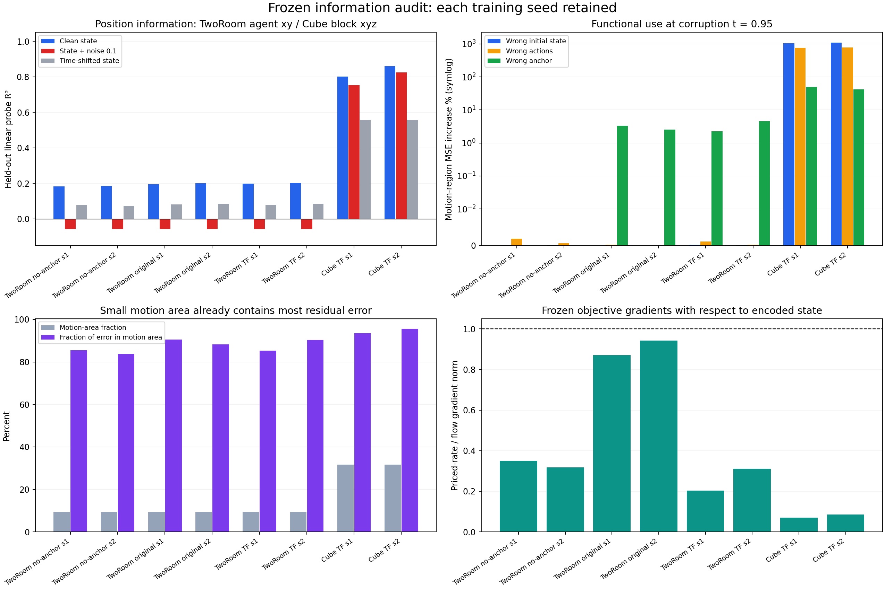

# Frozen information audit: TwoRoom and Cube

All 8 completed checkpoints are retained separately. Each audit uses 16 validation windows for interventions, and 128 training / 128 validation episodes for fixed-ridge probes. The model is frozen. Physical labels train only the diagnostic linear readout; they do not update the world model or policy.

## Main observations

TwoRoom retains weak clean, linearly recoverable position information, but the fixed posterior noise overwhelms it. Frozen-renderer state substitution has negligible effect even when error is measured only on moving pixels. Removing posterior noise and amplifying the tiny signal up to 100 times does not substantially improve this renderer. Small state amplitude is therefore not the entire failure, and linear-probe weakness is not a proof that all nonlinear information is absent.

The moving region occupies about 9.4% of TwoRoom pixels but contains most of the current residual denoising error. The simple explanation that the current loss is numerically dominated by static-background error is contradicted by this audit. Earlier optimization may still have prioritized easily predictable pixels. Both flow and rate share FRAME_ELEMS normalization; image resolution alone does not create an asymmetric weighting.

At the frozen temporal-forecast endpoints, the priced-rate gradient norm is smaller than the flow gradient norm, and the two are nearly orthogonal in encoded-state coordinates. This does not support a claim that the current total state gradient is simply overwhelmed by rate. It does not reconstruct the earlier optimization trajectory or encoder-parameter gradients. Fresh-versus-resumed rate controls are needed to distinguish objective preference from an optimization trap.

Cube is qualitatively different: the state supports strong position probes and the renderer strongly responds to state and action substitutions. Effector position is more accurately linearly recoverable than cube height, and cube displacement probes are weaker than effector displacement probes. This suggests a possible imbalance toward robot information; it does not prove the cause of planning failure or rule out nonlinear decoding. The companion action-candidate/goal-metric audit is needed for causal attribution.

## Position probes and residual error

Position R² below averages agent x/y for TwoRoom and block x/y/z for Cube. Full per-coordinate values are preserved below and in results.json. The motion mask is derived from observed within-window pixel variation, not semantic object labels.

| Checkpoint | Update | Clean R² | Noisy R² | Time-shift R² | Motion pixels % | Error in motion % | Rate/flow grad |
|---|---:|---:|---:|---:|---:|---:|---:|
| TwoRoom no-anchor s1 | 2600 | 0.1834 | -0.0574 | 0.0777 | 9.37 | 85.45 | 0.3497 |
| TwoRoom no-anchor s2 | 2600 | 0.1850 | -0.0573 | 0.0747 | 9.37 | 83.71 | 0.3172 |
| TwoRoom original s1 | 2000 | 0.1948 | -0.0574 | 0.0809 | 9.37 | 90.50 | 0.8697 |
| TwoRoom original s2 | 2000 | 0.2005 | -0.0573 | 0.0867 | 9.37 | 88.28 | 0.9429 |
| TwoRoom TF s1 | 2000 | 0.1980 | -0.0574 | 0.0802 | 9.37 | 85.32 | 0.2034 |
| TwoRoom TF s2 | 2000 | 0.2020 | -0.0573 | 0.0864 | 9.37 | 90.43 | 0.3107 |
| Cube TF s1 | 11671 | 0.8018 | 0.7531 | 0.5570 | 31.64 | 93.40 | 0.0703 |
| Cube TF s2 | 11671 | 0.8596 | 0.8255 | 0.5571 | 31.64 | 95.57 | 0.0855 |

## Functional substitutions

Values are percent change of aggregate MSE relative to the correct forecast, at t=.95. Motion-region values weight each batch by its actual motion area. Very small signed changes should be treated as negligible, not as reliable improvements.

| Checkpoint | Wrong state: all / motion % | Wrong actions: all / motion % | Wrong anchor: all / motion % |
|---|---:|---:|---:|
| TwoRoom no-anchor s1 | 0.00006 / 0.00005 | 0.00070 / 0.00191 | 0.00000 / 0.00000 |
| TwoRoom no-anchor s2 | 0.00007 / 0.00006 | -0.00059 / 0.00061 | 0.00000 / 0.00000 |
| TwoRoom original s1 | 0.00001 / 0.00000 | 0.00010 / 0.00017 | 6.77323 / 3.30228 |
| TwoRoom original s2 | -0.00002 / -0.00003 | 0.00007 / 0.00002 | 5.37152 / 2.54599 |
| TwoRoom TF s1 | 0.00017 / 0.00019 | 0.00105 / 0.00111 | 6.43883 / 2.28230 |
| TwoRoom TF s2 | 0.00014 / 0.00008 | 0.00020 / 0.00014 | 8.42564 / 4.59323 |
| Cube TF s1 | 1132.03466 / 1058.50206 | 715.83357 / 760.90884 | 53.04307 / 50.10722 |
| Cube TF s2 | 1207.18245 / 1107.90004 | 761.18891 / 790.28253 | 44.86924 / 42.09176 |

## Per-coordinate probes

Clean and noisy probes use only training-split feature normalization. Ridge coefficient .001 is fixed. Target dimensions with zero displacement variance have null R² and are excluded from means.

### TwoRoom no-anchor s1

| Coordinate | Clean | Noisy .1 | Time-shifted | Initial carry | Displacement |
|---|---:|---:|---:|---:|---:|
| pos_agent_x | 0.1411 | -0.0621 | 0.0931 | -0.0571 | 0.0012 |
| pos_agent_y | 0.2258 | -0.0526 | 0.0623 | 0.0982 | 0.1209 |
| pos_target_x | 0.1109 | -0.0599 | 0.1109 | 0.0686 | — |
| pos_target_y | -0.0238 | -0.0368 | -0.0238 | -0.2111 | — |
### TwoRoom no-anchor s2

| Coordinate | Clean | Noisy .1 | Time-shifted | Initial carry | Displacement |
|---|---:|---:|---:|---:|---:|
| pos_agent_x | 0.1109 | -0.0621 | 0.0701 | -0.0756 | -0.0597 |
| pos_agent_y | 0.2591 | -0.0525 | 0.0793 | 0.1182 | 0.1475 |
| pos_target_x | 0.1254 | -0.0597 | 0.1254 | 0.1123 | — |
| pos_target_y | -0.0191 | -0.0368 | -0.0191 | -0.0885 | — |
### TwoRoom original s1

| Coordinate | Clean | Noisy .1 | Time-shifted | Initial carry | Displacement |
|---|---:|---:|---:|---:|---:|
| pos_agent_x | 0.1399 | -0.0622 | 0.0841 | -0.0669 | -0.0085 |
| pos_agent_y | 0.2496 | -0.0526 | 0.0777 | 0.1244 | 0.1144 |
| pos_target_x | 0.1219 | -0.0599 | 0.1219 | 0.0620 | — |
| pos_target_y | -0.0231 | -0.0368 | -0.0231 | -0.1224 | — |
### TwoRoom original s2

| Coordinate | Clean | Noisy .1 | Time-shifted | Initial carry | Displacement |
|---|---:|---:|---:|---:|---:|
| pos_agent_x | 0.1156 | -0.0622 | 0.0760 | -0.0580 | -0.0662 |
| pos_agent_y | 0.2855 | -0.0525 | 0.0973 | 0.1615 | 0.1555 |
| pos_target_x | 0.1249 | -0.0595 | 0.1249 | 0.0769 | — |
| pos_target_y | -0.0267 | -0.0369 | -0.0267 | -0.0197 | — |
### TwoRoom TF s1

| Coordinate | Clean | Noisy .1 | Time-shifted | Initial carry | Displacement |
|---|---:|---:|---:|---:|---:|
| pos_agent_x | 0.1412 | -0.0621 | 0.0822 | -0.0621 | -0.0070 |
| pos_agent_y | 0.2548 | -0.0526 | 0.0782 | 0.1280 | 0.1227 |
| pos_target_x | 0.1205 | -0.0599 | 0.1205 | 0.0584 | — |
| pos_target_y | -0.0229 | -0.0368 | -0.0229 | -0.1252 | — |
### TwoRoom TF s2

| Coordinate | Clean | Noisy .1 | Time-shifted | Initial carry | Displacement |
|---|---:|---:|---:|---:|---:|
| pos_agent_x | 0.1133 | -0.0621 | 0.0755 | -0.0606 | -0.0702 |
| pos_agent_y | 0.2907 | -0.0525 | 0.0973 | 0.1469 | 0.1624 |
| pos_target_x | 0.1263 | -0.0595 | 0.1263 | 0.0739 | — |
| pos_target_y | -0.0263 | -0.0369 | -0.0263 | -0.0303 | — |
### Cube TF s1

| Coordinate | Clean | Noisy .1 | Time-shifted | Initial carry | Displacement |
|---|---:|---:|---:|---:|---:|
| privileged_block_0_pos_x | 0.9087 | 0.9007 | 0.7660 | 0.7770 | 0.4398 |
| privileged_block_0_pos_y | 0.9509 | 0.9482 | 0.7918 | 0.7068 | 0.6308 |
| privileged_block_0_pos_z | 0.5458 | 0.4105 | 0.1133 | -0.0289 | 0.6070 |
| proprio_effector_pos_x | 0.9872 | 0.9817 | 0.6909 | 0.7191 | 0.9447 |
| proprio_effector_pos_y | 0.9992 | 0.9986 | 0.7428 | 0.6892 | 0.9959 |
| proprio_effector_pos_z | 0.9797 | 0.9672 | 0.5283 | -0.0016 | 0.9860 |
### Cube TF s2

| Coordinate | Clean | Noisy .1 | Time-shifted | Initial carry | Displacement |
|---|---:|---:|---:|---:|---:|
| privileged_block_0_pos_x | 0.9087 | 0.9019 | 0.7669 | 0.7776 | 0.4250 |
| privileged_block_0_pos_y | 0.9503 | 0.9482 | 0.7926 | 0.7177 | 0.6284 |
| privileged_block_0_pos_z | 0.7197 | 0.6265 | 0.1120 | -0.0149 | 0.7543 |
| proprio_effector_pos_x | 0.9883 | 0.9829 | 0.6893 | 0.7262 | 0.9489 |
| proprio_effector_pos_y | 0.9991 | 0.9986 | 0.7428 | 0.6922 | 0.9952 |
| proprio_effector_pos_z | 0.9881 | 0.9764 | 0.5121 | 0.0000 | 0.9910 |

## Scope

These are frozen endpoint diagnostics, not training or control improvements. Scaling states or removing anchors moves the renderer off its training support. Cross-task checkpoints differ in training budget (TwoRoom 2000/2600 versus Cube 11671); they demonstrate current mechanisms, not equal-budget algorithm rankings. Existing TwoRoom adaptation results from update 2600 used different checkpoints/cases and are not replaced by update-2000 intervention values. All seeds and full gradient ranges, scale curves and intervention levels are retained in results.json.

