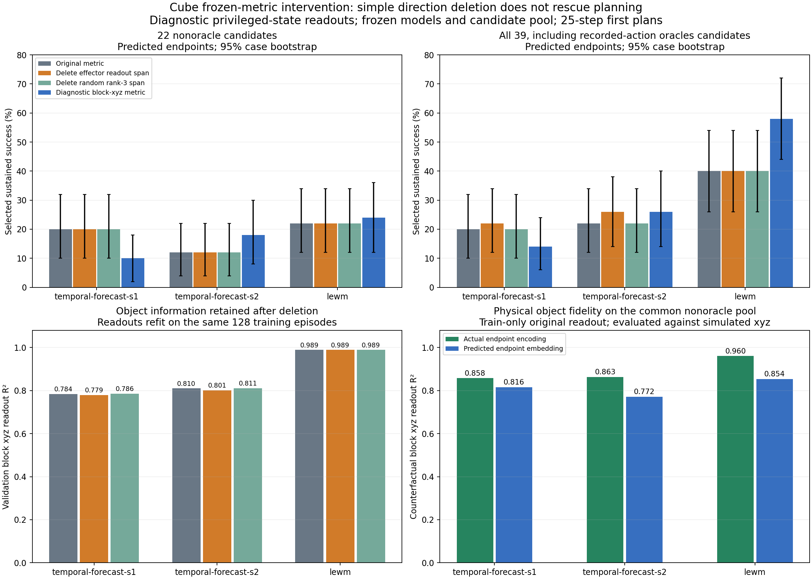

# Cube metric intervention: a negative simple-fix result and a clearer representation gap

Three jobs exit 0. The analysis uses the existing 50 cases and identical 39-candidate library. Each frozen model fits diagnostic xyz readouts on the same 128 training episodes x 8 frames, with a disjoint 128-episode validation set. Privileged coordinates are used only to diagnose a frozen representation and metric, not to train a policy or propose a deployable algorithm. Results are 25-step first-plan selection, not the original 50-step closed-loop benchmark.

## Integrity

Frozen commit b5227ca; script SHA 87e5bb6961b55c48f8981f5e2cf639e6a9ab227df00165572141c21b2ee973a4. All row episode IDs match the authoritative metadata and split; train and validation episodes/rows are disjoint and selected rows match across all three models. Goal embeddings are recomputed from actual goal images. Recomputed original costs differ by at most 1.26e-7 relative to each case maximum and change zero original selected indices. Projection ranks are exactly 64→61 for temporal and 192→189 for LeWM, with idempotence error below 1.4e-15. The fitted effector readout is numerically annihilated (max residual below 3e-17). Full checks are in audit.json.

## Deleting the fitted effector span does not remove effector information

| Model | Original effector val R² | After effector-span deletion, refit R² | Original block val R² | Block after deletion | Block after random deletion |
|---|---:|---:|---:|---:|---:|
| temporal-forecast-s1 | 0.9958 | 0.9944 | 0.7845 | 0.7793 | 0.7858 |
| temporal-forecast-s2 | 0.9968 | 0.9956 | 0.8105 | 0.8013 | 0.8105 |
| lewm | 0.9521 | 0.9247 | 0.9891 | 0.9888 | 0.9890 |

The deletion successfully destroys the specific fitted linear map, yet a newly fitted map recovers nearly all effector information for temporal-forecast. Therefore this is not semantic erasure of the effector, and its weak task effect cannot refute the earlier effector-dominance association. It does reject the simple hypothesis that one removable rank-3 readout span is enough to fix the metric. The apparent redundancy is a property of this linear intervention/readout family; it does not prove a complete factorization theorem.

## Predicted-endpoint selection

Percent sustained success, with 95% paired-case bootstrap intervals. All intervals are conditional on trained weights, the readout fit, and the candidate library.

### nonoracle

| Metric | Temporal seed1 | Temporal seed2 | LeWM |
|---|---:|---:|---:|
| Original metric | 20.0 [10.0, 32.0] | 12.0 [4.0, 22.0] | 22.0 [12.0, 34.0] |
| Delete effector readout span | 20.0 [10.0, 32.0] | 12.0 [4.0, 22.0] | 22.0 [12.0, 34.0] |
| Delete random rank-3 span | 20.0 [10.0, 32.0] | 12.0 [4.0, 22.0] | 22.0 [12.0, 34.0] |
| Diagnostic block-xyz metric | 10.0 [2.0, 18.0] | 18.0 [8.0, 30.0] | 24.0 [12.0, 36.0] |

### all

| Metric | Temporal seed1 | Temporal seed2 | LeWM |
|---|---:|---:|---:|
| Original metric | 20.0 [10.0, 32.0] | 22.0 [12.0, 34.0] | 40.0 [26.0, 54.0] |
| Delete effector readout span | 22.0 [12.0, 34.0] | 26.0 [14.0, 38.0] | 40.0 [26.0, 54.0] |
| Delete random rank-3 span | 20.0 [10.0, 32.0] | 22.0 [12.0, 34.0] | 40.0 [26.0, 54.0] |
| Diagnostic block-xyz metric | 14.0 [6.0, 24.0] | 26.0 [14.0, 40.0] | 58.0 [44.0, 72.0] |

On the nonoracle library, effector-span deletion leaves temporal success exactly at 20%/12%, and random deletion does likewise. On the full library, deletion changes 20→22% and 22→26%; these are one and two paired case changes, with bootstrap intervals including zero. There is no substantial rescue.

Using the diagnostic block-xyz readout metric does not consistently rescue temporal-forecast either: nonoracle predicted selection becomes 10%/18%, and full-library selection becomes 14%/26%. In contrast, LeWM full-library selection changes 40→58%, a paired +18pp interval [6,30]. This gain uses a privileged probe and a library containing recorded-action oracles; it is not a deployable benchmark gain. On the nonoracle library its gain is only 22→24%.

## Actual endpoint information and predicted physical fidelity

| Model | Nonoracle actual-encoding block R² | Nonoracle predicted-embedding block R² | Nonoracle actual-encoding effector R² | Nonoracle predicted-embedding effector R² |
|---|---:|---:|---:|---:|
| temporal-forecast-s1 | 0.8578 | 0.8155 | 0.9889 | 0.9770 |
| temporal-forecast-s2 | 0.8632 | 0.7717 | 0.9912 | 0.9764 |
| lewm | 0.9602 | 0.8539 | 0.9160 | 0.8552 |

Temporal encodes and forecasts the effector extremely well. LeWM preserves substantially more linearly accessible block-position information, both on held-out recorded frames and on counterfactual executed candidates. This strengthens a representation-allocation explanation beyond merely a wrong distance scale. It does not establish that all missing object information is absent: a stronger nonlinear probe or a larger fit set could recover more, and the models differ in state width and training budget.

Actual-embedding selectors use the observed simulated endpoint; predicted selectors use the model rollout. On all 39 candidates, the encoded-goal metrics nearly always select the recorded endpoint, explaining their near-100% endpoint-pose score but only ~56% hold success. Replacing the encoded goal by privileged physical xyz can reduce performance because readout calibration error becomes relevant; that auxiliary control must not be pooled with the encoded-goal metric.

## Updated interpretation

The earlier association remains: temporal goal geometry is strongly effector-centered. The new intervention rules out a simple three-direction subtraction fix, while revealing that object information is less accessible than in LeWM. A method that improves its own latent rollout error may primarily become better at forecasting the factors it already allocates most representation to. This suggests separating three questions: which factors survive encoding, how their distances express a goal, and how accurately action-conditioned predictions preserve those factors. None can be certified by denoising state sensitivity alone.

No new training method is established by this diagnostic. The exact causal contribution of the training objective to object underrepresentation remains open; the deletion intervention acts on the metric, not on learning or physical scene factors. Additional planning duration or full MPC can also change hold outcomes.

Full numeric tables, train/validation/counterfactual probes, and paired intervals: results.json. Integrity: audit.json. Exact per-case intervention records and fitted matrices remain in /efs/prescottsun/SPT-JEPA/runs/mechanism_metric_20261030.
