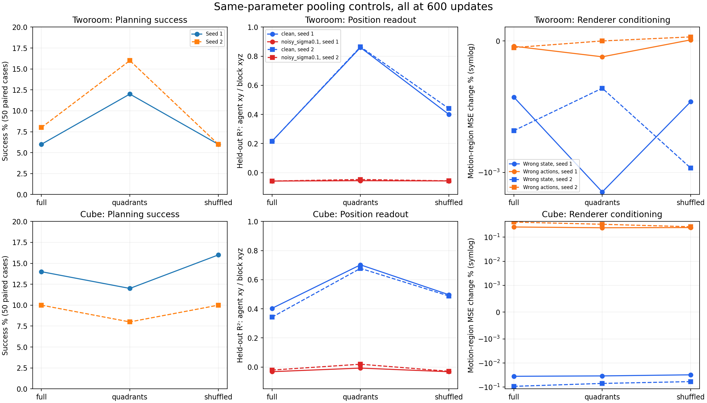
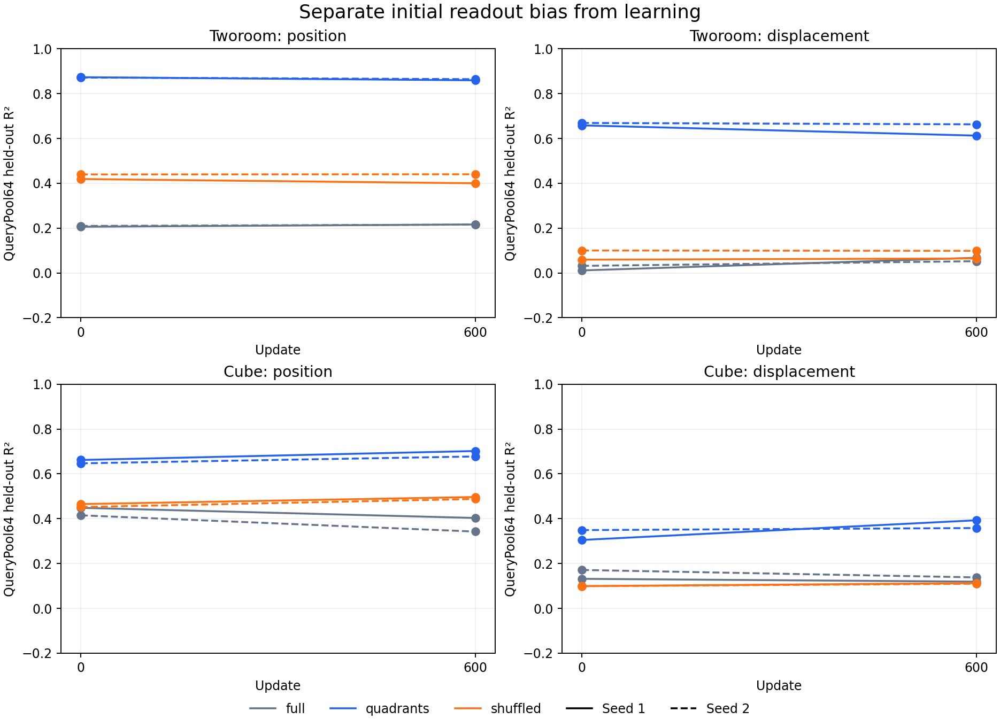

# Pooling address diagnostic: full versus quadrant versus shuffled

All 34 intended training/health/information/planning endpoints succeeded. Two original Cube control planning attempts failed during EGL setup and remain preserved; their explicit retries supply the results. All 16 additional frozen spatial probes succeeded. Four full-pooling fresh-600 models, information audits and health checks are reused from the rate campaign, two TwoRoom planning controls from the channel campaign, and eight full-pooling spatial probes from the prior spatial campaign.

All eight candidate initial models match all 550 baseline tensors exactly. Configurations match in their entirety after removing output path and the declared pooling partition. Therefore data path, data seed, batch size, worker settings, optimizer defaults and the 124910-step scheduler horizon are matched. An AST source hash comparison also verifies identical WindowSampler and configure_optimizers code in the frozen baseline and candidate snapshots. All stages start at zero and stop at 600. Every full checkpoint passes finite model/optimizer/scheduler, RNG, sample-cursor and portable-weight checks. Preflight gradient checks establish execution, not task competence.

All planners use matched 50 cases and identical solver/horizon/settings. All diagnostic probes use identical task-specific disjoint 128 training/128 validation episodes and starts, fixed ridge .001 and the same projection matrices. Position labels train only frozen diagnostic probes, never model or controller objectives.

**TwoRoom has a consistent small planning signal; Cube does not.** Full/quadrant/shuffled P0 is 6/12/6% for TwoRoom seed 1 and 8/16/6% for seed 2. Quadrants gain six and eight cases while losing three and four, respectively, against full pooling. Cube is 14/12/16% and 10/8/10%; quadrants lose two percentage points in both seeds. These paired counts support a task-specific early signal, not mature superiority or a universal pooling fix.

## Planning and state readout at 600

Position scores average agent xy for TwoRoom and block xyz for Cube. All seeds remain separate.

| Task | Pool | Seed | P0 % | Paired delta pp | Gained/lost | Clean R² | Noise .1 R² | State std |
|---|---|---:|---:|---:|---:|---:|---:|---:|
| tworoom | full | 1 | 6 | +0 | 0/0 | 0.2165 | -0.0574 | 0.000152172 |
| tworoom | quadrants | 1 | 12 | +6 | 6/3 | 0.8598 | -0.0549 | 0.000975944 |
| tworoom | shuffled | 1 | 6 | +0 | 1/1 | 0.4002 | -0.0565 | 0.000955064 |
| tworoom | full | 2 | 8 | +0 | 0/0 | 0.2159 | -0.0573 | 0.000160116 |
| tworoom | quadrants | 2 | 16 | +8 | 8/4 | 0.8647 | -0.0467 | 0.00117113 |
| tworoom | shuffled | 2 | 6 | -2 | 2/3 | 0.4405 | -0.0560 | 0.00119567 |
| cube | full | 1 | 14 | +0 | 0/0 | 0.4033 | -0.0317 | 0.00512339 |
| cube | quadrants | 1 | 12 | -2 | 2/3 | 0.7020 | -0.0071 | 0.00623375 |
| cube | shuffled | 1 | 16 | +2 | 5/4 | 0.4968 | -0.0321 | 0.00554968 |
| cube | full | 2 | 10 | +0 | 0/0 | 0.3426 | -0.0206 | 0.00822861 |
| cube | quadrants | 2 | 8 | -2 | 2/3 | 0.6777 | 0.0195 | 0.00809882 |
| cube | shuffled | 2 | 10 | +0 | 2/2 | 0.4880 | -0.0291 | 0.00668908 |

## Initialization versus learning

Only pooling address support differs at initialization; all pre-pooling probe R² vectors agree within 1e-8. These paired endpoints distinguish readout supplied by the architecture before training from later learning. Matched-dimensional spatial RP64 is retained as a reference; it is a fixed diagnostic projection, not the model's state.

| Task | Pool | Seed | Update | Query position R² | Query displacement R² | Spatial RP64 position R² |
|---|---|---:|---:|---:|---:|---:|
| tworoom | full | 1 | 0 | 0.2063 | 0.0114 | 0.9436 |
| tworoom | full | 1 | 600 | 0.2165 | 0.0679 | 0.9426 |
| tworoom | quadrants | 1 | 0 | 0.8736 | 0.6587 | 0.9436 |
| tworoom | quadrants | 1 | 600 | 0.8598 | 0.6129 | 0.9383 |
| tworoom | shuffled | 1 | 0 | 0.4192 | 0.0594 | 0.9436 |
| tworoom | shuffled | 1 | 600 | 0.4002 | 0.0647 | 0.9405 |
| tworoom | full | 2 | 0 | 0.2098 | 0.0318 | 0.9100 |
| tworoom | full | 2 | 600 | 0.2159 | 0.0526 | 0.9127 |
| tworoom | quadrants | 2 | 0 | 0.8722 | 0.6694 | 0.9100 |
| tworoom | quadrants | 2 | 600 | 0.8647 | 0.6633 | 0.9160 |
| tworoom | shuffled | 2 | 0 | 0.4397 | 0.1002 | 0.9100 |
| tworoom | shuffled | 2 | 600 | 0.4405 | 0.0988 | 0.9133 |
| cube | full | 1 | 0 | 0.4486 | 0.1317 | 0.6024 |
| cube | full | 1 | 600 | 0.4033 | 0.1192 | 0.6065 |
| cube | quadrants | 1 | 0 | 0.6621 | 0.3052 | 0.6024 |
| cube | quadrants | 1 | 600 | 0.7020 | 0.3930 | 0.6003 |
| cube | shuffled | 1 | 0 | 0.4652 | 0.0992 | 0.6024 |
| cube | shuffled | 1 | 600 | 0.4968 | 0.1124 | 0.5996 |
| cube | full | 2 | 0 | 0.4152 | 0.1713 | 0.6161 |
| cube | full | 2 | 600 | 0.3426 | 0.1381 | 0.6147 |
| cube | quadrants | 2 | 0 | 0.6471 | 0.3492 | 0.6161 |
| cube | quadrants | 2 | 600 | 0.6777 | 0.3583 | 0.6202 |
| cube | shuffled | 2 | 0 | 0.4521 | 0.0988 | 0.6161 |
| cube | shuffled | 2 | 600 | 0.4880 | 0.1098 | 0.6215 |

## Renderer conditioning at corruption .95

Values are percent changes in motion-region MSE after replacing initial state, actions or visual anchor. The final column measures replacing clean posterior variation by its batch mean at t=1, sigma=0. These are fixed-model diagnostic interventions, not batch-coupled proposed training losses. They test the DiT renderer, not the sensitivity of the latent planning cost.

| Task | Pool | Seed | Wrong initial % | Wrong actions % | Wrong anchor % | Clean constant posterior % |
|---|---|---:|---:|---:|---:|---:|
| tworoom | full | 1 | -0.000427 | -0.000040 | -7.021548 | 0.000382 |
| tworoom | quadrants | 1 | -0.001464 | -0.000120 | -4.626469 | 0.000205 |
| tworoom | shuffled | 1 | -0.000462 | 0.000008 | -6.943960 | 0.000352 |
| tworoom | full | 2 | -0.000683 | -0.000050 | -5.923861 | 0.000483 |
| tworoom | quadrants | 2 | -0.000359 | 0.000000 | -6.367054 | -0.000173 |
| tworoom | shuffled | 2 | -0.000967 | 0.000031 | -5.259314 | -0.000158 |
| cube | full | 1 | -0.035466 | 0.263675 | 5.592254 | 0.111784 |
| cube | quadrants | 1 | -0.034200 | 0.245261 | 5.942233 | 0.098980 |
| cube | shuffled | 1 | -0.030811 | 0.249964 | 5.761777 | 0.090573 |
| cube | full | 2 | -0.092430 | 0.421743 | 5.869589 | 0.208157 |
| cube | quadrants | 2 | -0.070059 | 0.341718 | 5.786663 | 0.146624 |
| cube | shuffled | 2 | -0.058937 | 0.269988 | 5.441783 | 0.124071 |

## Gradient direction

Positive scale derivatives mean infinitesimal shrinking lowers that fixed diagnostic loss; negative means expansion lowers it. A nonzero flow gradient need not amplify state distinctions. These are gradients with respect to the intermediate state, not full parameter-space training trajectories.

| Task | Pool | Seed | Priced rate / flow norm | Gradient cosine | Flow temporal-scale derivative | Rate temporal-scale derivative |
|---|---|---:|---:|---:|---:|---:|
| tworoom | full | 1 | 0.0285507 | 0.0278518 | -5.11949e-07 | 7.36223e-09 |
| tworoom | quadrants | 1 | 0.0291005 | 0.0838833 | 3.83417e-07 | 1.32469e-07 |
| tworoom | shuffled | 1 | 0.0398692 | 0.0498862 | 3.66835e-08 | 2.55195e-07 |
| tworoom | full | 2 | 0.0387242 | 0.0998549 | -1.35184e-07 | 6.41734e-09 |
| tworoom | quadrants | 2 | 0.0362737 | 0.111858 | 5.28917e-07 | 1.15994e-07 |
| tworoom | shuffled | 2 | 0.0497314 | 0.14062 | -1.06824e-07 | 3.2857e-07 |
| cube | full | 1 | 0.115305 | 0.126757 | -3.44115e-05 | -5.22688e-06 |
| cube | quadrants | 1 | 0.161613 | 0.184125 | -2.63876e-05 | -1.08192e-06 |
| cube | shuffled | 1 | 0.142625 | 0.149216 | -2.86464e-05 | -2.25207e-06 |
| cube | full | 2 | 0.133153 | 0.0572676 | -7.85659e-05 | -5.42739e-06 |
| cube | quadrants | 2 | 0.110459 | 0.0190211 | -5.05327e-05 | -1.10855e-06 |
| cube | shuffled | 2 | 0.105561 | 0.0181176 | -3.66821e-05 | -1.8349e-06 |

## Mechanism established by the controls

**Spatial addressing supplies clean position readout before learning, and this readout survives the 600-step gate.** TwoRoom quadrant initialization is already agent xy R²=.892/.855 and .896/.849, versus shuffled .379/.460 and .424/.455 and full .130/.282 and .122/.297. At 600 the quadrant values are .886/.833 and .883/.846. This is primarily an architectural readout advantage; it is not evidence that the objectives learned stronger dynamics. Identical initial pre-pooling features and the shuffled support-size control localize the contrast to pooling address structure.

**Clean accessibility is insufficient for renderer use.** TwoRoom quadrant states vary at std .000976/.001171, still far below posterior noise .1. Their noisy position probes remain negative. Wrong initial state or actions barely changes the renderer error, and even replacing clean posterior variation by a constant changes t=1 MSE by less than .00021% in magnitude. Thus fixing the clean linear readout bottleneck alone does not immediately establish the downstream state-to-renderer coupling. This result does not prove that a nonlinear readout could not extract other information.

**The planning gain and renderer insensitivity can coexist.** The implemented planner uses clean encoding, latent rollout and goal-MSE cost, bypassing DiT. Better clean latent goal geometry or action ranking could therefore improve planning while the noisy renderer channel remains insensitive. These experiments have not isolated which part mediates the gain; an insensitive renderer cannot be used to conclude that the entire latent predictor or planner ignores state and actions. Conversely, better P0 alone does not prove more accurate outcome prediction.

**The measured failure is not explained by rate gradients overwhelming flow gradients.** For TwoRoom quadrants the priced-rate/flow norm ratios are .029/.036, yet the flow gradient along temporal-state expansion has positive mean derivative in both seeds: locally it favors shrinking these distinctions. For Cube both flow and priced-rate derivatives along expansion are negative at this gate. The rate includes temporal prediction, so its local effect cannot universally be described as variance suppression. These local diagnostics constrain mechanisms; they do not establish a complete global optimization theory.

**Cube shows a weaker form of the same separation at 600.** Quadrants improve clean block xyz readout, including height, while noisy readout remains near zero and replacing initial state does not worsen the measured forecast error. This early behavior must be interpreted alongside the earlier full-pooling 11671 checkpoint, where robust state use and strong position readout do emerge. It cannot support a claim that either architecture is permanently incapable.

## Per-coordinate clean and noisy probes

Coordinate order is agent xy, target xy for TwoRoom; block xyz, effector xyz for Cube. Complete temporal controls and all seven spatial feature families are preserved in results.json.

| Task | Pool | Seed | Clean R² vector | Noise .1 R² vector |
|---|---|---:|---|---|
| tworoom | full | 1 | 0.1607, 0.2723, 0.1201, -0.0231 | -0.0622, -0.0526, -0.0599, -0.0368 |
| tworoom | quadrants | 1 | 0.8861, 0.8334, 0.1581, -0.0452 | -0.0592, -0.0505, -0.0595, -0.0366 |
| tworoom | shuffled | 1 | 0.3721, 0.4283, 0.1050, -0.0651 | -0.0618, -0.0513, -0.0598, -0.0361 |
| tworoom | full | 2 | 0.1243, 0.3075, 0.1263, -0.0307 | -0.0621, -0.0525, -0.0596, -0.0369 |
| tworoom | quadrants | 2 | 0.8833, 0.8461, 0.1535, -0.0349 | -0.0457, -0.0477, -0.0545, -0.0375 |
| tworoom | shuffled | 2 | 0.4089, 0.4720, 0.1074, -0.0468 | -0.0621, -0.0500, -0.0599, -0.0373 |
| cube | full | 1 | 0.4836, 0.4710, 0.2552, 0.4921, 0.4840, 0.7424 | -0.0599, -0.0273, -0.0080, -0.0742, -0.0304, 0.0827 |
| cube | quadrants | 1 | 0.8111, 0.8513, 0.4436, 0.8763, 0.8702, 0.7752 | -0.0530, 0.0368, -0.0052, -0.0695, 0.0412, 0.0850 |
| cube | shuffled | 1 | 0.5106, 0.7264, 0.2534, 0.5338, 0.7568, 0.7944 | -0.0589, -0.0154, -0.0219, -0.0743, -0.0180, 0.0530 |
| cube | full | 2 | 0.3978, 0.3919, 0.2380, 0.4238, 0.4093, 0.7398 | -0.0499, -0.0455, 0.0337, -0.0668, -0.0499, 0.2052 |
| cube | quadrants | 2 | 0.7780, 0.8513, 0.4039, 0.8452, 0.8700, 0.7885 | -0.0267, 0.0699, 0.0152, -0.0414, 0.0695, 0.1510 |
| cube | shuffled | 2 | 0.4859, 0.7380, 0.2401, 0.5024, 0.7734, 0.8024 | -0.0564, -0.0271, -0.0037, -0.0742, -0.0286, 0.0942 |

## Interpretation limits

The partitioned pools have the same parameters and 64-dimensional output as full pooling. Each query sees one quarter of patches and the shared CLS token. The encoder already mixes information globally; these controls restrict pooling addresses, not the encoder's receptive field. Shuffled partitions match support size but cannot match every conditioning effect of spatial partitions. Their single fixed random partition is not a seed-tuned optimization.

Linear decodability is neither information-theoretic sufficiency nor functional dynamics. Initialization gains are architectural readout gains. Noise robustness, action-conditioned state use, and task success must be assessed separately. Wrong-anchor interventions alter the whole visual context and cannot isolate agent position. Fixed-t denoising error is not generated-image quality.

All models stop at 600, still within the 1249-update warmup. These results can identify immediate failures and representation changes but cannot establish permanent limits or mature benchmark superiority. The current report does not launch or authorize a continuation.

