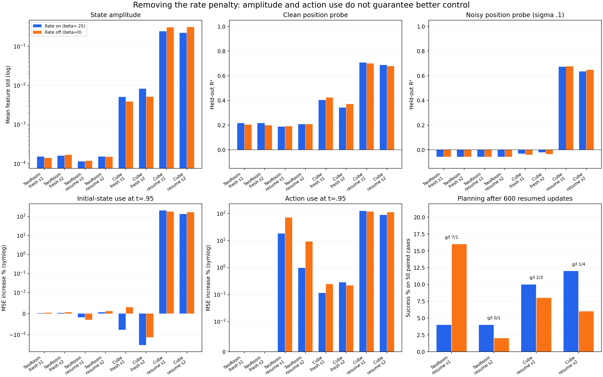

# Paired rate-removal diagnostic review

All 16 training runs, 16 health audits, 16 frozen-information audits and 8 resumed-run planning evaluations completed with exit 0 (56 endpoints). Four fresh on/off initialization pairs match all 550 tensors. Resumed pairs start from identical complete checkpoint copies, including optimizer/RNG/cursor state. All seeds remain reported.

Only beta differs within each pair: .25 versus 0. Both arms retain the temporal-forecast model. Fresh runs stop at update 600; resumed runs start at update 2000 and stop at 2600. These are diagnostic ablations, not a new algorithm or a long-run performance claim.

## Planning outcome

| Task | Training seed | Rate on % | Rate off % | Off − on pp | Gained / lost cases |
|---|---:|---:|---:|---:|---:|
| tworoom | 1 | 4 | 16 | +12 | 7 / 1 |
| tworoom | 2 | 4 | 2 | -2 | 0 / 1 |
| cube | 1 | 10 | 8 | -2 | 2 / 3 |
| cube | 2 | 12 | 6 | -6 | 1 / 4 |

The seed-1 TwoRoom gain is real for these fixed cases but is not replicated in seed 2. Cube decreases in both seeds. The evidence does not support promoting rate removal as a cross-seed control improvement.

## Mechanistic conclusions

**TwoRoom: rate removal strengthens an action/anchor route without recovering a useful noisy encoder state.** Resumed rate-off increases action-substitution sensitivity from 18.4/1.0% to 71.9/9.3%, and anchor-substitution sensitivity from 62.6/20.3% to 169.6/39.3%. Initial-state-substitution effects remain below .003% in magnitude. Clean position probes remain weak and nearly unchanged, while adding sigma=.1 noise leaves position R² below zero. This supports a decoder that can use initial visual context and action-dependent forecast conditions while largely bypassing the encoded initial state. It does not demonstrate counterfactual physical accuracy.

**The fresh contrast rules out an immediate 600-step rescue, not eventual recovery.** Turning rate off from initialization also fails to establish a robust noisy state channel at the checkpoint inspected. The fresh gate is still inside the inherited learning-rate warmup, and fresh/resumed cohorts differ in learning history, optimizer, cursor and learning rate. They cannot establish an irreversible absorbing state or the impossibility of later learning.

**Cube: extra amplitude does not become extra task information or better control.** After resumed training, rate-off raises feature std from .242/.221 to .307/.312. Clean block-position R² is slightly worse in all three coordinates for both seeds. Some noisy probes improve, consistent with a larger signal relative to sigma, but planning falls from 10/12% to 8/6%. Denoising sensitivity and signal amplitude are therefore insufficient proxies for planning usefulness.

Beta=0 removes both entry and temporal surprise penalties. The latter also constrains the relation between encoded states and the action-conditioned predictor. These results cannot separately assign the effect to information pricing, dynamical consistency or their interaction. The forecast-render branch continues to train the predictor through pixel denoising.

## Every run

Position probe averages agent x/y in TwoRoom and block x/y/z in Cube. All probe standardization uses training episodes only; physical labels supervise only the diagnostic readout. Feature std below uses the fixed frozen-audit batches, and may differ from the training or health minibatch statistics.

| Task | Start | Seed | Rate | Update | State std | Clean position R² | Noisy position R² | Wrong-state MSE % | Wrong-action MSE % |
|---|---|---:|---|---:|---:|---:|---:|---:|---:|
| tworoom | fresh | 1 | on | 600 | 0.000152172 | 0.2165 | -0.0574 | 0.00031 | -0.00022 |
| tworoom | fresh | 1 | off | 600 | 0.000141161 | 0.2033 | -0.0574 | 0.00047 | -0.00000 |
| tworoom | fresh | 2 | on | 600 | 0.000160116 | 0.2159 | -0.0573 | 0.00041 | -0.00003 |
| tworoom | fresh | 2 | off | 600 | 0.00016935 | 0.1980 | -0.0573 | 0.00066 | 0.00004 |
| tworoom | resume2000 | 1 | on | 2600 | 0.000113707 | 0.1871 | -0.0574 | -0.00172 | 18.42477 |
| tworoom | resume2000 | 1 | off | 2600 | 0.000119186 | 0.1913 | -0.0574 | -0.00288 | 71.87903 |
| tworoom | resume2000 | 2 | on | 2600 | 0.000152238 | 0.2072 | -0.0573 | 0.00066 | 0.97465 |
| tworoom | resume2000 | 2 | off | 2600 | 0.000150679 | 0.2077 | -0.0573 | 0.00124 | 9.27961 |
| cube | fresh | 1 | on | 600 | 0.00512339 | 0.4033 | -0.0317 | -0.00764 | 0.11474 |
| cube | fresh | 1 | off | 600 | 0.00385782 | 0.4236 | -0.0400 | 0.00315 | 0.24472 |
| cube | fresh | 2 | on | 600 | 0.00822861 | 0.3426 | -0.0206 | -0.03448 | 0.28522 |
| cube | fresh | 2 | off | 600 | 0.00518746 | 0.3708 | -0.0349 | -0.01352 | 0.22071 |
| cube | resume2000 | 1 | on | 2600 | 0.24159 | 0.7082 | 0.6735 | 209.42240 | 126.49296 |
| cube | resume2000 | 1 | off | 2600 | 0.307353 | 0.7001 | 0.6772 | 181.12407 | 118.20966 |
| cube | resume2000 | 2 | on | 2600 | 0.221078 | 0.6866 | 0.6354 | 136.82443 | 90.06145 |
| cube | resume2000 | 2 | off | 2600 | 0.312399 | 0.6778 | 0.6488 | 168.01593 | 112.47186 |

## Coordinate-level probe results

The following vectors follow the stated label order. Null indicates a zero-variance target; it is excluded from R² means.

### TwoRoom fresh s1

| Rate | Coordinates | Clean R² | Noisy R² |
|---|---|---|---|
| on | pos_agent_x, pos_agent_y, pos_target_x, pos_target_y | 0.1607, 0.2723, 0.1201, -0.0231 | -0.0622, -0.0526, -0.0599, -0.0368 |
| off | pos_agent_x, pos_agent_y, pos_target_x, pos_target_y | 0.1365, 0.2701, 0.1193, -0.0255 | -0.0622, -0.0526, -0.0599, -0.0368 |
### TwoRoom fresh s2

| Rate | Coordinates | Clean R² | Noisy R² |
|---|---|---|---|
| on | pos_agent_x, pos_agent_y, pos_target_x, pos_target_y | 0.1243, 0.3075, 0.1263, -0.0307 | -0.0621, -0.0525, -0.0596, -0.0369 |
| off | pos_agent_x, pos_agent_y, pos_target_x, pos_target_y | 0.1230, 0.2730, 0.1200, -0.0292 | -0.0621, -0.0525, -0.0596, -0.0369 |
### TwoRoom resume s1

| Rate | Coordinates | Clean R² | Noisy R² |
|---|---|---|---|
| on | pos_agent_x, pos_agent_y, pos_target_x, pos_target_y | 0.1281, 0.2461, 0.1194, -0.0240 | -0.0621, -0.0526, -0.0599, -0.0368 |
| off | pos_agent_x, pos_agent_y, pos_target_x, pos_target_y | 0.1341, 0.2485, 0.1193, -0.0238 | -0.0621, -0.0526, -0.0599, -0.0368 |
### TwoRoom resume s2

| Rate | Coordinates | Clean R² | Noisy R² |
|---|---|---|---|
| on | pos_agent_x, pos_agent_y, pos_target_x, pos_target_y | 0.1170, 0.2975, 0.1273, -0.0270 | -0.0622, -0.0525, -0.0596, -0.0369 |
| off | pos_agent_x, pos_agent_y, pos_target_x, pos_target_y | 0.1154, 0.2999, 0.1274, -0.0266 | -0.0622, -0.0525, -0.0596, -0.0369 |
### Cube fresh s1

| Rate | Coordinates | Clean R² | Noisy R² |
|---|---|---|---|
| on | privileged_block_0_pos_x, privileged_block_0_pos_y, privileged_block_0_pos_z, proprio_effector_pos_x, proprio_effector_pos_y, proprio_effector_pos_z | 0.4836, 0.4710, 0.2552, 0.4921, 0.4840, 0.7424 | -0.0599, -0.0273, -0.0080, -0.0742, -0.0304, 0.0827 |
| off | privileged_block_0_pos_x, privileged_block_0_pos_y, privileged_block_0_pos_z, proprio_effector_pos_x, proprio_effector_pos_y, proprio_effector_pos_z | 0.5211, 0.4918, 0.2580, 0.5396, 0.5087, 0.7480 | -0.0637, -0.0298, -0.0265, -0.0797, -0.0326, 0.0217 |
### Cube fresh s2

| Rate | Coordinates | Clean R² | Noisy R² |
|---|---|---|---|
| on | privileged_block_0_pos_x, privileged_block_0_pos_y, privileged_block_0_pos_z, proprio_effector_pos_x, proprio_effector_pos_y, proprio_effector_pos_z | 0.3978, 0.3919, 0.2380, 0.4238, 0.4093, 0.7398 | -0.0499, -0.0455, 0.0337, -0.0668, -0.0499, 0.2052 |
| off | privileged_block_0_pos_x, privileged_block_0_pos_y, privileged_block_0_pos_z, proprio_effector_pos_x, proprio_effector_pos_y, proprio_effector_pos_z | 0.3992, 0.4743, 0.2390, 0.4293, 0.4846, 0.7561 | -0.0566, -0.0400, -0.0082, -0.0728, -0.0420, 0.0792 |
### Cube resume s1

| Rate | Coordinates | Clean R² | Noisy R² |
|---|---|---|---|
| on | privileged_block_0_pos_x, privileged_block_0_pos_y, privileged_block_0_pos_z, proprio_effector_pos_x, proprio_effector_pos_y, proprio_effector_pos_z | 0.8571, 0.9431, 0.3242, 0.9306, 0.9892, 0.9171 | 0.8219, 0.9324, 0.2662, 0.9040, 0.9835, 0.8842 |
| off | privileged_block_0_pos_x, privileged_block_0_pos_y, privileged_block_0_pos_z, proprio_effector_pos_x, proprio_effector_pos_y, proprio_effector_pos_z | 0.8464, 0.9418, 0.3121, 0.9231, 0.9883, 0.9120 | 0.8275, 0.9319, 0.2723, 0.9092, 0.9832, 0.8919 |
### Cube resume s2

| Rate | Coordinates | Clean R² | Noisy R² |
|---|---|---|---|
| on | privileged_block_0_pos_x, privileged_block_0_pos_y, privileged_block_0_pos_z, proprio_effector_pos_x, proprio_effector_pos_y, proprio_effector_pos_z | 0.8037, 0.9426, 0.3136, 0.8835, 0.9916, 0.9084 | 0.7368, 0.9351, 0.2344, 0.8169, 0.9867, 0.8514 |
| off | privileged_block_0_pos_x, privileged_block_0_pos_y, privileged_block_0_pos_z, proprio_effector_pos_x, proprio_effector_pos_y, proprio_effector_pos_z | 0.7965, 0.9408, 0.2961, 0.8771, 0.9891, 0.9015 | 0.7680, 0.9360, 0.2423, 0.8503, 0.9870, 0.8804 |

## Decision and limits

Keep these rate-off runs held. The controls resolve the narrow hypothesis that merely removing the rate is a ready cure: it is not supported at this budget. They motivate locating where position information is lost before/after QueryPool, and separating encoded-state quality, action-conditioned prediction and goal-metric ranking. No new long run follows automatically from this diagnostic.

Planning uses 50 identical validation cases within each task; no final test claim is made. Two training seeds provide limited stability evidence. The early diagnostic rate-on results are new numerical continuations and should not be substituted for previously published 2600-step controls with different numerical histories. The full exit records, original health review, initial-state identities, per-seed probes, gradients, scale curves and planning outcomes are preserved in results.json.

