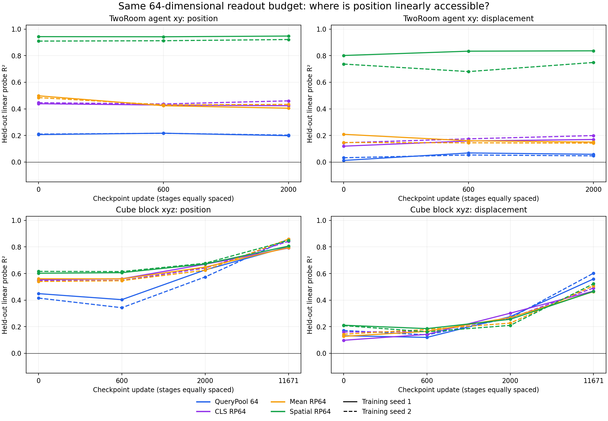

# Frozen spatial readout audit

All 14 endpoints exit 0. Each checkpoint uses exactly the same task-specific 128 training and 128 validation episodes and window starts. Train and validation episodes are disjoint. All projection matrices have identical hashes across tasks, seeds, stages and splits; the projection seed was fixed at 20261030. Every probe uses training-only feature normalization and ridge=.001. Primal/dual solver choice and feature dimensions were checked.

## What changed in our understanding

**TwoRoom position is already linearly accessible in encoder patch features, while the current learned QueryPool exposes much less of it.** At update 2000, spatial4x4 followed by a fixed 64-dimensional random projection gives agent x/y R²=.958/.938 and .951/.893, versus QueryPool64=.141/.255 and .113/.291. The matched output dimension matters: this gap is not solely an advantage from fitting a 3072-dimensional readout.

**Much of this spatial accessibility predates learning.** At initialization, spatialRP64 already reaches .944/.943 and .928/.892, while QueryPool gives .130/.282 and .122/.297. The initialization-to-2000 path does not create a substantially stronger QueryPool position code in TwoRoom. Spatial displacement readout is also strong, so the result is not explained solely by static episode identity: at update 2000, spatialRP64 displacement x/y R²=.872/.801 and .850/.648, versus QueryPool −.007/.123 and −.070/.162.

**Cube has a different trajectory.** QueryPool position readout initially weakens at 600, then improves at 2000 and 11671. By 11671, QueryPool and other matched-64 readouts are broadly competitive. Cube height is .546/.720 from QueryPool versus .577/.697 from spatialRP64. QueryPool block-displacement probes can outperform spatialRP64 at this endpoint. A universal claim that the pooling architecture must be replaced is not supported.

**The unrestricted high-dimensional probe is an important failure control.** On TwoRoom, the full 3072-dimensional spatial ridge nearly fits the training positions but generalizes poorly, sometimes with very negative R². It is not evidence that spatial features lack information. The fixed high-dimensional probe is poorly regularized/conditioned for this finite dataset. Random projection changes capacity and conditioning, and occurs before coordinate-wise standardization, so it is not a pure information-preservation intervention.

## Matched 64-dimensional position probes

Values average agent x/y for TwoRoom and block x/y/z for Cube. Individual training seeds are never pooled away.

| Task | Seed | Update | QueryPool64 | CLS RP64 | Mean RP64 | Spatial RP64 |
|---|---:|---:|---:|---:|---:|---:|
| tworoom | 1 | 0 | 0.2063 | 0.4384 | 0.4981 | 0.9436 |
| tworoom | 1 | 600 | 0.2165 | 0.4285 | 0.4234 | 0.9426 |
| tworoom | 1 | 2000 | 0.1980 | 0.4235 | 0.4049 | 0.9479 |
| tworoom | 2 | 0 | 0.2098 | 0.4461 | 0.4846 | 0.9100 |
| tworoom | 2 | 600 | 0.2159 | 0.4368 | 0.4300 | 0.9127 |
| tworoom | 2 | 2000 | 0.2020 | 0.4601 | 0.4334 | 0.9218 |
| cube | 1 | 0 | 0.4486 | 0.5534 | 0.5606 | 0.6024 |
| cube | 1 | 600 | 0.4033 | 0.5604 | 0.5596 | 0.6065 |
| cube | 1 | 2000 | 0.6269 | 0.6697 | 0.6484 | 0.6718 |
| cube | 1 | 11671 | 0.8018 | 0.7919 | 0.7956 | 0.8066 |
| cube | 2 | 0 | 0.4152 | 0.5462 | 0.5402 | 0.6161 |
| cube | 2 | 600 | 0.3426 | 0.5483 | 0.5459 | 0.6147 |
| cube | 2 | 2000 | 0.5741 | 0.6410 | 0.6249 | 0.6773 |
| cube | 2 | 11671 | 0.8596 | 0.8423 | 0.8589 | 0.8486 |

## Capacity and overfitting control

| Task | Seed | Update | Full spatial train R² | Full spatial validation R² | Spatial RP64 validation R² |
|---|---:|---:|---:|---:|---:|
| tworoom | 1 | 0 | 0.9992 | -0.4618 | 0.9436 |
| tworoom | 1 | 600 | 0.9992 | -0.1621 | 0.9426 |
| tworoom | 1 | 2000 | 0.9992 | -0.9948 | 0.9479 |
| tworoom | 2 | 0 | 0.9993 | -2.5285 | 0.9100 |
| tworoom | 2 | 600 | 0.9992 | -2.7733 | 0.9127 |
| tworoom | 2 | 2000 | 0.9992 | -2.1037 | 0.9218 |
| cube | 1 | 0 | 1.0000 | 0.7121 | 0.6024 |
| cube | 1 | 600 | 1.0000 | 0.7177 | 0.6065 |
| cube | 1 | 2000 | 0.9975 | 0.7824 | 0.6718 |
| cube | 1 | 11671 | 0.9967 | 0.8588 | 0.8066 |
| cube | 2 | 0 | 1.0000 | 0.7079 | 0.6161 |
| cube | 2 | 600 | 0.9999 | 0.7115 | 0.6147 |
| cube | 2 | 2000 | 0.9974 | 0.7640 | 0.6773 |
| cube | 2 | 11671 | 0.9967 | 0.8790 | 0.8486 |

## Per-coordinate position probes

Coordinate order is agent x/y, target x/y for TwoRoom; block xyz, effector xyz for Cube. Full vectors for all seven feature families and all temporal controls are in results.json.

| Checkpoint | Feature | Validation R² vector |
|---|---|---|
| tworoom-seed1-step0 | QueryPool 64 | 0.1305, 0.2821, 0.1293, -0.0244 |
| tworoom-seed1-step0 | CLS RP64 | 0.3428, 0.5339, 0.1108, -0.0754 |
| tworoom-seed1-step0 | Mean RP64 | 0.3652, 0.6310, 0.1053, -0.0762 |
| tworoom-seed1-step0 | Spatial RP64 | 0.9441, 0.9431, 0.0653, -0.1484 |
| tworoom-seed1-step600 | QueryPool 64 | 0.1607, 0.2723, 0.1201, -0.0231 |
| tworoom-seed1-step600 | CLS RP64 | 0.3644, 0.4926, 0.1073, -0.0742 |
| tworoom-seed1-step600 | Mean RP64 | 0.3404, 0.5063, 0.0963, -0.0690 |
| tworoom-seed1-step600 | Spatial RP64 | 0.9424, 0.9429, -0.0115, -0.1415 |
| tworoom-seed1-step2000 | QueryPool 64 | 0.1412, 0.2548, 0.1205, -0.0229 |
| tworoom-seed1-step2000 | CLS RP64 | 0.3604, 0.4865, 0.1167, -0.0826 |
| tworoom-seed1-step2000 | Mean RP64 | 0.3195, 0.4904, 0.0930, -0.0676 |
| tworoom-seed1-step2000 | Spatial RP64 | 0.9575, 0.9382, 0.0395, -0.1400 |
| tworoom-seed2-step0 | QueryPool 64 | 0.1223, 0.2974, 0.1278, -0.0399 |
| tworoom-seed2-step0 | CLS RP64 | 0.4094, 0.4827, 0.1083, -0.0560 |
| tworoom-seed2-step0 | Mean RP64 | 0.3804, 0.5888, 0.1151, -0.0554 |
| tworoom-seed2-step0 | Spatial RP64 | 0.9277, 0.8923, 0.1114, -0.0826 |
| tworoom-seed2-step600 | QueryPool 64 | 0.1243, 0.3075, 0.1263, -0.0307 |
| tworoom-seed2-step600 | CLS RP64 | 0.3595, 0.5140, 0.0997, -0.0790 |
| tworoom-seed2-step600 | Mean RP64 | 0.2969, 0.5631, 0.1134, -0.0692 |
| tworoom-seed2-step600 | Spatial RP64 | 0.9554, 0.8700, 0.0956, -0.0993 |
| tworoom-seed2-step2000 | QueryPool 64 | 0.1133, 0.2907, 0.1263, -0.0263 |
| tworoom-seed2-step2000 | CLS RP64 | 0.3587, 0.5614, 0.0920, -0.0671 |
| tworoom-seed2-step2000 | Mean RP64 | 0.3097, 0.5570, 0.1178, -0.0707 |
| tworoom-seed2-step2000 | Spatial RP64 | 0.9509, 0.8926, 0.0972, -0.1085 |
| cube-seed1-step0 | QueryPool 64 | 0.5388, 0.5607, 0.2463, 0.5604, 0.5794, 0.7310 |
| cube-seed1-step0 | CLS RP64 | 0.7066, 0.6698, 0.2839, 0.7455, 0.7139, 0.8085 |
| cube-seed1-step0 | Mean RP64 | 0.7317, 0.7057, 0.2444, 0.7652, 0.7353, 0.8043 |
| cube-seed1-step0 | Spatial RP64 | 0.5839, 0.8778, 0.3453, 0.6163, 0.9101, 0.7650 |
| cube-seed1-step600 | QueryPool 64 | 0.4836, 0.4710, 0.2552, 0.4921, 0.4840, 0.7424 |
| cube-seed1-step600 | CLS RP64 | 0.6818, 0.7162, 0.2832, 0.7252, 0.7527, 0.8098 |
| cube-seed1-step600 | Mean RP64 | 0.6886, 0.7344, 0.2558, 0.7343, 0.7675, 0.8184 |
| cube-seed1-step600 | Spatial RP64 | 0.6248, 0.8618, 0.3328, 0.6543, 0.8996, 0.7983 |
| cube-seed1-step2000 | QueryPool 64 | 0.7122, 0.9066, 0.2619, 0.7828, 0.9545, 0.8669 |
| cube-seed1-step2000 | CLS RP64 | 0.7704, 0.9128, 0.3259, 0.8352, 0.9605, 0.8830 |
| cube-seed1-step2000 | Mean RP64 | 0.7621, 0.9116, 0.2715, 0.8313, 0.9615, 0.8707 |
| cube-seed1-step2000 | Spatial RP64 | 0.7772, 0.9248, 0.3134, 0.8469, 0.9725, 0.8900 |
| cube-seed1-step11671 | QueryPool 64 | 0.9087, 0.9509, 0.5458, 0.9872, 0.9992, 0.9797 |
| cube-seed1-step11671 | CLS RP64 | 0.8973, 0.9398, 0.5387, 0.9764, 0.9908, 0.9833 |
| cube-seed1-step11671 | Mean RP64 | 0.9010, 0.9441, 0.5416, 0.9805, 0.9932, 0.9883 |
| cube-seed1-step11671 | Spatial RP64 | 0.8921, 0.9508, 0.5768, 0.9750, 0.9945, 0.9846 |
| cube-seed2-step0 | QueryPool 64 | 0.4716, 0.5352, 0.2387, 0.5083, 0.5539, 0.7381 |
| cube-seed2-step0 | CLS RP64 | 0.7024, 0.6918, 0.2443, 0.7413, 0.7194, 0.7944 |
| cube-seed2-step0 | Mean RP64 | 0.7082, 0.6727, 0.2397, 0.7566, 0.6900, 0.8064 |
| cube-seed2-step0 | Spatial RP64 | 0.5884, 0.8746, 0.3853, 0.6194, 0.9084, 0.8126 |
| cube-seed2-step600 | QueryPool 64 | 0.3978, 0.3919, 0.2380, 0.4238, 0.4093, 0.7398 |
| cube-seed2-step600 | CLS RP64 | 0.6641, 0.7138, 0.2670, 0.7054, 0.7493, 0.8065 |
| cube-seed2-step600 | Mean RP64 | 0.7135, 0.6770, 0.2473, 0.7663, 0.7129, 0.8198 |
| cube-seed2-step600 | Spatial RP64 | 0.5851, 0.8809, 0.3782, 0.6237, 0.9144, 0.8147 |
| cube-seed2-step2000 | QueryPool 64 | 0.5895, 0.8696, 0.2632, 0.6514, 0.9155, 0.8370 |
| cube-seed2-step2000 | CLS RP64 | 0.7117, 0.8858, 0.3256, 0.7819, 0.9357, 0.8753 |
| cube-seed2-step2000 | Mean RP64 | 0.7079, 0.8833, 0.2836, 0.7775, 0.9334, 0.8754 |
| cube-seed2-step2000 | Spatial RP64 | 0.7127, 0.9119, 0.4074, 0.7845, 0.9549, 0.8906 |
| cube-seed2-step11671 | QueryPool 64 | 0.9087, 0.9503, 0.7197, 0.9883, 0.9991, 0.9881 |
| cube-seed2-step11671 | CLS RP64 | 0.8873, 0.9439, 0.6959, 0.9734, 0.9941, 0.9762 |
| cube-seed2-step11671 | Mean RP64 | 0.8979, 0.9479, 0.7310, 0.9857, 0.9960, 0.9899 |
| cube-seed2-step11671 | Spatial RP64 | 0.8989, 0.9502, 0.6966, 0.9823, 0.9957, 0.9883 |

## Provenance and limits

Initial and 600-step weights come from the new fresh rate-on gate; 2000-step weights come from the earlier temporal-forecast campaign, and Cube 11671 comes from its first-window-epoch continuation. A separate CPU tensor comparison confirms all 550 initial tensors exactly match the historical initialization for each of the four task/seed pairs. The 600 point is a numerical repeat rather than a byte-identical intermediate checkpoint on the historical 2000 training path; the lines describe comparable stages, not a single uninterrupted optimizer trace.

These are diagnostic readouts trained with physical labels on frozen features, not usable policies or demonstrations of learned dynamics. Good random-feature probes at initialization do not imply the world model predicts actions' effects. The evaluated planner still consumes the original QueryPool state. The projected spatial features have not been trained with a predictor, priced noisy channel or matched planner, and their raw scale differs strongly from QueryPool. This audit neither proves robustness under posterior noise nor promises a control gain from replacing pooling.

The supported conclusion is narrower: the TwoRoom image encoder has spatial information accessible to a fixed 64-dimensional spatial readout, but the current learned pooling path does not expose it nearly as well. Coupled with the frozen-information and rate-removal audits, this localizes a concrete representation bottleneck worth testing. It does not establish an information-theoretic absence of all nonlinear signal, nor algorithmic novelty.

