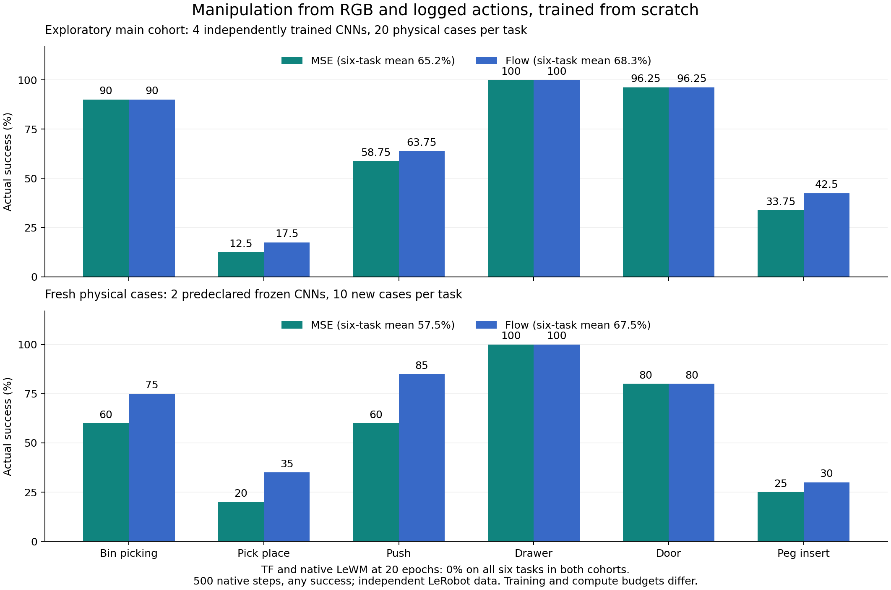

本轮已经得到真实操作成功率的大幅提升。有效方案是从零训练的目标条件事实动作模型，增加了动作重构目标；不能将其描述为“纯JEPA预测损失本身已解决操作任务”。候选只用RGB、日志中实际执行的动作及同轨迹后续RGB，所有损失在样本内计算，没有外部预训练模型、最优动作oracle、奖励、状态、success或task ID输入。

主队列每任务20个共同物理场景。CNN用4个独立训练种子，共80次/任务；原TF/Native各2个训练种子，共40次/任务。候选训练40k更新，原模型目前是20 epoch/16480更新；阶段采样、窗口、模型和计算量也不同。下面是相同物理评测的内部结果，尚非同预算或公开SOTA排名。

| 任务 | TF 20 epoch | Native 20 epoch | CNN MSE 40k，4种子 | CNN Flow 40k，4种子 |
|---|---:|---:|---:|---:|
| BinPicking | 0% | 0% | 90% | 90% |
| PickPlace | 0% | 0% | 12.5% | 17.5% |
| Push | 0% | 0% | 58.75% | 63.75% |
| DrawerOpen | 0% | 0% | 100% | 100% |
| DoorOpen | 0% | 0% | 96.25% | 96.25% |
| PegInsertSide | 0% | 0% | 33.75% | 42.5% |
| Reach | 87.5% | 67.5% | 20% | 21.25% |
| ReachWall | 90% | 57.5% | 23.75% | 16.25% |

六操作均值：MSE **65.21%（313/480）**、Flow **68.33%（328/480）**，原TF/Native均0%。以共同物理种子为block，跨任务和训练模型整体重采样，条件于这些模型的95%区间为[61.46,68.75]、[63.13,73.33]%。这不包含训练初始化总体的不确定性，也不能把20个物理场景重复4模型说成80个独立场景。

最初两模型的Flow均值71.67%，新增两模型65%；主结果使用全部四模型。MSE对应63.33%和67.08%。Flow相对MSE四模型只高3.13pp，不能把全部收益归因于生成式损失，更不能声称“多模态”已被唯一因果识别。

另在冻结权重、声明主方法Flow/次方法MSE之后，才构造2042–2051这10个新物理种子/任务；各用最初两个训练模型，共20次/任务。80个专家参考目标79个有效，失败案例保留。新场景没有用于后续候选调参。

| 新场景任务 | TF | Native | MSE 40k | Flow 40k |
|---|---:|---:|---:|---:|
| BinPicking | 0% | 0% | 60% | 75% |
| PickPlace | 0% | 0% | 20% | 35% |
| Push | 0% | 0% | 60% | 85% |
| DrawerOpen | 0% | 0% | 100% | 100% |
| DoorOpen | 0% | 0% | 80% | 80% |
| PegInsertSide | 0% | 0% | 25% | 30% |
| Reach | 75% | 55% | 40% | 35% |
| ReachWall | 85% | 75% | 50% | 35% |

新场景六操作均值为Flow **67.5%（81/120）**、MSE **57.5%（69/120）**；原TF和Native各0/120。这仍只是10个物理场景/任务、两个模型的验证。

为什么持续为0：冻结TF/Native parent1，在8任务×4场景上逐动作重放CEM与专家诊断轨迹，共64模型场景、32个物理场景，所有权重不变。排除专家本身失败的Peg seed43两个记录后，**46/46次有效比较中，实际潜空间目标距离都更偏好失败CEM的30步终点，而不是最终成功轨迹的前30步**。专家前缀本身未必已成功；这说明必要的前置动作可能被短期终点距离排斥。

同场景渲染“手臂到目标、物体仍在初始位置”的因子干预，TF目标距离只剩初始值0.006%–1.24%；BinPicking仅0.088%–0.213%。这些组合未必物理可达，仅测视觉敏感性。Native在Drawer中仍能敏感编码物体但也失败，因此目标/规划问题不能全归于encoder。很低的自身潜空间预测误差也不证明物体预测正确。

由此得到的抽象是：**观测相似性、动力学预测、控制进展是不同对象。** 终点距离可以奖励“手到了目标附近”，却没有可靠奖励接触、闭合、抬起、搬运这些路径条件。有效方案从同一联合数据中学习“当前与未来观测之间实际发生了什么动作”，绕过只用短期潜空间距离选路的限制；这没有提供未知的下一个最优动作。

成熟方案为随机初始化的局部CNN和共享Transformer动作头，当前/目标RGB输入，输出6个20维macro动作，每次执行前3个后重算；一个macro含5个4维原生动作。MSE重构事实动作，Flow学习动作至高斯噪声的rectified-flow速度，推理12步。当前成熟40k模型还包含样本内时间偏移辅助回归，训练用日志时间偏移、线上用估计偏移。去掉未知时间条件及只保留单一动作损失的新控制仍在测，不能混同为已验证方案。

所有模型混合50个任务，来自同一LeRobot corpus及45/5轨迹划分。CNN取phase0完整轨迹，旧TF/Native取全部5个phase/window8；两者采样不同。目标随机取同记录后续帧或无success标签的末帧。数据本身为脚本专家轨迹，尚不能推断随机失败探索数据也有同等效果。本方法属于目标条件逆动力学/行为重构方向，[GC-IDM已有相关机制](https://arxiv.org/html/2605.08732v1)，不主张重新包装为原创。

局部CNN评测已经移除未使用的TF分支：四个10k模型共256个共同场景的首动作块逐元素相等，权重不变；40k评测也不加载TF。主队列、四种子复现和新场景对照共**2560条真实动作轨迹SHA256**通过核对，物理case hash在方法间一致。完整模型/AdamW/scheduler恢复、留出集FP32反传、样本独立性及20步真实环境入口通过。

负证据保留：共同8场景/任务、两训练种子、10k步的较小队列，原local Flow六操作61.46%，提高噪声odds至4后56.25%，没有采用；全局64维动作逆模型33.33%，冻结全patch特征MSE/Flow33.33/30.21%，时间可达性代价0%。自有TF初始化的全token ViT+history，冻结/微调、MSE/Flow四组为35.42/41.67/27.08/26.04%，没有给弱分支盲目长训。已知的[中间目标规划机制](https://arxiv.org/html/2609.30036v1)在本地只局部改善Door/Drawer，没有解开抓取。

无模型执行视频重放：BinPicking seed42，TF500步失败、无抬升；Flow177步成功、抬升0.132m。PickPlace seed43，TF500步失败、无抬升；Flow59步成功、抬升0.209m。逐步success与原保存动作完全一致。这是选取的正例，不能替代完整分母。视频在工作区artifacts/metaworld_contact_20261106/visual-v1/replay，证明文件在results/visual-v1。

尚未解决：Reach/Wall退步，PickPlace对初始化敏感，Peg不稳定；没有统一全任务赢家、纯forecast-only提升或公开SOTA/创新性证据。

两台机器的有限后续：冻结候选/原模型的50任务覆盖，独立训练种子3/4覆盖复现，NoH的10k完整状态分叉，单动作损失CNN历史上下文，以及原TF/Native累计40k更新预算控制。最后一项匹配batch128/总更新数，保留原41200 LR horizon，仍不匹配图像FLOPs、窗口和采样。只用dev13/dev15，原24小时截止2026-11-06 19:30:22 UTC；不恢复旧campaign/goal/LLM监控，不自动开启下一轮。

原始证据：[analysis.json](results/evidence-v2/analysis.json)、[2560轨迹核对](results/evidence-v2/trace-checks.json)、[302文件SHA索引](results/evidence-v2/INDEX.json)。最新50任务数值与机器状态另存results/latest，不应把冻结快照当成当前进度。

50-task coverage extension: both CNN objectives now have4 independent training seeds x8 common physical cases/task =1600 episodes/method. Flow all50 mean65.25%,MSE65.1875%;excluding Reach/ReachWall,the remaining48 tasks give67.38/67.25%. These are50 training-task types with new physical configurations,not unseen-task generalization or standardMT50. FrozenTF/Native all50 comparison remains pending. All3200 additional candidate actiontraceSHA checks pass;see results/latest/handoff-v4/{local-flow,local-mse}-coverage.json.

Latest22:32UTC one-time health:all16 GPUs assigned to live useful work with actualCUDAcontexts;TF/native40k continuations all pass full-state entry,16482 restore/backward and20-native-step interface,and have advanced.TF16900/16600;Native18400/17600.NoH40k trainings completed;their50task frozen coverage reuses freedG0/4.History-only-action models finish10k at46.875/48.958% six-manip on the small8case cohort,below originallocalFlow/MSE at10k;full40k matched-budget controls remain pending.No additional pretraining or new simulation trainingdata.

Final finite queue extension,source505f6a8:after NoHcoverage,G0/4 run independently randomized originalTF/native seeds3/4 to40k (configtemplates only,no parentNN/optimizer loaded);together with two original continuations,this aims to provide4 initializationseeds/method.After old50task baselines,G3/5 run minimalCNNs(current+goal only,oneactionloss,no timeaux/no history),2seeds xMSE/Flow.These arequeued or attechnicalentry,not new performancewins.Nativecold has2actualupdates;fullentry gates and finalscores must be read before claimingresults.Original24hdeadline unchanged;finiteJSONcollector now56logicaltargets.
