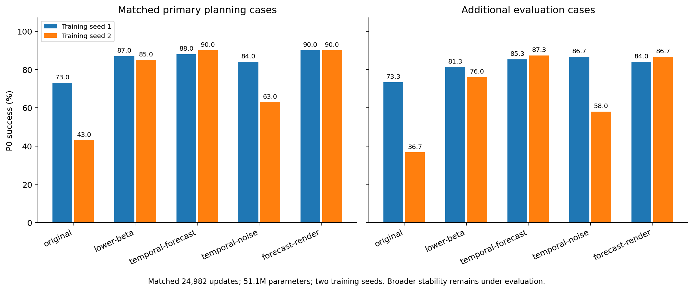

# Budget followup: components

| Method | Training seed | PrimaryP0% | FreshP0% |
| --- | ---: | ---: | ---: |
| original | 1 | 73.00 | 73.33 |
| original | 2 | 43.00 | 36.67 |
| lower-beta | 1 | 87.00 | 81.33 |
| lower-beta | 2 | 85.00 | 76.00 |
| temporal-forecast | 1 | 88.00 | 85.33 |
| temporal-forecast | 2 | 90.00 | 87.33 |
| temporal-noise | 1 | 84.00 | 86.67 |
| temporal-noise | 2 | 63.00 | 58.00 |
| forecast-render | 1 | 90.00 | 84.00 |
| forecast-render | 2 | 90.00 | 86.67 |

Completeper-case/endpoints/costs/pairedintervals:followup-results.json andfollowup-per-case.npz. Sameparameter/updatebudget;twoinitialseeds,notbroadstabilityornoveltyproof.

[中文结论与继续依据](DECISION.md)。第三epoch与组件第二epoch的训练预算不同，请分别阅读。
