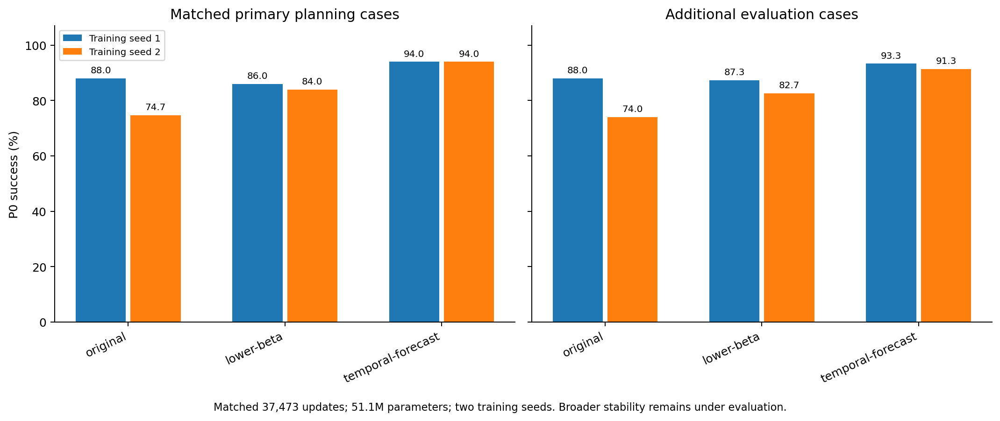

# Budget followup: epoch3

| Method | Training seed | PrimaryP0% | FreshP0% |
| --- | ---: | ---: | ---: |
| original | 1 | 88.00 | 88.00 |
| original | 2 | 74.67 | 74.00 |
| lower-beta | 1 | 86.00 | 87.33 |
| lower-beta | 2 | 84.00 | 82.67 |
| temporal-forecast | 1 | 94.00 | 93.33 |
| temporal-forecast | 2 | 94.00 | 91.33 |

Completeper-case/endpoints/costs/pairedintervals:followup-results.json andfollowup-per-case.npz. Sameparameter/updatebudget;twoinitialseeds,notbroadstabilityornoveltyproof.

[中文结论与继续依据](DECISION.md)。第三epoch与组件第二epoch的训练预算不同，请分别阅读。
