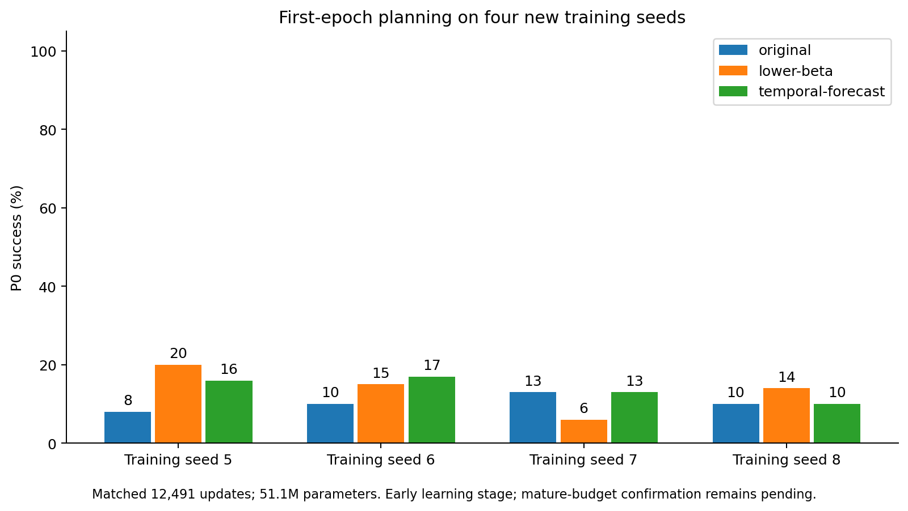

# Four new training seeds: first-epoch stage

| Method | Seed | P0% | h7agent/copy | h7movingblock/copy | ActionCF% |
| --- | ---: | ---: | ---: | ---: | ---: |
| original | 5 | 8.0 | 0.880 | 0.571 | 37.50 |
| original | 6 | 10.0 | 0.847 | 0.572 | 42.19 |
| original | 7 | 13.0 | 0.816 | 0.442 | 42.19 |
| original | 8 | 10.0 | 0.811 | 0.584 | 42.19 |
| lower-beta | 5 | 20.0 | 0.685 | 0.340 | 50.00 |
| lower-beta | 6 | 15.0 | 0.869 | 0.458 | 43.75 |
| lower-beta | 7 | 6.0 | 0.861 | 0.446 | 40.62 |
| lower-beta | 8 | 14.0 | 0.827 | 0.414 | 43.75 |
| temporal-forecast | 5 | 16.0 | 0.726 | 0.508 | 45.31 |
| temporal-forecast | 6 | 17.0 | 0.583 | 0.444 | 53.12 |
| temporal-forecast | 7 | 13.0 | 0.786 | 0.480 | 39.06 |
| temporal-forecast | 8 | 10.0 | 0.714 | 0.519 | 46.88 |

All96endpointsrecorded;first-epochimmaturitydoesnotestablishmaturestabilityorsuperiority.Fullper-case/outcomeevidenceisretained.
