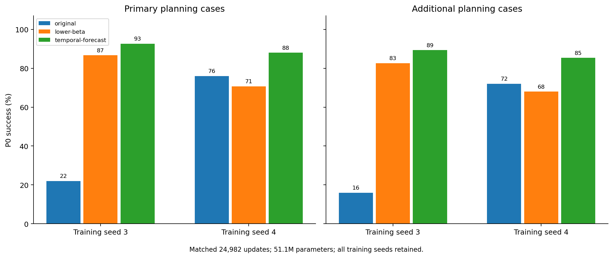

# Two-epoch replication

| Method | Training seed | PrimaryP0% | AdditionalP0% | h7agent/copy | h7movingblock/copy |
| --- | ---: | ---: | ---: | ---: | ---: |
| original | 3 | 22.00 | 16.00 | 0.530 | 0.425 |
| original | 4 | 76.00 | 72.00 | 0.176 | 0.219 |
| lower-beta | 3 | 86.67 | 82.67 | 0.120 | 0.205 |
| lower-beta | 4 | 70.67 | 68.00 | 0.206 | 0.241 |
| temporal-forecast | 3 | 92.67 | 89.33 | 0.106 | 0.223 |
| temporal-forecast | 4 | 88.00 | 85.33 | 0.119 | 0.232 |

Allnumericalendpointsandconditionalpairedintervals:replication-results.jsonandreplication-per-case.npz. Nooutlierremoval;notafinalthird-epochclaim.
