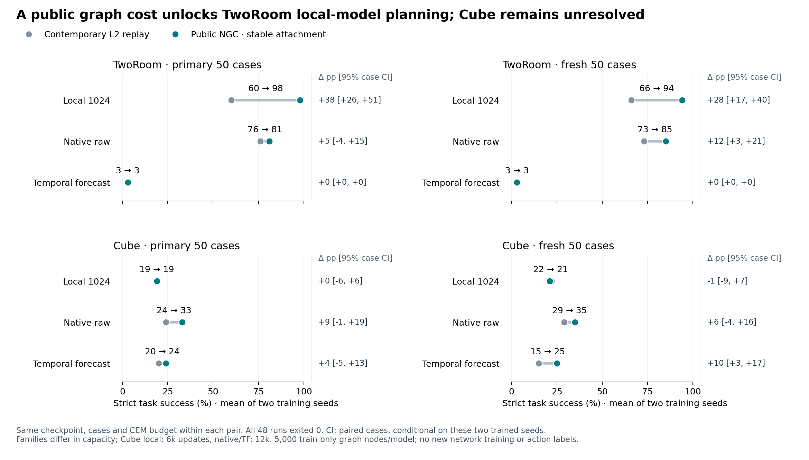

# Public NGC, uniform stable attachment: complete 48-endpoint comparison

All 48 endpoints exited 0. The major result is a large TwoRoom gain for frozen local1024 under the public graph cost, replicated across both seeds and both case sets. Cube local1024 shows no consistent improvement. This is a controller result with fixed learned weights, not a new sample-level learning algorithm.

The figure is generated from all 48 case vectors; mean points are checked against their two constituent training seeds. [Vector PDF](figure/ngc-comparison.pdf) and [input provenance](figure/provenance.json) are retained.

| Task | Model | Seed | Primary L2 → NGC (%) | Fresh L2 → NGC (%) |
|---|---|---:|---:|---:|
| tworoom | local1024 | 1 | 60 → 98 | 72 → 96 |
| tworoom | local1024 | 2 | 60 → 98 | 60 → 92 |
| tworoom | native-raw | 1 | 80 → 84 | 76 → 90 |
| tworoom | native-raw | 2 | 72 → 78 | 70 → 80 |
| tworoom | TF64 | 1 | 2 → 2 | 4 → 4 |
| tworoom | TF64 | 2 | 4 → 4 | 2 → 2 |
| cube | local1024 | 1 | 16 → 14 | 24 → 16 |
| cube | local1024 | 2 | 22 → 24 | 20 → 26 |
| cube | native-raw | 1 | 22 → 32 | 32 → 32 |
| cube | native-raw | 2 | 26 → 34 | 26 → 38 |
| cube | TF64 | 1 | 20 → 24 | 14 → 18 |
| cube | TF64 | 2 | 20 → 24 | 16 → 32 |

| Task | Model | Cases | Mean L2 → NGC (%) | Paired change, 95% case CI (pp) |
|---|---|---|---:|---:|
| tworoom | local1024 | primary | 60 → 98 | +38 [+26, +51] |
| tworoom | local1024 | fresh | 66 → 94 | +28 [+17, +40] |
| tworoom | native-raw | primary | 76 → 81 | +5 [-4, +15] |
| tworoom | native-raw | fresh | 73 → 85 | +12 [+3, +21] |
| tworoom | TF64 | primary | 3 → 3 | +0 [+0, +0] |
| tworoom | TF64 | fresh | 3 → 3 | +0 [+0, +0] |
| cube | local1024 | primary | 19 → 19 | +0 [-6, +6] |
| cube | local1024 | fresh | 22 → 21 | -1 [-9, +7] |
| cube | native-raw | primary | 24 → 33 | +9 [-1, +19] |
| cube | native-raw | fresh | 29 → 35 | +6 [-4, +16] |
| cube | TF64 | primary | 20 → 24 | +4 [-5, +13] |
| cube | TF64 | fresh | 15 → 25 | +10 [+3, +17] |

## What the intervention establishes

TwoRoom local1024 contained knowledge that this public cost could use much more effectively: primary 60/60 → 98/98 and fresh 72/60 → 96/92. At the first iteration, L2 versus NGC rank correlation is only 0.054–0.116 even though their best candidate agrees on 72–82% of cases. The changed distribution of candidate costs can alter subsequent CEM elite updates; initial argmin agreement alone is not a sufficient account of the final gain. These rank statistics compare two costs, not predictions against physical truth, and do not prove a particular geometric mediation mechanism.

TwoRoom TF stays at 2/4 primary and 4/2 fresh, with first-bank rank correlation about 0.99995 and 98–100% argmin agreement. Fixing the numerical radius failure made the public baseline executable but did not repair control performance. No conclusion of missing task information follows from this negative result.

Cube local changes sign across seeds and remains flat on average. Native and TF benefit more, but native intervals span zero, and the TF fresh gain is larger for seed 2. High global rank agreement is compatible with meaningful selection effects: Cube TF first-bank correlation remains 0.978–0.982 while fresh success rises 14/16 → 18/32. This does not establish a unified cross-task candidate or eliminate the earlier goal-metric, action-support and search-coverage explanations.

## Comparability and actual replay evidence

All 1,200 first-iteration banks (24 paired comparisons × 50 cases) have exactly matching actions, goal embeddings and predicted terminal embeddings across the L2/NGC arms; both recorded cost arrays also match bit for bit. Native CEM uses batch_size=1 and 30 iterations per case, so the first bank for each of the 50 initial cases is at calls 0,30,…,1470. The analysis collector initially assumed a 50-row call and stopped; that analysis-only indexing was corrected from the pinned CEM loop. No evaluation/source/controller rerun followed. Later CEM populations are allowed to diverge and are not treated as common banks.

All 48 full model-state hashes are unchanged, original model-source imports and train-card scalers pass, and 1,916 immutable inputs were checked. Every case manifest, checkpoint audit, plan, solver, normalization and strict protocol matches its designated historical reference. Current L2 is always the comparator. Historical success vectors reproduce exactly for 21/24 L2 runs; the exceptions are:

- Cube native seed 1 primary: historical 26 → current 22%; cases 7 and 35 lose success.
- Cube native seed 1 fresh: 28 → 32%; cases 38 and 49 gain success.
- Cube TF seed 1 primary: 18 → 20%; case 21 gains success.

Indices are zero-based. These repeats are preserved, without choosing the better historical/current number. Case-paired bootstrap uses 10,000 resamples and fixed seed 20261031. Two-seed intervals resample the same 50 case indices after averaging seed differences; they are conditional on these two trained models and exclude environment-repeat variance and population training-seed uncertainty. Primary/fresh remain separate.

TwoRoom models all have 6,000 updates. Cube local has 6,000, whereas native/TF have 12,000. Parameter totals are approximately local 55.9M, native 18.0M and TF 51.1M; state widths are 1,024/192/64. These are controlled within-checkpoint controller comparisons, not equal-capacity or equal-exposure learning claims. Graph memory uses 5,000 frozen training-only RGB embeddings per model; no action/physical/optimal-action labels or network fitting were added. Native batch-coupled training objectives remain unchanged.

Both arms retain the original command CEM budget (300 samples × 30 iterations, top30, horizon5, history3, action_block5, receding5, 50 primitive steps). Both compute both costs for recording, so execution times are instrumented, not bare-L2 latency. Eight Cube local logs contain exit-zero EGL destructor warnings; complete outputs and all integrity checks pass. No numerical fallback, floor, metric tuning or action clipping was added.

## Separate historical controller context

The earlier fixed-correlation CEM control reported Cube mean primary/fresh: local 22/29%, native 36/35%, TF 33/31%. The present NGC means are 19/21, 33/35 and 24/25%. These are separate runs/controllers, not this round's paired comparison; no best-of combination is formed. The older TwoRoom candidate was F64free, whereas this NGC round uses local1024, so those candidate scores are not interchangeable. See [the complete earlier correlation report](../../../action_covariance_20261031/results/evaluation/RESULTS.md).

## Artifacts and stop state

All 48 ran from frozen helper `05ebb20bc564fdaa7a79533f5c2d62c1b5983412` and the separately pinned original model sources. The original public graph failure and the first stable-run JSON serialization failure remain preserved; the successful twelve-graph gate is detailed in [the numerical gate report](../stable-gate/REPORT.md). Public vendor code is unchanged; stable attachment is an explicitly reported uniform numerical adaptation.

Authoritative run: `/efs/prescottsun/SPT-JEPA/runs/public_ngc_stable_evaluation_v2_20261031`. Full CPU aggregate and bank metadata: `/efs/prescottsun/SPT-JEPA/reports/public-ngc-stable-20261031/results.json`; the compact local results retain all case vectors, seed effects and evidence hashes. Large score arrays stay on EFS. All 16 owned GPUs were verified idle, exact workers/monitors closed, and HOLD saved. No additional experiment follows from this report.
